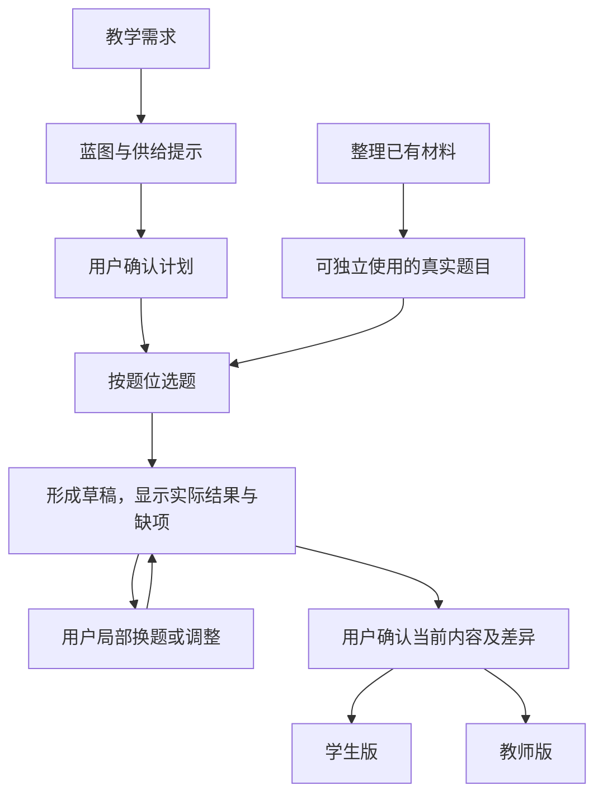

# ADR-0002：题库与蓝图

- 状态：草案；2026-10-10 按第一性原则精简，待 S2-04 评审采纳。
- 前置决策：[ADR-0001：教师组卷 workflow](0001-assembly-workflow.md)。
- 依据：[S2-01 验证任务](../validation/mvp-assembly-task.md)、[S2-02 供给核查](../validation/question-bank-supply.md)。

## 要解决什么问题

**怎样从已有材料中，选出符合教学目的的真实题目，组成用户愿意修改、打印和使用的试卷？**

从这个目标出发，只需要分清三件事：题库提供可用题目，蓝图说明要找什么题，试卷保存实际选了什么。蓝图的计划与题库数量都不能代替实际成卷。

本次先验证集合专项：45 分钟、100 分，以 6 单选、2 填空、2 解答作为初始结构。材料是 S2-01 归档、S2-02 清点的同一批 50 题，其中 10 题构成标杆卷。

## 决策一：把材料整理成能独立使用的题目

一题至少需要以下信息，具体字段和存储方式在实现时确定。

| 信息 | 为什么需要 |
| --- | --- |
| 完整题面 | 学生能独立作答；包括题干、选项、小问及必要图片。带小问的题整体选取、替换，计为一题 |
| 题型 | 能按试卷结构选题 |
| 考查任务 | 知道这题具体考什么，不能只有“集合”这样的宽标签 |
| 解题所需知识及依据 | 判断是否能用本次已学知识完成；依据不足就标为未知 |
| 答案与解析 | 支撑教师版；与学生题面分开，缺失或冲突如实说明 |
| 来源与内容身份 | 能找到原材料、区分同题与重复出现，并重现用户选中的内容 |

本次“原卷版”有 11 题混入答案或解答，因此学生卷必须由整理后的题面生成。原卷内容、整理增补和本次建议评分分别注明来源；本卷分值由组卷决定，不作为题目的固定属性。

先整理支撑标杆及换题验证所需的题目，不以补齐全部标签或重建整个题库为前提。

## 决策二：蓝图只负责把需求变成选题目标

蓝图回答两个问题：**整卷要满足什么？每个题位要考什么？**

- 整卷：主考范围、已学边界、题量、总分、时长和来源范围；区分用户要求、可调整偏好与默认值。
- 题位：题型、计划分值和具体考查任务；难度有依据才给预估，不当成实测结果。

例如第 7 题位要考“元素属于条件下求参，并用互异性舍解”。另一道只考互异性的填空题虽然相关，也不能直接算作完整替代。

主考范围说明主要考什么，已学边界说明解题允许用什么。判断依据是实际解法；有完整的允许解法才计为符合，证据不足保持未知。用户可以选择保留未知或有差异的题，系统保留提示，不将其记为已证实符合。

用户确认初始蓝图后开始选题。后续局部调整按实际结果记录差异；用户更正教学条件时重检受影响题，保留已有内容与锁定，由用户决定取舍。

## 决策三：围绕实际草稿选题和换题

选题要检查来源、题型、考查任务、已学边界和同卷重复。符合当前条件的题可以自动选入；部分相关或未知的题带差异展示，由用户决定。没有合适备选就保留现题并说明不足，不静默放宽条件、扩大来源或编题补位；请求失败也不能说成题库无题。

换题只改用户指定的部分，保留无关题和锁定；多项独立修改分别保留成功结果。自然语言建议先展示作用范围供应用，直接界面操作表达对应授权，不增加逐题审批。

草稿统计实际题数、分值和覆盖，保留与原计划的差异。最终确认保存用户看到的内容和缺项摘要，两版使用同一份题目内容、顺序和分值；学生版不含答案和教师记录，教师版如实展示答案、解析及评分来源。

未知或缺项不取消用户确认权。缺题面的位置不计为可用题，输出明确标为未完整；缺答案或解析则在教师版说明，不编造为原卷内容。

## 怎样证明这套设计有用

用同一批材料验证三件事：

| 验证 | 成立的标准 |
| --- | --- |
| 组成首份标杆卷 | 10 道完整题能按教学目标组织，题型与分值符合当前计划 |
| 局部换题 | 有合适题时只替换指定题；无合适题时说明原因，现题及其他成功修改保留 |
| 交付两版 | 输出与用户确认的内容一致，学生版无答案泄露，教师资料来源及缺项清楚 |

[真实样例推演](../validation/blueprint-contract-walkthrough.md)提供对照。目前第 5–10 题位没有保持完整目标的直接备选；全源仅两道解答题且均已用于标杆。这是供给限制，流程设计不能解决题目不存在的问题。

本次已完成设计推演，尚未证明实际入库、自动选题、打印或教师使用成功。S2-04 评审后，按“整理可用题目、实现选题与局部修改、保存输出并真实验证”拆开发任务。数据库表、接口字段、版本存储、重试和并发细节进入开发设计，出现实际问题再细化。

## 为什么采用这个方案

直接使用 PDF/OCR 整块内容，无法可靠区分学生题面与答案；只按知识标签选题，无法保证具体考查目标；每次重做整卷，会丢失满意题。采用“题目、蓝图、实际草稿”三者分工，代价是需要整理必要内容与适配依据；能否减少用户准备和返工，仍由真实使用验证。
