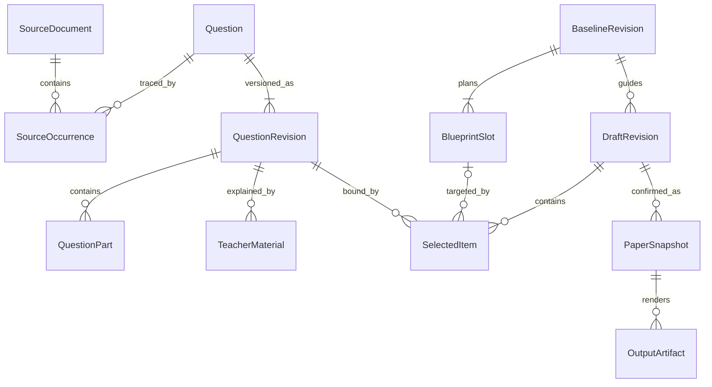
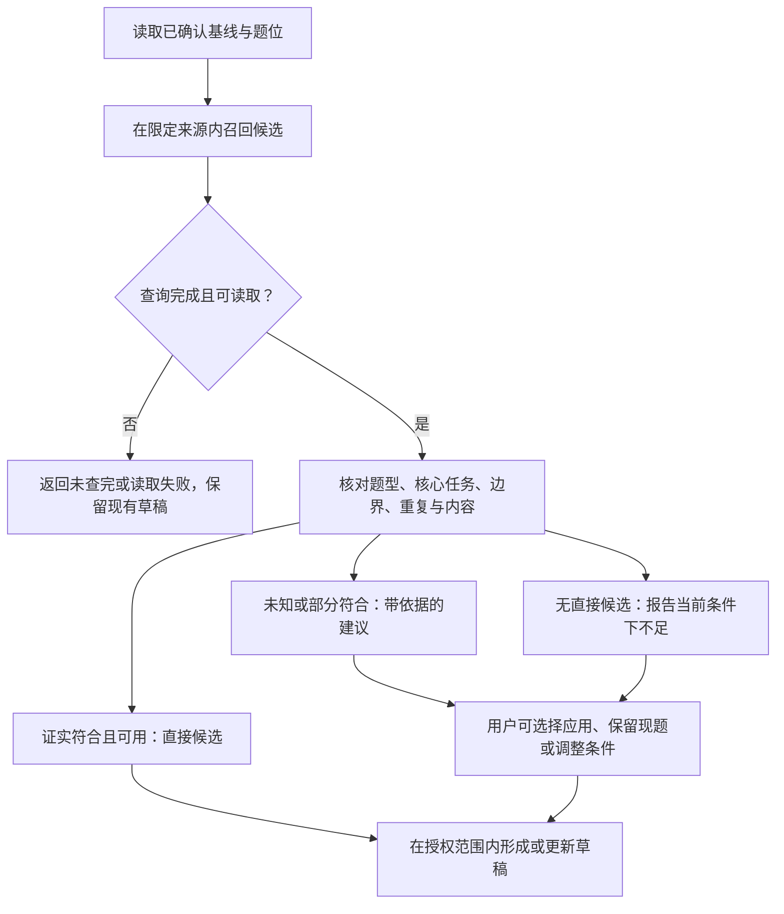
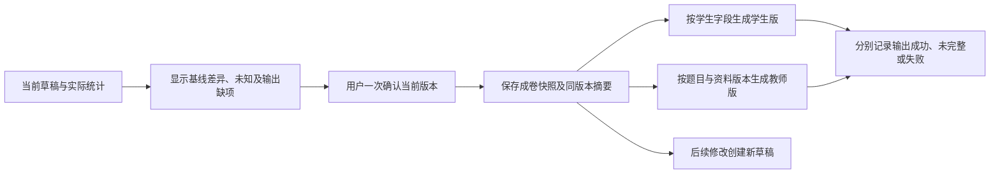

# ADR-0002：题库与蓝图详细设计

- 状态：草案（2026-10-10）；待 S2-04 评审采纳。
- 适用项目：Tutor v1，从零设计。
- 前置决策：[ADR-0001：教师组卷 workflow](0001-assembly-workflow.md)。
- 任务与证据：[S2-01 验证任务](../validation/mvp-assembly-task.md)、[S2-02 供给核查](../validation/question-bank-supply.md)、[50 题来源清单](../validation/sources/set-source-catalog.md)。
- 验证附件：[真实样例推演](../validation/blueprint-contract-walkthrough.md)。本 ADR 定义合同；样例推演不代表已入库、接口已实现、成卷已打印或教师已试用。

## 1. 要解决的问题与证据

ADR-0001 已确定从教学需求形成蓝图，再组织真实题目、局部调整并交付两版试卷。本 ADR 要回答：**题库需要提供什么、蓝图怎样约束实际选题，以及每次修改和最终输出怎样保留用户确认的内容？**

本轮只设计支撑一个真实任务的最小合同：集合专项、45 分钟、100 分，以 6 单选、2 填空、2 解答作为初始结构。S2-01 归档原始材料并确定 10 题标杆卷；S2-02 对同一材料清点出 50 个父题单元，不是新增 50 题。两个 PDF 是同一批题的不同载体。

真实材料已经暴露必须处理的问题：

| 已知事实 | 设计必须回答的问题 |
| --- | --- |
| 50 题有来源与位置，但尚未成为可调用题库 | 来源位置、题目身份与内容版本如何分别表达？ |
| 标注为原卷版的 PDF 有 11 题混入答案或解答 | 如何从结构化内容生成纯学生题面？ |
| 两道解答题各有两个小问，评分是本次建议 | 父题、小问、分值和教师资料怎样绑定？ |
| 第 1–4 题位有核心目标相符的备选，第 5–10 题位无直接备选 | 如何区分找不到、没有查完、请求失败和不符合？ |
| 有原解析笔误、对象语义冲突，以及边界未知题 | 如何保留证据与修订，不把未知或源文件错误包装成通过？ |
| 难度与用时只有预估 | 如何组织草稿而不声称已验证教学效果？ |

首版不建设通用题库管理平台，不重做全学科知识图谱，不自动编题补供给，不实现学生作答与实测校准。来源扩展与生产数据处理不由本 ADR 自动触发。

## 2. 决策：分开来源、题目、计划和实际内容

以下是逻辑合同，不预先指定数据库、服务拆分或 HTTP 路由。

一份 PDF 中的出现位置不等于题目身份；蓝图中的题位不等于实际选中的题目；保存确认不等于输出成功。相同题可在不同来源出现，不按文件名或局部题号自动认定同一实体。

图中的 `BlueprintSlot` 是某基线中的题位计划实例，以 `(baselineRevisionId, slotId)` 标识；`SelectedItem` 是某草稿中的选中项状态实例，以 `(draftRevisionId, itemId)` 标识。`slotId`、`itemId` 跨版本保持对象身份，各版本实例分别保存状态。选中项只关联所引用基线中的对应题位实例；草稿增题不能反向写入不可变基线。

### 2.1 最小题库读取信息

| 对象 | 最小字段与规则 |
| --- | --- |
| 来源文档 `SourceDocument` | 稳定 ID、文件 SHA-256、可访问引用、页数、载体角色；名称与汇编标注的学校仅是来源说明，不证明原始考试出处 |
| 来源出现 `SourceOccurrence` | 稳定 ID、文档 ID、1 起算物理页码、页内定位或冻结阅读序号、局部题号、对应题目及配对依据；跨页保留页码列表 |
| 题目 `Question` | 稳定 ID、学科、重复关系；版本更新不更换题目身份。`SET-SRC-*` 是本次审计引用，入库后显式映射，不能冒充既有生产 ID |
| 题面版本 `QuestionRevision` | 题目 ID、不可变版本 ID、内容 hash、题型、公共题干、顺序稳定的选项/填空/小问、素材清单、来源出现引用、规范化或修订说明 |
| 素材 | 稳定素材 ID、内容 hash、用途、可用状态；正文引用素材 ID。读取时短期访问地址可以变化，不能作为内容身份 |
| 小问 `QuestionPart` | 父题内稳定 ID、显示顺序、小问题干、回答形式、所需公共素材。单选/填空可用一个作答单元；多小问父题整体选取、替换和计题数 |
| 教师资料 `TeacherMaterial` | 不可变资料版本 ID、适用题面版本与小问 ID、答案/解析/评分条目、来源类别与引用、缺失或冲突说明；缺少的部分保持缺失 |
| 匹配证据 | 适用题面/解法版本、主要考点、具体考查任务、解法所需知识、证据出处与判断来源；难度标明预估或实测及来源，缺失不填默认数值 |

题面、素材和教师资料均读取指定版本，不能自动跟随“最新”。数学排版规范化保留说明；改变对象、条件、选项或结论属于内容修订，要建新版本并重检有关证据。旧证据不能无条件复用到新题面。

两个 PDF 的配对需要题干、顺序与来源位置依据，不能仅因题号相同就合并。题干去空白 hash 只提供精确提取串比较线索，不是数学等价或完整题组去重证明。已确认同题关系用于默认同卷排重；疑似近重复作为提示，不能强行合并，也不能声称全部无重复。用户主动保留重复题时记录其决定与重复情况。

### 2.2 学生题面与教师资料分离

学生题面只能由公共题干、选项、填空位置、小问题干和学生所需素材组成。教师资料通过独立字段读取，不能把混合 OCR 正文删掉几个“答案”关键词后作为学生题面。字段拆分仍须核对公式、图像及隐藏答案，白名单不能替代内容核查。

教师资料来源按条目保存，不能只给整道题贴一个来源标签：

| 来源类别 | 含义与展示 |
| --- | --- |
| `source` | 原卷直接提供，绑定文档、位置及题面版本；有来源不等于原结论必然正确 |
| `source_adapted` | 原卷整理或增补，保留原引用和整理说明；展示“原卷整理增补” |
| `proposed` | 本次新增的评分等建议，标明提出者与采用记录；展示“本次建议评分规则” |
| `generated` | 模型生成的答案或解析，注明生成来源及核验情况；不能标成原卷标准答案 |

资料冲突时保留不同结论与依据，未解决不宣称“已核验标准答案”。本次标杆第 7 题的扣分说明及第 9、10 题分步评分属于 `proposed`，不能附会成原卷评分。当前 MVP 不通过本 ADR 自动生成缺失资料。

## 3. 蓝图合同：确认基线、题位任务与实际差异

需求由 LLM 整理成候选蓝图，程序对限定来源做供给探查，展示结构、课程前提与已知不足；未完成结构化的来源只报告审计结果或待核查，不能显示成接口可用题数。用户一次确认蓝图及需求摘要后形成基线，再进入实际检索与草稿组装，无需另行确认“开始搜索”。

### 3.1 整卷基线 `BaselineRevision`

基线不可变，保存用户确认的需求、系统展开的计划及对应版本，包括：

- 学科、年级、教材与教学用途；主考范围和已学边界分别保存。
- 每项条件的值、来源及属性：要求、偏好、默认值；保存确认时采用的默认值，不要求逐项审批。
- 来源范围：本次为已归档的两份集合 PDF；候选不能静默扩展至其他材料。
- 题量、总分、时长；初始题型分配与目标预估难度；不存在的分类配比不补写。
- 课程依据版本：教材章节映射、初中前置集合与高中依赖展开，以及本次显式补充和排除项。
- 稳定题位列表、确认时间与确认摘要。

初中前置按可见的基础集合注入，高中知识按本次确认章节及已定义依赖展开。本次额外采用韦达、判别式、初步二次函数图象等已确认前提；不能从章节名称猜测全套函数知识已学。依赖映射有缺口时保存未知，不能以递归展开成功冒充教学证据。目录摘录只证明节号映射，不证明完整知识图谱已核验。

### 3.2 题位 `BlueprintSlot`

每个题位有稳定 `slotId`，保存题型、计划分值、核心考查任务、必要解法边界、偏好及证据引用。显示题号是派生结果，插删或排序不改变题位身份。题型配额是本次可调整偏好，但按当前题位执行换题时，程序不能擅自改成另一题型。

“直接备选”表示同题型、符合当前边界并保留该题位明确的核心任务，不表示所有干扰项、难度和用时相同。需要保留的细项必须写进题位目标，不能靠“集合”“中档题”两个标签表达。只部分相关的题作为带差异建议展示，不计入直接供给。

| 题位 | 初始题型/分值 | 具体核心任务 | 标杆审计引用 |
| --- | --- | --- | --- |
| S01 | 单选 / 8 | 根据确定性判断能否成集 | SET-SRC-001 |
| S02 | 单选 / 8 | 常用数集符号与元素属于关系 | SET-SRC-008 |
| S03 | 单选 / 8 | 正整数约束下描述法转列举法 | SET-SRC-022 |
| S04 | 单选 / 8 | 子集、真子集包含关系辨析 | SET-SRC-035 |
| S05 | 单选 / 8 | 绝对值不等式与有限集取交的组合 | SET-SRC-045 |
| S06 | 单选 / 8 | 补并运算覆盖实数全集，讨论参数与端点 | SET-SRC-047 |
| S07 | 填空 / 10 | 元素属于条件、二次方程求参、互异性舍解 | SET-SRC-018 |
| S08 | 填空 / 10 | 补集逆推二次方程两根，韦达求系数 | SET-SRC-049 |
| S09 | 解答 / 14（6+8） | 区间交补计算与空集条件参数讨论 | SET-SRC-050 |
| S10 | 解答 / 18（8+10） | 含参方程退化、包含关系与非空真子集计数 | SET-SRC-041 |

标杆引用用于复现和核验，不是未来检索必须命中某个题目 ID 的筛选条件。S04 的 SET-SRC-034 保留核心包含关系，但增加空集情形、减少原题交集/相等辨析；必须回显差异。若用户要求完整保留这些细项，它就不能继续计为直接备选。

### 3.3 实际选题 `SelectedItem` 与草稿

选中项有独立 `itemId`，绑定题目、题面版本、教师资料版本、来源出现及可选题位 ID，保存顺序、实际分值、小问分值、锁定状态和匹配结论。题目内容中不嵌入本卷的“第 9 题/14 分”；相同题可在不同试卷采用不同赋分。

新增题在草稿保存自己的考查目标，可不绑定基线题位；只有用户主动更正基线时才将新增计划纳入新基线版本。删除题保留历史。换题保持选中项与题位身份，但更新绑定的题目版本与证据。旧题的小问评分不能沿用到新题：只有明确适用的新资料才可绑定，否则记评分待补，不编造细则。

草稿保存不可变 `DraftRevision` 和基线引用。实际题数、分值、题型、已证实覆盖、未知数、缺题面数和教师资料缺项由实际选中项计算，不能复制计划数字。完整父题算一题；题面缺失的占位分别报告，不计入可用题数。难度仅在有适用预估的题目范围内汇总，注明覆盖分值；换题后若缺估计，不继续显示原卷 0.693 为当前卷难度。

## 4. 读取与匹配 workflow

### 4.1 最小读取能力

| 逻辑操作 | 输入 | 必须返回 |
| --- | --- | --- |
| 检索候选 | 基线及题位条件、来源范围、排除已选题与已确认重复身份、游标 | 候选 ID/题面版本、来源、匹配证据摘要、缺项与差异；查询引用、分页是否结束、结果范围及错误 |
| 读取题目包 | 指定题目/题面版本，指定资料版本或首次选择策略 | 纯题面、素材引用、父题/小问、教师资料与证据；缺失/失效分别返回，不偷偷读取更新版本 |
| 核对适配与输出能力 | 题目包、基线/题位版本、实际分值和输出类型 | 各维度结论、具体依据、未知/不符合原因、题面与资料/素材可用性 |

首次选择解析到确切版本后立即固定，后续读取不得重新解析为最新版。检索错误、未读完分页、筛选证据不足不能返回成“零供给”。只有限定来源及条件的检索已完成，才报告该条件下无直接候选；源清单结论注明是清单审计，不能声称接口已执行。

自动选入的候选需要证实当前来源、题型、核心任务与已学边界符合，并有可读取题面与必要素材；可选标签和教师资料缺失不作为普通选题的统一门槛。本次详细教师版若缺解析，仍可继续草稿与确认，但必须列为该交付物未满足项。

### 4.2 匹配依据与未知

每个结论绑定 `baselineRevision`、题面及所用解法版本；有基线题位时绑定 `slotId`，新增未绑定项则以 `itemId` 及该草稿版本的考查目标定位。逐项返回 `match / mismatch / unknown` 和依据，正文/依赖变更后相应结论重算。系统组织事实与提示，用户决定取舍，不形成逐题审批队列。

- 主考范围看主要考点；已学边界看完成题目所需知识，背景中出现某个词不自动判超纲。
- 至少有一条**能够完成全部必要小问、且已说明依赖的有效解法**落在允许范围内，才支持边界 `match`；另有高阶解法不自动否定该结论。
- 只有标签重叠、模型声称可解或知识列表不完整，记 `unknown`。有题目要求或核查依据证明必要依赖禁止知识时记 `mismatch`；仅现有解法越界、替代解法尚未核查时记 `unknown`，不据此断言题目必然超纲。两者均不自动选入合格候选；后续发现允许解法可更新依据。
- 来源审计的 `within` 是输入证据，不自动变成已入库版本的最终匹配结论；公式抽取或小问不完整时仍不能判完整适配。
- 难度预估、风险与用户偏好分别展示，不伪装成已学边界事实。

用户可直接选入未知、不同目标或有内容缺项的题，系统保留该决定及对应差异，不把它计为已证实符合。无需逐项接受提示；直接界面操作已授权该动作，自然语言建议则先呈现作用范围供应用。自动行为不能用用户可以接受为理由，静默选入不符合要求的题。

## 5. 局部修改与基线更正

局部操作记录 `operationId`、作用对象、所依据的基线及草稿版本、目标项的原绑定、变更意图和逐项结果。自然语言中的“换这两道”须绑定当时的 `itemId`，不能靠执行时显示题号重新猜测。

| 场景 | 合同 |
| --- | --- |
| 换一题 | 新题包、适配结果及所需素材读取完成后替换；失败或无候选保留原题。自动替换跳过锁定题，用户直接改锁定题仍可执行 |
| 多项独立调整 | 按项提交，分别记录已应用、无直接候选、读取失败、因锁定跳过或因目标已变化未应用；独立成功项保留，不因其他项失败整体回滚 |
| 相关联调整 | 增删题与相应排序、计数、分值汇总在该次修改内保持一致；相互依赖的一组不能伪装成多个独立成功项 |
| 用户局部增删/改分 | 保存实际结果和基线差异，不强迫恢复原题量或总分；分值须可计算、小问合计与该题实际分值一致，否则明确该项尚未应用及原因 |
| 用户更正整卷条件 | 建新基线版本，保留全部已选题与锁定；重检受影响项并展示结果，用户决定换题、删除或继续保留，不自动清空草稿 |
| 同一请求重试 | 同一操作 ID 返回已记录结果，未完成项可继续；不能重复新增题、重复扣分或悄悄再换一次成功题 |
| 执行期间目标变化 | 提交前核对目标绑定与相关基线；过时建议不覆盖新内容。无关项已成功的结果继续保留，需要更新的建议重新计算并展示 |

首版单用户、单编辑入口；仍可能出现慢请求晚返回。操作按范围顺序处理，不能仅凭旧草稿总版本失效就丢掉本批已成功项。基线变化会影响相关匹配条件，须按新基线重检；只因无关题位改变，不要求重做所有候选。

## 6. 确认、保存与两版输出

确认摘要保存：基线与草稿版本、实际题目和顺序、实际分值、计划差异、范围与边界结论、未知及风险、缺题面/素材、教师资料缺项，以及未满足项来自供给、执行失败或用户主动调整的原因。展示简明摘要，不要求用户再填写报告或逐项签字。

确认动作必须绑定用户看到的草稿版本与摘要。若相关内容已变化，不能确认另一个版本，要展示当前差异；没有变化则不再要求额外“开始保存”或“开始输出”确认。保存失败如实报告并保留草稿，不称已成卷。

`PaperSnapshot` 固定基线、选中项、题面/素材/教师资料版本、实际评分和确认摘要；保存可重放的内容快照或可永久读取的版本，不能只保存短期地址。两版输出从同一快照派生，记录成卷 ID、版别、渲染模板版本及输出结果，题号、题目顺序、分值与小问对应一致。

| 输出 | 必须满足的规则 |
| --- | --- |
| 学生版 | 使用学生字段白名单；不得携带答案、解析、评分细则或内部风险记录。缺题面/素材的对应位置显示具体缺失，不编造内容，输出标为未完整 |
| 教师版 | 同序题目与小问；答案、解析及评分逐条标明来源。缺失/冲突直接说明，不因用户确认就变成已核验资料 |
| 确认记录 | 保留用户当时看到的差异、风险与未知；内部信息不嵌入学生题面。输出缺失标记只说明缺少什么，不泄露教师结论 |
| 输出状态 | 保存成功、学生版成功、教师版成功分别记录；一种失败可重试，另一种成功不撤销，不能以文件生成成功宣称内容完整 |

用户接受缺题面、未知或分值偏离时仍可确认。占位不计入可用题数和已证实覆盖；摘要与对应输出明确未完整内容。本次详细教师版缺解析时，即使学生版完整，教师版也须标明未满足，不能泛称“两版完整交付”。内容完整与教学适配是不同结论，用户保留未知题不等于适配已通过。

## 7. 真实样例验证与后续实现边界

[推演附件](../validation/blueprint-contract-walkthrough.md)以 10 个真实题位检查首份草稿、成功换题、供给不足、独立成功、基线更正、小问评分、答案泄露、缺项与输出一致性。它证明合同能够表达已知场景；不证明抽取准确、检索已运行或打印已成功。

| 能确定的部分 | 仍需实施与实测的部分 |
| --- | --- |
| 50 题来源身份、10 题位及已知直接/部分备选关系 | 定向抽取、数学公式与学生题面核查、入库后版本绑定和可检索性 |
| 字段、版本和逐项操作结果可表达真实问题 | 实际持久化、失败重试与晚返回不覆盖的执行验证 |
| 来源、解析增补、建议评分可分别表达 | 两版真实渲染、打印检查、评分绑定和素材可达性 |
| 无备选时保留现题并说明原因 | 用户是否接受、需要重做多少、45 分钟和预估难度是否适用 |

S2-03 完成是草案与样例完成。S2-04 评审并决定采纳后，再拆分最小开发任务：先建立本次材料的可靠题目包与读取，再实现蓝图/草稿与局部修改，最后保存输出并做真实用户验证。优先支撑标杆及已知备选，不把全库重处理或补齐全部标签作为前提。

## 8. 替代方案、代价与待评审项

| 方案 | 取舍 |
| --- | --- |
| 直接使用 PDF/OCR 整段作为题目 | 处理少，但本材料已证实答案混入、跨页及重复局部题号；采用结构化题面与来源引用 |
| 仅凭题型、知识标签和难度选题 | 简单，但无法区分第 7 题互异性完整任务及超边界解法；采用题位任务与解法证据，接受部分未知 |
| 单一大状态表示题目可用 | 实现简单，但会把学生题面、教师资料与教学适配混为一谈；按维度和交付物报告，增加少量字段 |
| 每次整卷重算并读取最新内容 | 状态少，但会丢失满意题、改变已确认版本；固定题目包、局部修改及成卷快照，承担版本保存成本 |
| 换题失败时自动扩源或生成新题 | 容易填满数量，但违背当前基线；报告不足，扩源或改变任务由用户决定 |

S2-04 聚焦三项实际取舍：上述题目包是否足够支撑首份交付；题位核心任务与可见差异是否足够指导换题；缺项与未知的呈现是否既真实又不增加审批负担。发现具体矛盾时修订合同，不为假设场景提前扩展平台。
