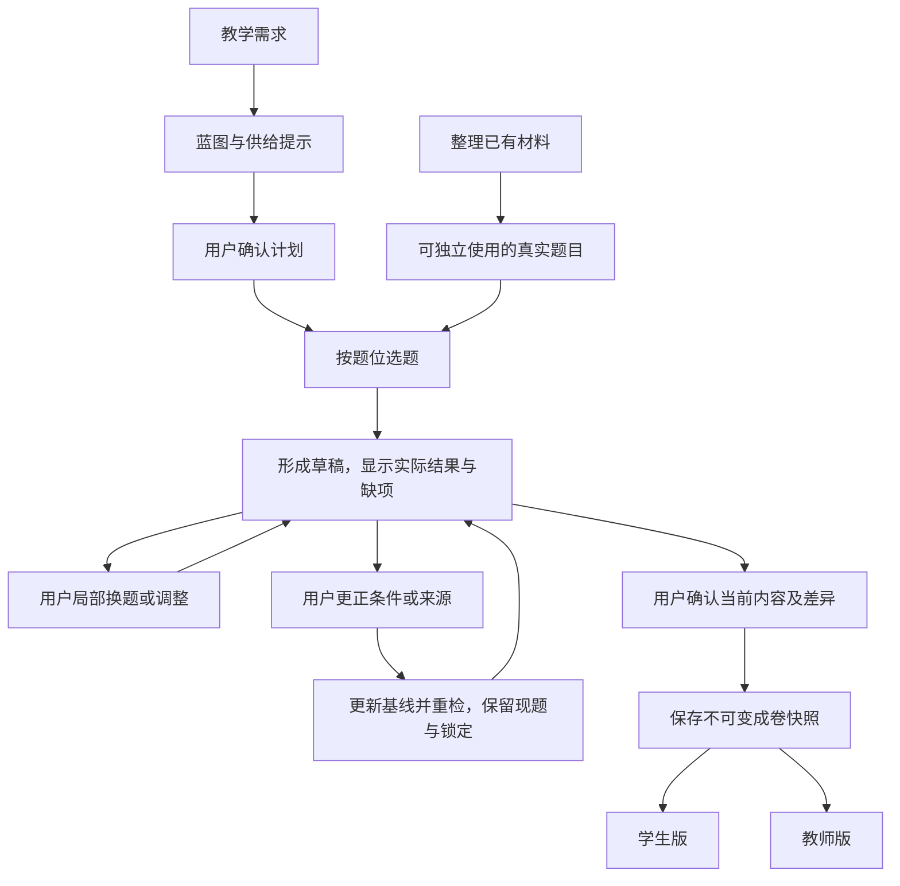

# ADR-0002：题库与蓝图

- 状态：已采纳（2026-10-10，S2-04）；作为 MVP 开发基线，不表示功能已经实现。
- 前置决策：[ADR-0001：教师组卷 workflow](0001-assembly-workflow.md)。
- 依据：[S2-01 验证任务](../validation/mvp-assembly-task.md)、[S2-02 供给核查](../validation/question-bank-supply.md)。
- 采纳记录：[S2-04 复核结论](../validation/adr-0002-adoption.md)；执行入口：[MVP 开发任务](../tasks/mvp-implementation.md)。

## 要解决什么问题

**怎样从已有材料中，选出符合教学目的的真实题目，组成用户愿意修改、打印和使用的试卷？**

从这个目标出发，只需要分清三件事：题库提供可用题目，蓝图说明要找什么题，草稿保留实际选择与调整，成卷保存用户最终确认的结果。蓝图的计划与题库数量都不能代替实际成卷。

本次先验证集合专项：45 分钟、100 分，以 6 单选、2 填空、2 解答作为初始结构。材料是 S2-01 归档、S2-02 清点的同一批 50 题，其中 10 题构成标杆卷。

## 决策一：把材料整理成能独立使用的题目

题目按以下信息整理，缺项如实记录；具体字段和存储方式在实现时确定。

| 信息 | 为什么需要 |
| --- | --- |
| 完整题面 | 学生能独立作答；包括题干、选项、小问及必要图片。带小问的题整体选取、替换，计为一题 |
| 题型 | 能按试卷结构选题 |
| 考查任务 | 知道这题具体考什么，不能只有“集合”这样的宽标签 |
| 解题所需知识及依据 | 判断是否能用本次已学知识完成；依据不足就标为未知 |
| 答案与解析 | 支撑教师版；与学生题面分开，缺失或冲突如实说明 |
| 来源与内容身份 | 能找到原材料、区分同题与重复出现，并重现用户选中的内容 |

完整可作答的题面及必要素材是自动选题的前提；边界未知或题面、解法依据存在未解决的冲突时，不自动作为合格题选入，可展示具体问题由用户决定。仅缺教师答案或解析，不阻止题面和教学条件均符合的题目选入，教师版另记缺项；没有独立答案块不等于没有答案结论。

本次“原卷版”有 11 题混入答案或解答，因此学生卷必须由整理后的题面生成。原卷内容、整理增补和本次建议评分分别注明来源。分值由本次组卷确定，采用可编辑的默认分配，调整后同步更新总分、两版保持一致，不作为题目的固定属性。

先整理支撑标杆及换题验证所需的题目，不以补齐全部标签或重建整个题库为前提。

## 决策二：蓝图只负责把需求变成选题目标

蓝图回答两个问题：**整卷要满足什么？每个题位要考什么？**

- 整卷：主考范围、已学边界、题量、总分、时长和来源范围；区分用户要求、可调整偏好与默认值。
- 题位：题型、计划分值和具体考查任务。题目的难度估计及依据与本次目标难度分别记录，缺估计保持未知，不当成实测结果。

例如第 7 题位要考“元素属于条件下求参，并用互异性舍解”。另一道只考互异性的填空题虽然相关，也不能直接算作完整替代。

主考范围说明主要考什么，已学边界说明解题允许用什么。高中知识按本次确认的章节、知识点及明确的必要依赖展开；初中基础知识按可查的基础集合自动注入，本次特殊工具（如韦达定理）作为显式前提记录。允许知识及其依据随确认计划保存；可预填上次选择，但须用户确认本次适用，不自动沿用。

至少证实存在一条能完成整题全部必要小问的允许解法，才计为边界符合；未找到这样的解法只说明证据不足，保持未知，不能据此断言超纲。用户可以选择保留未知或有差异的题，系统保留提示，不将其记为已证实符合。

用户确认初始蓝图后开始选题，已确认条件保存为基线。后续局部调整记录实际差异；用户更正教学条件或来源范围时保存新基线及更正记录，重检受影响题，保留已有内容与锁定。新来源须核查身份和适配依据，不能直接计为合格供给。

## 决策三：围绕实际草稿选题和换题

选题要检查来源、题型、考查任务、已学边界和同卷重复。初始仅自动选入证实符合条件的可用题；无合格候选的题位留空并记入缺项，可附带差异建议，由用户决定采用、调整目标或删除。换题无合格候选则保留现题。不静默放宽条件、扩大来源或编题补位；请求失败也不能说成题库无题。

换题只改用户指定的部分，保留无关题；锁定防止自动换题，用户直接操作锁定题仍可执行。默认保留当前题位的题型、考查目标及已设分值，新题评分不直接套用旧题细则。多项独立修改分别保留成功结果。

增减题或改分只调整当前草稿，同步重排题号、重算实际统计并记录计划差异，不改写原基线。调难度改变本次选题目标，只在用户授权范围重选，不改写题面或伪造难度值。自然语言建议先展示作用范围供应用，直接界面操作表达对应授权，不增加逐题审批。

草稿区分计划值与实际题数、分值及覆盖。最终确认前展示差异与缺项，保存用户看到的内容和摘要为不可变成卷快照；后续调整从快照派生新草稿。两版使用同一份内容、顺序和分值；学生版不含答案和教师记录，教师版如实展示答案、解析及评分来源。

未知或缺项不取消用户确认权。未选或缺题面的位置保留题号、打印明确占位，卷头标明未完整卷、实际可用题数及可用题目分值合计（按完整可作答父题计）；删除该位后重排题号、重算总分。缺教师答案或解析只在教师版注明，不编造为原卷内容。

## 怎样证明这套设计有用

用同一批材料验证三件事：

| 验证 | 成立的标准 |
| --- | --- |
| 按需求形成首份草稿 | 不预置选中题目 ID，从 50 题候选池按蓝图选题，记录未就绪项及实际差异；10 题标杆仅作参考，由用户判断是否可用 |
| 局部换题 | 有合适题时只替换指定题；无合适题时说明原因，现题及其他成功修改保留 |
| 交付两版 | 输出与用户确认的内容一致，学生版无答案泄露，教师资料来源及缺项清楚 |

[真实样例推演](../validation/blueprint-contract-walkthrough.md)提供对照。目前第 5–10 题位没有保持完整目标的直接备选，限制的是换题，不等于首次没有标杆原题；全源仅两道解答题且均已用于标杆。流程设计不能解决题目不存在的问题。

记录用户替换数量、原因和是否愿意使用，不预设“一半需替换”等无依据阈值。若必须大量手工重做、局部操作丢失满意题或输出与确认内容不一致，说明设计或实现需要调整；只复现已知标杆不能证明选题有效。

本次设计推演和 S2-04 采纳不能代替实际入库、自动选题、打印或教师使用的证据。[开发任务](../tasks/mvp-implementation.md)记录实际交付，按“整理可用题目、实现选题与局部修改、保存输出并真实验证”推进。数据库表、接口字段、版本存储、重试和并发细节进入开发设计，出现实际问题再细化。

## 为什么采用这个方案

直接使用 PDF/OCR 整块内容，无法可靠区分学生题面与答案；只按知识标签选题，无法保证具体考查目标；每次重做整卷，会丢失满意题。采用“题目、蓝图、实际草稿”三者分工，代价是需要整理必要内容与适配依据；能否减少用户准备和返工，仍由真实使用验证。
