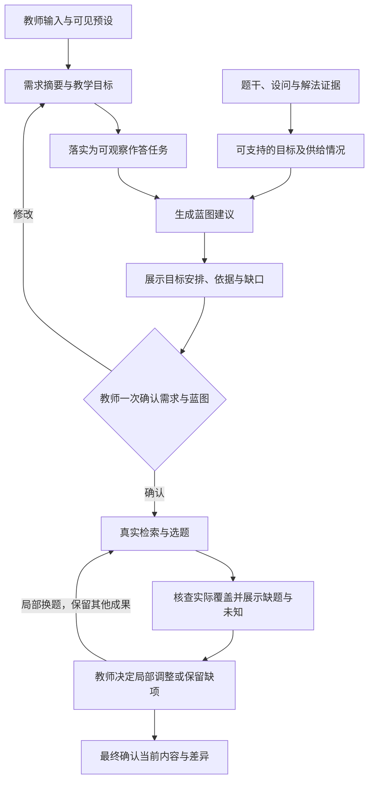

# ADR-0003：教学需求收集与确认

- 状态：草案
- 日期：2026-10-10
- 本次澄清：2026-10-10，结合第一轮评审补充目标支持判定、歧义与冲突处理、供给反馈和版本重核；保留一次确认及缺项可继续调整的边界。
- 交互简化：2026-10-11，快速需求改为单页基本条件与可选原话，由 LLM 整理目标；取消已学边界、目标强度、作答要求和提示条件的逐项必经步骤。
- 对话与计分：2026-10-11，范围使用弹层，发送后输入框固定底部；需求建议和蓝图在同一助手对话内确认，练习默认不计分。
- 范围优先级澄清：2026-10-21，用户明确要求原话中的知识内容优先，未勾选也由 LLM 识别真实教材范围；此范围规则已记录于已采纳的 ADR-0005，本 ADR 其余部分仍为草案。
- 关联：[ADR-0001：教师组卷 workflow](0001-assembly-workflow.md)、[ADR-0002：题库与蓝图](0002-question-bank-blueprint.md)
- 关系：补充需求形成与确认规则，保留既有的蓝图确认、真实选题和局部调整边界；采纳后再落实到实现。

## 要解决什么问题

同样是“集合专项卷”，教师可能希望学生理解概念、熟练运算，或完成推理论证。仅有章节、题型和题数，无法区分这些教学目的；让教师逐题选择预设考查任务，又把设计试卷的工作交还给了教师。

本决策要用尽量少的输入，把教师的教学意图转成可确认、可选题、可核查的蓝图目标。成立的标准是：教学目的变化时，蓝图能作出有依据的变化；题库无法支持时，能明确指出差距。

范围限于一次组卷的需求收集与确认。不要求先建立完整知识图谱、穷举所有考查任务，也不根据组卷需求推断学生已经掌握了什么。

快速入口保留固定大小的输入框，其上方点选范围与用途；范围树通过弹层展示，不撑高输入框；题量、时长和其他条件由原话补充，不提供完整条件表单。发送后，同一输入框固定在底部，教师原话、助手建议、规划状态和蓝图沿对话展示。考查重点与安排说明直接可读，确认按钮依附于对应建议；输入补充后重新整理并确认，不静默修改已确认蓝图或草稿。

课后巩固、专项练习和学情诊断默认不计分，单元或阶段测验可选计分，模拟考试默认计分。计分方式是本次需求的一部分，可由教师切换；自然语言中的明确总分形成可见待确认建议，手动指定优先。不计分时，不生成总分或小问赋分，不以分数差异提示教学缺口，学生及教师输出均省略评分分值。既有未记录计分方式的历史内容维持原计分行为。

## 决策一：先形成够用的需求，再按影响追问

教师可用自然语言、教材章节或已有模板开始。系统整理以下内容，已有信息可预填，不要求逐项手工填写：

| 内容 | 要确认的含义 |
| --- | --- |
| 使用场景与对象 | 给谁用，做同步检测、专项训练或阶段测验等什么用途 |
| 主考范围 | 主要考什么知识；可按教材章节或知识点表达 |
| 已学边界 | 默认按已核实教材进度纳入所选最晚章节及此前登记章节，可按需修改；不等同于主考范围 |
| 试卷规模与约束 | 题量、题型、分值、时长及来源等本次明确要求；未指定项可由模板提出建议 |
| 教学目标与偏好 | 希望学生完成什么表现，哪些必须满足，哪些可以调整；难度允许不指定 |

快速入口以一个输入框表达需求，范围树与用途选择放在框上方，题数、分值与时长通过原话补充，不要求先填写题型配比或认知、能力、素养表格。LLM 整理简洁教学目标与必要认知要求，也可从原话提取尚未手动指定的题数、总分和分钟数；教师已经手动指定的数值保留，冲突只提示。范围按 2026-10-21 用户澄清，以原话明确的知识内容优先匹配真实教材目录，未选择也可识别，已选与原话不同则展示调整依据供确认；原话没有新的知识要求时沿用本次选择。用途、独立明确的已学边界和方法不被模型替换。清楚的需求直接展示含规模的简短摘要，确有影响选题的关键歧义才追问一至两个问题。教师可采用建议后预览蓝图，也可明确按当前基本条件继续；后者不代表未采纳的目标或规模已经生效。

已学边界不单列必经步骤。选择已核实教材的某章节后，默认本次允许所选最晚章节及此前登记章节，在摘要中简短说明推定方式；教师需要跳章学习、回顾训练或限用特定知识时再修改。只采用唯一且可查的教材映射与目录顺序，不按章节字符串排序，不注入未核实旧知识树，也不把年级、教材名称直接解释成“全部内容已学”。该默认描述教学前提，不是学生掌握程度的结论；特殊方法仍按本次明确许可处理。

只追问会实质影响蓝图或选题、且无法从已有信息确定的差异。模板值、历史设置和模型推断须标明为建议或默认，范围与教材依据在确认摘要中保留。

“出几道活题”等歧义需求，先展示少量候选解释及对应任务供教师选择。未明确时保留原话和待澄清项，可基于已明确条件提出暂定蓝图；不虚构正式目标代码，不宣称该目标已满足，也不因教师跳过澄清就把明确的必需目标降为偏好。

教师明确要求优先于未确认的模板建议，调整建议在蓝图确认时一并展示；两个明确要求无法同时满足时，展示冲突及可选方案，由教师决定调整哪项。不自动改变已确认的目标或难度配额，不把某类任务预先认定为 hard；难度证据不足时说明尚不能判断配额是否可满足。

可以在信息不全时展示暂定蓝图；影响选题的关键条件未明确时，应指出待确认项，不能宣称已经具备可执行条件。初中基础依赖按 ADR-0001 自动纳入并在摘要中说明，无须逐项确认；特殊工具仍须显式说明。

界面不设置“额外允许的知识与方法”入口。初中基础知识作为默认教学前提自动纳入，无须逐项勾选；这不表示对学生实际掌握程度已有证据。超出默认已学边界的特殊知识或方法，只有教师明确提出且确认后才纳入；LLM 不因缺题擅自扩大边界。

## 决策二：用教学目标连接知识、认知要求、能力与素养

当前阶段采用知识点、认知要求、能力和核心素养作为教学目标的基本框架。教学目标以“学生对什么内容，完成什么可观察表现”为核心，按需关联四个维度：

| 维度 | 回答的问题 | 使用边界 |
| --- | --- | --- |
| 知识点 | 考什么内容 | 区分主要考查知识与解题所需的支撑知识 |
| 认知要求 | 要怎样理解和使用知识 | 例如辨认概念、解释关系、应用方法、分析论证；不等同于题目难度 |
| 能力 | 要完成什么可观察的数学活动 | 例如运算求解、推理论证、表示转换，须落实到题目中的活动 |
| 核心素养 | 希望提供哪类数学思维的考查机会 | 须有题目活动依据，不能仅凭知识点或能力名称推定 |

四个维度是表达目标的工具，不是每次组卷必须填满的表格。教师只说“练习交集运算”也可以开始；系统可以提出补充目标，由教师结合蓝图一次确认。分类讨论、数形结合等方法可另作目标补充，不直接等同于核心素养。

“熟练使用”等表达由 LLM 结合范围与用途整理为可观察表现和必要认知要求，不要求教师手工选择全部目标字段。目标默认作为偏好；“重点练习、熟练掌握”不自动变成必须满足的硬门槛，只有教师明确要求必须或不能缺失时才提出硬约束。未指定作答要求或提示条件时保持未指定，不因“推理”默认要求书面完整证明，也不自动要求教师确认这些字段。若它们确实决定教学目标能否成立，再按需澄清。题目提供练习和考查机会，学生是否达成仍需作答证据。

目标术语使用有版本的定义与依据：区分课标原文、内部整理和本次生成建议，保留可追溯来源。知识点映射到已有目录；没有匹配项时保留待核实描述，不生成貌似正式的目录编号。本 ADR 不直接规定一套认知等级枚举，也不把内部分类宣称为课标原文。

需求与证据关联保存所用课标、教材目录及目标定义的版本或依据身份；未核实的依据如实记录。切换相关版本时重核受影响的目标映射与支持结论，无法确认映射则保留待核实，不静默沿用同名代码。恢复历史组卷使用当时保存的定义与内容，版本切换不改写历史快照；具体字段留待详细设计。

### 将四维细化为可判定的目标细目

“集合、分析、推理、逻辑推理素养”仍是宽标签，不能直接充当选题规格。每个用于指导选题的目标细目至少说明以下内容，四维关联附着于该目标；系统根据需求整理并展示，教师无须逐项填写：

| 内容 | 需要具体到什么程度 |
| --- | --- |
| 知识范围 | 细化到概念、性质或关系，如“集合包含关系与空集”；主考知识和解题依赖分别记录 |
| 可观察表现 | 用动作与对象描述，如“识别空集分支，分类求参数并论证完整性”，不只写“提升推理能力” |
| 完成条件 | 记录教师明确的理由、提示或相关工具前提；未指定时保持未指定，只有影响目标判定时才按需澄清，不作为必填表单 |
| 支持判据与边界 | 说明哪些必要活动构成完整支持，哪些只支持部分目标，什么情况证据不足 |

同一知识范围可以形成不同目标。以下是内部操作性示例，不是课标等级枚举，也不是新的封闭考查任务目录：

| 主考知识 | 认知要求示例 | 可观察任务 | 题目支持的检查重点 |
| --- | --- | --- | --- |
| 集合包含关系与空集 | 理解并解释概念 | 解释空集为何是任意集合的子集，区分子集与真子集 | 设问是否要求概念解释或辨析；只做元素运算不足以支持该解释目标 |
| 集合包含关系 | 应用定义判断关系 | 判断两个给定有限集合的包含关系并说明依据 | 是否需要检验元素包含及相等情况；若只要求判断子集，则不额外要求真子集辨析 |
| 含参集合包含关系与空集 | 自主分析并论证 | 判断空集是否可能，按必要分支求参数并说明讨论完整性 | 空集是否确为相关情形，学生是否需自主识别分支，以及设问是否要求完整理由 |

例如，最后一个目标可关联“分类讨论、条件推导与完整论证”等能力；只有实际要求的论证活动及证据充分时，才记录其对逻辑推理素养的支持。若题目已明确给出全部分类，只能据此证明分类后的求解机会，不能直接计为支持“自主发现分支”；空集不可能的题也不能冒充空集分支训练。认知要求按具体任务判断，不把“含参”或“分类讨论”固定映射为某等级。

目标细目按实际需求和代表题逐步建立，保存定义、依据与版本；新目标可以先保留为待核实描述。无需先穷举全教材、全真题的目标，也不要求教师从完整细目表中逐项选题。

教师原话随确认后的需求保存，传到蓝图规划与候选比较，避免整理目标时丢失“题干简洁、少复杂运算”等偏好。原话不覆盖已确认的结构化条件；明确题型数量由 LLM 提取为可见待确认配比，采纳后作为固定数量校验。只给总题数时仍允许建议题型配比，教师手动指定的规模及题型优先。

### 四维描述目标，七维按需辅助判断挑战

需求与蓝图通过“具体教学目标、可观察任务、题目支持证据”衔接。四维标签用于描述和查找目标，不能仅凭标签重合判定匹配。可观察任务说明学生实际要做什么，不新增为必须填报的一套分类。

需要进一步区分候选题的挑战时，可按需分析知识组合、策略发现、推理论证、运算负担、表征转换、提示与表达、情境熟悉度七类特征。它们作为待校准的工程分析框架，不替代四维目标，不直接等同于学生实际认知负荷、课标等级或实测难度，也不要求先完成全部七维标注才能组卷。

例如，“运用集合知识进行完整分类论证”表达教学目标；“多分支协调、提示较少、计算较轻”描述候选题的预期挑战。同一目标可对应不同负担，同一负担也不能证明目标相同。

若启用挑战评估，依据当前题目、可行解法、教学上下文和适用参考题独立判断，再与题位目标比较；不向评估输入期望档位或剩余难度配额，以免为凑计划反改判断。关键依据不足保持未知，不使用未经验证的加权总分或负担向量相似度作为已符合目标的证明。具体判档与校准规则留待详细设计。

## 决策三：目标规划与题目证据共同决定可兑现的蓝图

蓝图将教学目标安排到题位或题组，说明为什么这样安排，并结合题量、分值、时长和优先级检查可行性。预设考查任务可以作为模板，不能成为只能从中选择的封闭目录；自然语言目标必须参与规划，不能只保存成备注。

确认前基于真实题库的可用记录预检供给，展示已知缺口与未知；初筛数量不保证后续整卷去重与实际选择均成功。确认后若无合格候选，保留原计划、已有题目与锁定，缺位留空并记录实际差异，由教师决定调整或接受。不自动撤销蓝图确认，不因缺题或证据未知新增阻断或审批；最终成卷仍按 ADR-0001、0002 确认并如实交付当前结果。

题目侧从题干、设问和解法中提取可支持的目标，记录到具体题目或小问的内容版本与证据。提取结果属于待核实判断；标签相同、题位关联了目标编号，都不单独构成覆盖证据。已学边界仍按 ADR-0002，以至少一条完整允许解法判断。

题库补强先复用已有题面、来源、任务与解法，补充目标细目关联、实际作答条件、支持判据及证据定位。带小问的题按小问核查目标支持，但仍按 ADR-0002 整题选取与替换；同一题可支持多个目标。分析补充与原题内容分开记录，未核实判断保持未知，不因标注增加就把原题视作已获验证。

目标支持与边界符合分别核查。参考解法出现某步骤，不足以证明学生作答必须完成该活动；应结合设问、作答形式及合理的替代解法，判断是否支持目标。例如，要求自主论证时，不能仅因参考答案写了证明，就把可直接代入选项完成的题计为已证实支持自主论证。证据引用须能定位内容，也须核对其是否支持结论。

若目标要求呈现完整书面论证，题面必须要求提交相应论证；仅选择结论不能证明这一目标已覆盖。客观题仍可提供推理判断、命题辨析等考查机会，按具体目标和作答条件判断，不按题型一概否定推理能力。

对具体目标、完成条件及当前题目或小问版本，记录以下判定；结论须附理由、证据与判定来源，不只保存一个真假值：

| 判定 | 依据 | 对该目标的处理 |
| --- | --- | --- |
| 已证实支持 | 实际设问与作答条件提供目标全部必要活动的考查机会，各支持判据有经核对的有效证据，并考虑已知的合理替代解法 | 计入已证实覆盖；仍须另查范围、题面就绪与其他选题条件 |
| 部分支持 | 已证实提供部分活动，但未完整支持目标，例如给定分类后求解，只支持分类后的求解部分 | 报告已支持部分，不单独计为完整覆盖 |
| 证据不足 | 目标含义、关键题面、活动依据或替代解法尚不能核实，无法可靠判定支持程度 | 保持未知，可展示候选和缺项，不计为已证实符合 |
| 明确不支持 | 有具体依据表明题目不提供所需活动，或作答条件与该目标不相容 | 不用于满足该目标，仍可用于其他适合的目标 |

以上判定描述目标支持，不合并内容就绪、来源与已学边界的检查；未结构化步骤或未经教师逐题审核，不单独构成“不支持”的理由。判据应可复核，不承诺把语义判断完全变成确定性规则；教师决定保留候选也不自动将未知变为已证实。

需求表达希望考什么，题目证据说明能提供什么考查机会，两者分别保留。选题后核查实际覆盖：已证实支持、证据不足或缺少供给，并指出涉及的目标及题位；不能用计划覆盖冒充实际覆盖，也不能自动把教师目标改成题库现有标签。

普通组卷不以补齐全部能力、认知和素养标签为前提。教师明确要求某目标时，自动选入的题目须有相应支持证据；证据不足的候选可展示，不能静默当作符合。供给不足时保留缺口，提出补题、调整结构或放宽具体要求的建议，由教师决定。

必须目标至少安排一个兼容题位承担，可由少量关键题位考查；其他题位保留基础练习，不要求每道题都承担同一目标。目标所关联的题位仍按该目标严格筛选，证据不足保持未知或缺题，不能删除全部关联来绕过要求。关联可以在兼容题位之间调整，最后一个关联被移除前须先明确修改需求。

## 决策四：一次确认形成基线，后续只处理变化

沿用 ADR-0001 的蓝图确认节点，同时确认需求摘要、教学目标和蓝图，无须新增独立的需求审批或搜索确认。摘要须清楚展示主考范围、已学边界、硬性要求、偏好、预设来源和剩余未知；确认表示教师认可本次意图与安排，不表示未知内容已获证明。

需求摘要可直达单项修改，保留其余已确认条件。修改目标或题量后直接返回需求核对；范围变更按既定推定方式更新已学范围，教师自定义的边界保留，仅重核相关目标和条件，不要求补走边界步骤。编辑从已确认需求派生新会话，原记录保持可追溯，不要求重新走完整流程。

确认后保存需求与蓝图的版本关联。教师修改教学目标、范围或约束时展示影响，保留已有题目和锁定状态，按变化重新核查；局部换题不重复确认整份需求。最终成卷记录所依据的需求与蓝图版本，后续调整仍从快照派生新草稿。

组卷全程保留同一个输入框。蓝图确认后，以对话回复实际题量、供给缺口和已知限制，回复底部附试卷产物卡片；点击卡片从右侧抽屉预览与操作，消息不重复显示双方名称。添加题位放在相应题型分组末尾。教师可直接用文本增删题位、调整蓝图或指定题号换题：系统先展示修改提案，确认后沿既有操作接口执行并重核。题号歧义、不能兑现的新能力诉求或未标定难度须如实澄清，不将预期当成实际结果。历史成卷仍须派生草稿后修改。

## 替代方案与代价

- 全量表单能统一字段，但增加教师负担；采用少量输入、可见预设和必要追问。
- 只保留自由文本输入成本低，但难以稳定选题和核查；采用原话与结构化目标并存。
- 只使用固定考查任务菜单容易实现，但难以表达新目的；保留模板，同时允许按需求提出目标和具体任务。
- 将完整七维评估设为组卷前置条件会增加标注与校准成本；当前先验证四维目标、任务与证据的匹配价值，七维按实际需要启用。

本方案需要目标术语、题目证据和规划校验支持，不能仅靠增加几个标签字段完成。先在小样本中验证，再扩大材料范围。

## 成立前提与验证

首轮沿用 [S2-01 验证任务](../validation/mvp-assembly-task.md)、[50 源单元清单](../validation/sources/set-source-catalog.json)与[就绪台账](../../data/question-bank/ledger.json)，实际选题仅使用台账中就绪的题包；[标杆卷](../validation/benchmark-paper.md)作为对照，不预置选中结果。按需要从 [2025 高考材料](../gaokao-2025/README.md)选择少量代表题，核对原卷题面与解析后补充样本，不将汇总标签当作已核实证据，也不将全套真题处理设为首轮前提。

1. 用同一知识范围和试卷规模，分别输入“概念理解、运算应用、推理论证”三类真实需求，检查蓝图安排及理由是否响应差异；措辞变化但目的相同，不应无依据地改变目标。
2. 先用少量代表题建立目标细目与支持样例，核对“同知识、不同任务”“自主发现与已给提示”“完整支持与部分相关”的差异，再覆盖现有已就绪题目，必要时补充少量真题代表样本。按小问检查实际支持和已学边界，核查合理替代解法是否绕过所需活动，不因样本不足编造覆盖。未要求的维度或七维负担缺失，不应阻塞普通组卷。
3. 验证歧义需求提供候选解释，未澄清的必需目标不会自动降为偏好；预设可见，教师可以不指定难度。明确要求冲突时展示选择，不自动改写基线；确认后供给不足仍保留成果、缺位与实际差异。
4. 验证需求修改及教材、目标定义版本切换能追溯到受影响题位，已有成果与历史快照保留；由教师实际使用评价目标表达是否准确、确认负担是否合理。
5. 若启用负担分析，先检查教师参考判断的一致性、上下文变化与候选选择的实际收益；仅改变期望难度或配额不得改变独立评估。功能检查、模型输出一致或教师认可都不表述为实测难度验证。

采纳后的下一步是依据上述目标细目细化最小合同及术语依据，用代表题建立可复核的标注样例，再覆盖现有就绪题、改造需求驱动的蓝图规划并执行上述验证。本文不代表这些能力已实现，也不要求先完成全教材、全真题的维度提取。
