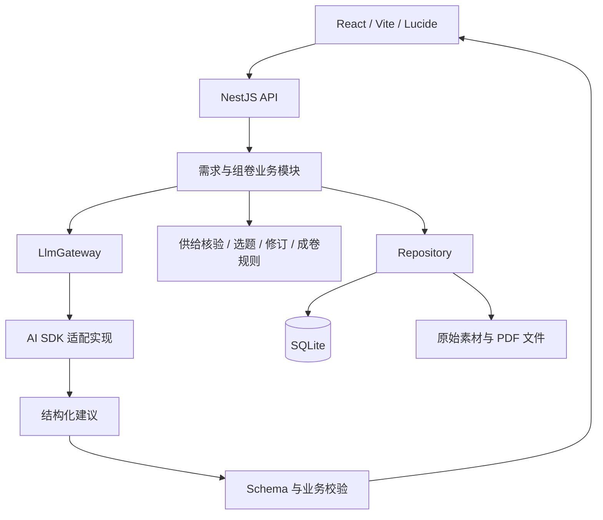

# ADR-0004：MVP 应用框架与模型接入

- 状态：已采纳
- 日期：2026-10-10
- 已明确约束：使用用户提供的 [DESGIN.md](../../DESGIN.md)，前端 React + Vite + Lucide，数据库 SQLite。
- 选型：后端 NestJS + TypeScript，使用默认 Express 适配器；模型接入 Vercel AI SDK；SQLite 使用 better-sqlite3、SQL migrations 与 Repository。
- 关联：[ADR-0001](0001-assembly-workflow.md)、[ADR-0002](0002-question-bank-blueprint.md)、[ADR-0003](0003-teaching-requirements.md)、[UI 应用说明](../design/tutor-ui.md)。

## 问题与验收目标

教师需要从自然语言需求出发，确认可执行蓝图，调整真实题目，并保存和导出试卷。当前规则、题包和成卷机制已经可运行，需求理解与目标证据匹配尚未贯通。选型应让这条链路能够快速开发和验证，并保留明确的业务边界。

首版已接通 NestJS、SQLite 与在线 LLM 需求整理。题目四维目标证据匹配仍未贯通；框架交付不代表教学有效性已验证。

## 决策一：React + Vite，按产品流程组织 UI

使用 `lucide-react`，按教学需求、蓝图、试卷编辑与历史组织页面，共享表单、状态提示和预览组件。视觉遵循 DESGIN 及 Tutor 应用说明。服务入口使用 TypeScript，HTTP 需求与 LLM 输出采用 Zod 运行时合同；已有 `.mjs` 业务逻辑与 JSX 可分步整理，避免一次性重写妨碍流程验证。

## 决策二：NestJS 单服务，复用组卷业务模块

NestJS 用于控制器、依赖注入、配置、请求校验、统一错误处理和业务模块组织。首版采用默认 Express 适配器，保持单个服务与现有 API 合同；有实际测量依据后再评估 Fastify。

按需求、蓝图、草稿与成卷、题库、输出、模型调用和持久化划分模块。控制器负责协议，组卷业务模块负责范围约束、候选核验、修订与冻结规则，Repository 负责存储。LLM SDK 和 HTTP 框架类型不进入组卷规则。

当前 `src/assembly`、`src/question-bank`、`src/output` 模块继续复用；首版由 Nest/Express middleware 承载现有 HTTP handler，单个 listener 对外服务，尚未逐路由整理为 Controller/Service。迁移保留错误码、幂等、修订冲突、锁定和历史快照行为，稳定后逐路由整理，不同时维护两套生产业务逻辑。

## 决策三：AI SDK 作为首个模型适配实现

首要模型任务是将教师原话转成结构化需求，提出关键澄清项，并结合真实候选供给提出蓝图建议。AI SDK 的结构化输出、流式响应、工具调用和 React 接入与这些任务直接相关。

项目保留一个薄的 `LlmGateway`，只暴露需求整理、蓝图建议等业务操作，首个实现使用 AI SDK。调用记录保存模型身份、提示词版本、耗时、用量、请求状态和诊断信息；API 密钥只在服务端配置。使用 schema 校验完整输出，并再次进行业务校验；流式片段只用于预览，不直接成为确认后的蓝图。

Pi 按 `pi-mono` 的 `pi-ai` 底层统一模型 API 理解；若用户指的是其他项目，需要重新核对。Pi 同样支持多供应商、流式和工具调用；采用它需要项目自行接合结构化业务输出和页面交互。若后续需要 Pi 的模型或运行环境特性，可以新增 Gateway 实现。首版只维护一种实现，暂不引入完整编码代理运行时。

模型输出是建议：教师确认后才能影响选题；不得生成虚构题目身份、自动放宽已学边界、绕过锁定或把分析自报结论视为独立复核。未配置模型时显示未配置状态，保留手工填写流程，不将规则结果冒充模型生成。

首版需求 UI 依次确认用途、主考范围、已学边界、题量分值、教学目标及摘要。LLM 返回 `single_choice / multi_choice / number / text / notice` 白名单组件和待采纳字段；本地 schema 与业务 ID 双重校验后展示。教师显式采纳才改写条件，完成各步确认后才能生成蓝图。支持取消、超时、重试和刷新恢复，保留已点选条件与教师原话。

默认采用 JSON object 输出，在提示中附完整 schema，再做本地校验；格式或业务校验失败时共用至多一次纠错机会，共享原超时期限并累计记录用量，不能删去未知字段或截断组件后放行。两类校验通过后才记录成功，语义与教学适切性仍需教师核对。供应商明确支持时可配置原生 JSON Schema。首版展示请求状态与最终建议，尚未逐 token 流式渲染。模型服务只在服务器配置，调用审计记录不存密钥。

## 决策四：SQLite 保存业务状态与版本，文件保存素材

运行期以 SQLite 为业务状态存储，使用 better-sqlite3、SQL migrations 和 Repository 管理访问，已在 Windows / Node 24 验证。MVP 先保存经过校验的业务文档与版本，暂不加 ORM；出现跨对象查询需求后再评估类型化表与 Drizzle。

首批持久化对象：需求会话及确认快照、草稿内的蓝图、草稿修订与操作幂等记录、不可变成卷、输出状态、反馈和模型调用审计。题目与待复核目标分析仍从版本化材料读取，尚未迁入数据库；父题与小问身份、题面与教师资料版本继续分开。

原始 PDF、图片和输出文件保留在文件系统；数据库记录相对路径、大小和哈希。已核验题包作为可复现的导入材料，导入保留身份与版本。运行读写逐模块切换到 Repository，避免同一对象在 JSON 与数据库之间双写。

启动时幂等导入旧草稿、成卷、反馈和输出 JSON，保留原文件，不覆盖数据库新版本；损坏文件保留并告警。正式运行对这些业务状态单写 SQLite。需求会话在单进程内按会话串行处理；多 worker 部署前须增加跨进程需求会话并发控制。

使用事务和版本条件更新实现并发修订与确认操作；幂等键有唯一约束，历史成卷只读，后续修改派生新草稿。备份覆盖数据库及所引用的文件，不能仅备份 `.db` 后宣称完整恢复。

## 结构与交付顺序

1. 按 DESGIN 建立页面框架和状态组件；先展示真实题库、历史与缺项原因。
2. 建立 NestJS 入口和 SQLite Repository，贯通一条现有需求到成卷的流程；验证旧历史导入及不可变快照。
3. 接入 AI SDK 的真实需求整理调用，提供澄清、取消、重试和教师确认；使用手工结构化需求作对照。
   需求确认后，默认由 LLM 结合教学目标、任务目录及真实供给提出蓝图；规则负责严格校验并重新核查候选，教师确认后才创建草稿。教师选择“AI 建议题型配比”时可调整各题型数量，但总题量、总分、时长及教学边界保持；固定题型数量时不允许调整。模型失败明确展示，可重试、取消或主动使用规则预设，不静默降级。蓝图、草稿与成卷保留规划来源、原需求及调用记录，不把生成理由当作题目支持或难度证据。
4. 接入已复核的题目目标证据，允许蓝图据此选题；目标证据缺失的阻断原因清楚可见。

不等待完整题库和所有自动标注才提供可试用版本。首轮验收采用真实教师需求，检查能否完成组卷、选题是否符合确认条件、保存恢复是否一致及模型失败时能否继续工作。

## 替代方案与代价

| 方案 | 适用与代价 |
| --- | --- |
| 继续原生 Node HTTP | 短期改动最少；模块增多时须自行维护请求校验、配置和依赖组织。仍是迁移前可运行的入口 |
| NestJS + Express（建议） | 有一次传输层整理成本；明确模块职责，便于后续扩展需求、证据与历史管理 |
| NestJS + Fastify | 可在性能需求明确后采用；需要处理适配器相关插件和响应差异 |
| Pi 的底层模型 API | 统一模型调用可用；前端流协议与结构化业务校验需自行衔接 |
| AI SDK（建议） | 更直接覆盖当前结构化和流式需求；供应商差异与业务正确性仍须项目校验 |

## 依据

2026-10-10 查阅官方资料，并锁定已验证的安装版本：

- [AI SDK 概览](https://ai-sdk.dev/docs/introduction)：Core、UI 与多供应商接入。
- [AI SDK 结构化输出](https://ai-sdk.dev/docs/ai-sdk-core/generating-structured-data)：输出 schema、验证及流式片段限制。
- [Pi 底层模型 API](https://raw.githubusercontent.com/badlogic/pi-mono/main/packages/ai/README.md)：统一模型调用、流式事件与工具接口。
- [NestJS HTTP 适配器](https://docs.nestjs.com/techniques/performance)：默认 Express、Fastify 及适配差异。
- [Drizzle SQLite](https://orm.drizzle.team/docs/sqlite/get-started-sqlite)：SQLite 驱动接入方式。
- [Lucide React](https://lucide.dev/guide/react)：React 图标包使用方式。
