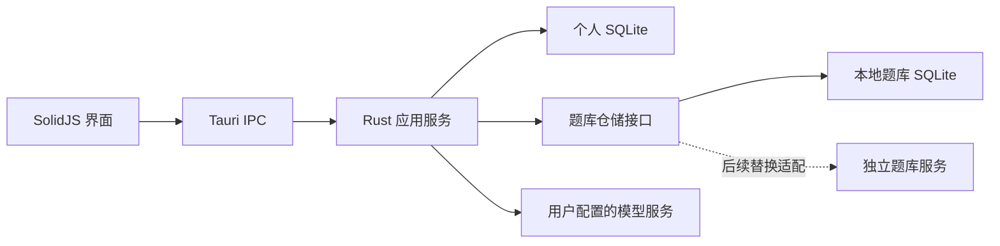

# ADR-0005：本地桌面应用与数据边界

- 状态：已采纳，2026-10-17，依据用户明确要求；实现与验证进度单独记录。
- 取代 ADR-0004 中 React、NestJS 和网页账号体系作为主应用的技术选择。
- 沿用 ADR-0001／0002 的组卷流程、题库证据和教师确认边界。

## 决策

使用 SolidJS + TypeScript + Vite 构建界面，Tauri 2 承载桌面窗口，Rust
负责组卷规则、模型请求、数据存储与文件输出。正式桌面运行时不启动
Node／NestJS 服务，不开放本地 HTTP API，不通过浏览器保存业务数据。
前端使用受限 IPC 调用 Rust；密钥不进入前端包或返回界面。

2026-10-19 补充：本地可保存多套命名模型配置，各自拥有接口、模型名与加密密钥，
由用户明确指定当前使用项。既有单套配置保留并兼容读取，首次显式保存时升级文件结构。
配置切换本身不调用模型；后续模型操作使用当前项，不自动切换服务商或改变组卷确认边界。
各套密钥按配置身份分别保留，新增配置不继承其他密钥；修改服务来源时需重新提供密钥。

2026-10-23 用户要求新增“千问AI平台”，服务地址固定为
`https://maas.qianwenaiapi.com/compatible-mode/v1`，作为独立服务商，不与阿里云百炼共用来源身份或密钥。
用户显式获取模型列表时，由 Rust 使用该配置自己的凭据调用所选服务商的模型列表接口；
内置模型资料仅描述已知能力，不再作为可选模型列表或接口失败后的静默兜底。
新增的动态模型选择绑定实际拉取结果及对应服务商、配置和凭据，已有未变化配置与旧别名继续兼容。
读取设置、取消编辑及查看历史不自动拉取，列表请求不占用组卷执行锁；切换服务商或密钥后不得复用旧响应。
列表返回模型ID不等于证实其支持对话、结构化输出、图片或某种思考参数，未知能力不按名称猜测。
同日实测后，仅为千问AI平台 `qwen3.8-flash` 开放关闭／开启思考，以顶层 `enable_thinking` 布尔值发送，不提供强度档位；这项能力元数据不替代实际模型列表，旧配置未显式设置时保留原请求策略。
本轮用户提供的 `~/.agent.env` 密钥只用于显式离线联通验证，不成为正式应用自动读取的共享凭据来源。

首次使用仅设置昵称，随后可在个人设置修改。取消登录、注册、邮箱、密码、
会话、管理员和多账号概念。本地应用不将昵称视为身份认证。

个人库保存昵称、设置、学生、草稿及其确认需求、成卷、反馈及输出记录；题库另存
`question-bank.sqlite`。两者位于系统应用数据目录，不写入安装目录。题库接口
不承担个人记录存储。以后拆题库服务时，个人记录仍留在本机；成卷冻结已选
题目版本和内容，不依赖远程题目在日后仍然存在。

## 旧数据与迁移

用户明确选择桌面版从空白个人数据开始，旧网页端数据库原样保留。
不得自动合并旧账号、认领记录或将原库替换为桌面数据库。原网页代码在迁移初期暂留作
对照；2026-10-21 用户明确要求移除网页端，按 [ADR-0008](0008-desktop-only-repository.md) 退休，历史版本仍可从 Git 追溯。题库首次导入已核验的版本化
种子；后续启动不覆盖本地题库。

2026-10-17 用户进一步明确共享题库全部迁移：只读导出旧库的全部共享台账、
题目、教材、知识映射、来源与审核依据，个人记录仍不导入。当前包含 372 条台账，
其中 358 道 ready 可用、14 条 pending 不可用，367 份原始题目内容。
新建桌面库导入全量种子；原 45 题桌面库通过清单哈希及原始版本依据事务升级，
保留本地新增记录与配置。本地版本冲突时整体回滚并提示，不删除、重建或覆盖用户库。
迁移失败不改变已有个人库和冻结成卷，重复启动幂等；原网页库保持原样。

## 保留的产品边界

需求确认 → 题位规划确认 → 真实选题 → 编辑草稿 → 确认成卷。规则预设与
模型建议明确区分；模型失败不伪装为模型成功。题量由教师决定，缺题保留空位。
刷新、读历史与预览不调用模型。学生关联仅用于本地归档，不注入模型、不打印。
2026-10-21 用户明确补充：AI 需求整理依据本次原话中的知识内容匹配真实教材范围，未选择范围也可开始；原话与已选范围冲突时，展示识别后的范围及依据供教师确认，不沿用隐藏默认。先校验目录身份，再核对相应真实供给及整理配比；无法匹配时提示补充，规则预设仍要求选择范围。发送后以对话展示实际处理状态和已完成结果，完成后进入需求确认，不跳过原确认边界。
2026-10-21 用户另行采纳 [ADR-0007](0007-student-answer-grading.md)，提供学生答卷与显式后台批改；
这不改变组卷关联的隐私边界，不自动把批改结果注入组卷需求或推断掌握度。
改名、换题和成卷操作保留修订检查与稳定操作身份；成卷不可变，继续编辑派生草稿。

题库提供本地教材章节与知识点导航，知识点使用稳定身份。
2026-10-19 用户调整题目知识点关联规则：模型关联现有目录 UID 后直接用于知识点题数和筛选，
不再要求教师单独确认关联。历史题包中已有正式 UID 的候选关系也直接参与检索；
迁移原始存档及其历史状态保持不变，不将自动关联改写成教师审核记录。
新导入保存 `model_mapped` 来源，教师手动改选保存 `teacher_assigned` 来源；
未知 UID 仍拒绝，题目内容审核及解法范围确认各自保留。
知识点之间的 `prerequisites`／`related_to` 与题目知识点归属分别保存，不由前置或相关边自动扩展归属。
同日后续采用 [ADR-0006](0006-question-knowledge-paths.md)：新导入以主考知识点和逐解法知识依赖为准，
模型标注直接保存，不再依赖旧的章节确认开关；完整性、真实 UID、版本和题目内容审核分别校验。
试卷导入前必须配置模型；界面在文件选择与读取前检查，Rust 在文件处理与保存前再次检查。
导入原件、解析结果和审核进度保存在本机。模型解析仅产生待审核题目，教师核对、编辑并
显式确认后才发布到题库。原文缺少答案或解析时保留缺项，不生成虚假参考资料。
2026-10-20 根据用户明确要求，普通 PDF／DOCX 上传接入 PaddleOCR 异步服务。
设置新增“试卷识别”，单独保存接口、识别模型和 DPAPI 加密的 API Key；不继承当前 LLM 密钥，
也不自动迁移旧项目凭据。界面及 Rust 在读取上传文件前检查两项配置；TXT／Markdown 仅需 LLM。
PDF 直接识别，DOCX 使用已安装的 Word／LibreOffice 转为 PDF 后识别；缺转换工具提示导出 PDF。
原件、逐页识别文本、版面块、原页图及实际图表裁图在本地绑定哈希保存，LLM 只整理这些来源材料。
识别成功后的整理重试复用已保存材料；读取历史和审核不重新识别。识别不等于内容正确性审核。
未能保真提取的图片、公式或复杂表格阻止相关题目发布。
查看目录、导入历史及待审核内容不调用模型；取消、失败及重试保留原件与已有成果。

2026-10-20 用户明确授权本次旧库整卷导入的抽查及合格题自动入库。开发维护入口可发布
实际对照原 PDF、独立验算并核验知识与解法标注通过的逐题清单；保存原卷、题目、审计和
题库快照绑定及分项依据，审核方式为 `user_authorized_agent_review`，核验者为 `codex`。
这不是教师审核记录。样本发现实质错误后不能外推放行未抽题，失败或疑义题保留待审核。
原卷无答案／解析时保持缺项，独立验算仅作为核验依据；未知完整解法的普通练习不能据此
获得自动教学适配资格。常规界面仍要求教师显式审核，维护入口不进入正式应用 IPC。

同日用户进一步明确本轮扩充必须验证真实文件上传流程：使用原始 DOCX／PDF，经普通
`import_prepare` 提取并由 LLM 拆题及标注，再审核发布。此前使用已结构化旧题的整卷适配器
只能说明迁移及元数据处理结果，不代表原文件上传能力已验证。原迁移记录与已入库题保留，
不能用其题目、参考答案或素材重建文档来代替本次上传；实际扫描、公式、图表提取失败保留
原件及错误，不通过旧题回填隐藏。普通上传也保留独立模型尝试及脱敏响应，便于区分提取、
模型输出和审核问题；查看历史不重新请求模型。

## 平台与验证

首个交付目标为 Windows（本机现有工具链）。PDF 通过 WebView2 原生排版输出，
复用学生／教师整卷渲染，避免要求使用者另装 Node 或 Python。其他平台的密钥
存储、PDF 和安装包须各自适配及验证，不能以可编译 Rust 推断跨平台交付完成。

模拟回归使用临时数据目录；验证昵称重启、个人／题库分离、真实题库检索、题量与
缺题、版本冲突、幂等保存、冻结成卷、关联隐私、两版输出、公式及表格内容。
没有真实教师使用案例，工程迁移不代表完成教学适配验证。

### 2026-10-20 导入交互补充（用户明确要求）

上传接受后作为本机持久化后台任务执行，OCR／LLM 使用独立连接，不占用组卷 Runtime 锁；页面切换不取消，退出应用中断保留已有材料并显式重试。任务独立取消、幂等接受和同条记录写保护保留。原卷无答案或解析时不要求教师审核不存在的字段，仍核对题面与图表保真；有答案解析的小问分别纳入检查。缺失素材仍阻断，不能因为减少人工操作而自动声称核验通过。

难度、主考知识点和完整解法依赖独立：题面可支持前两类内容估计；缺少可靠完整解法时后者未知，不生成答案解析。显式补充标注仅补缺项元数据，不覆盖已完整的维度、题面、素材、发布版本或内容审核。原文与整页原图对照为本地只读展示，不重新调用 OCR。

### 模型初审与审核导航（2026-10-20 后续调整）

依据用户要求，常规导入改为模型先初审、教师重点处理疑点，取代上文逐题人工核对的统一门槛。
普通上传的后台解析后继续初审；旧导入仅由“模型初审”显式发起。读取历史、打开审核、预览不外呼。
意见保存状态、置信档、具体疑点、模型身份、原卷页码、题面与来源哈希、实际响应及请求依据；
置信档是模型自评，不表示实测正确率，也不等同教师审核。初审不改写题面或补编缺失答案解析。
只有高置信、无疑点、来源与素材完整且意见未过期的题可以统一确认入库；显式入库仍由用户发起。
疑点、缺图、选项不完整、精确重复等继续阻断，人工复核入口作为按需处理方式保留。
题面修改使意见失效；发布重新核验实际审计、原卷与素材哈希，不接受前端伪造的意见或审核来源。
模型复核发布使用独立的 model_review 依据，不写成 teacher_review；成卷与教学适配规则不改变。

审核统一展示已提取的题面和答案解析，无学生版／教师版 Tab；其它预览与 PDF 的版本隔离不变。
未完成审核和未保存修改均不锁住全局导航。返回组卷保留组卷输入与学生引用，审核编辑保留在当前窗口；
只有显式保存才持久化，不能声称未保存缓冲可跨应用退出恢复。对照窗口使用接近全屏的稳定视窗。
阅读选项按实际排版宽度采用四列、两列或一列。对于历史题面末尾完整且唯一的 A–D 图选项，
可只读整理展示；含糊内容保持原文并提示，不改写原始记录、不据此绕过入库完整性检查。

### 导入整理与检查合并（2026-10-20 用户澄清）

用户明确要求减少人工操作，不新增独立“模型初审”步骤。新上传的 question_import 同一次
模型响应同时返回逐题检查意见、自评置信档和具体疑点；不再在解析后逐题额外调用模型。
来源材料、原页图及实际题图按已有能力与身份校验提供；意见是整理模型的自评，不称为独立核验。
保存意见时绑定实际解析响应、原题位置、最终题面及原卷／OCR 哈希，发布回读相应审计。
常规完成结果直接显示意见，符合条件的题统一确认入库，疑点题保留待处理。
不设置常驻“模型初审”按钮；仅检查失败、缺少意见或题面修改后提供“重新检查”。
旧记录也可通过此入口按需补充意见。旧 provider 未返回意见时保留解析成果并说明原因，
不静默追加模型调用或把缺失意见当合格。读取记录不外呼，缺图及内容保真阻断不变。
这项澄清取代上一节“上传后再串联初审”的实现，内部兼容 review 字段及旧审计格式。
