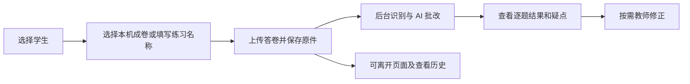

# ADR-0007：学生答卷与后台 AI 批改

状态：已采纳，2026-10-21，依据用户明确提出流程并确认实施。实现与实测证据见独立验证记录。

## 决策与范围

第一版提供学生基础信息、答卷原件、后台 LLM 批改、结果历史与可选教师修正。
这项决策取代同日调研稿中“首版暂不接入 AI 批改”的建议，保留原件、结果与学情判断分离的原则。
不建设班级、学生账号、掌握度雷达、成绩预测或自动同步组卷学情。

学生基础信息为姓名／昵称、可选年级和简短备注。答卷记录保存练习名称、可选作答日期和备注；
实际作答日期未知时留空，上传时间独立记录。已有组卷学生关联不自动变成批改或诊断请求。

选择本机已确认成卷时绑定不可变快照，沿用题位和小问身份。外部练习不要求先导入题库，
只保存在个人数据域。2026-10-21 用户补充决策：外部原试卷为选填，用户只上传答卷即可保存并发起批改，不要求额外勾选完整性声明。
模型从实际答卷材料识别题干与作答；可判断的题正常给出结果，缺少必要题干、图表或判断依据的题保留“暂无法判断”及具体原因。
只有练习名称不构成批改依据，也不据此补造题目；补充原卷可以改善题号与题干对照，不能以模型自报完整代替实际来源引用。

## 原件、模型结果与修正

原件先落盘并保存内容哈希，任务失败、取消、中断仍保留。识别与模型请求在后台执行，不占用
组卷全局操作锁；读取、返回页面或重启应用不自动调用服务。中断后由用户显式重试。

使用本机当前模型配置，密钥仅 Rust 读取；所需识别沿用独立 PaddleOCR 配置。
发起前明确说明答卷材料会发送到配置的服务，应用不额外发送学生姓名、年级、昵称和自由备注。
原图本身可能含姓名，不承诺图像自动去标识。文档内容均视为材料，不执行材料中的指令。

优先使用真实参考答案、解析和既有赋分标准。模型可依据完整题面判断，但不得用一份虚构的
“原卷答案”包装自身推导。看不清、无法定位对应题、条件缺失或依据不足时保留无法判断及原因。
模型置信度不等于正确率，不用一个错题直接推断知识点未掌握。

逐题结果区分正确、部分正确、错误、未作答和暂无法判断；未识别不等于未作答。
得分仅在有明确计分上限时保存，无计分练习的 0 分配置不当作真实满分。
存在未判或部分结果时不显示误导的完整总分；可以显示已判部分的分数并明确范围。
本机题位／小问必须校验身份、覆盖和重复，不能接受模型自造题号冒充完整批改。

保留模型原始结果、模型及请求依据、批改时间、输入快照和脱敏审计；教师可修改当前展示结果，
但另存修正，不覆写初始模型结果。无需逐题确认即可查看、使用 AI 建议；不标成“教师已审核”。

## 数据与失败边界

学生和答卷元数据保存在 `personal.sqlite`，原件位于独立受限附件目录。文件读取校验归属、
路径边界、类型、大小及内容哈希，不接受前端传任意本机路径。备份需要数据库和实际附件。
保存采用操作身份和幂等处理，修正采用修订检查。取消与重试不能让旧工作线程覆盖新结果。
已有题库、不可变成卷与旧网页个人记录保持原样。

隔离回归应覆盖保存后立即离开、后台完成、无模型配置、文件损坏、无法辨认、输出校验、
失败重试、取消、退出恢复、重复操作、版本冲突和教师修正保留 AI 原结果。
模拟服务回归仅证明系统行为；真实手写识别与数学评分质量需真实样本独立核验，不据此宣称已验证。
