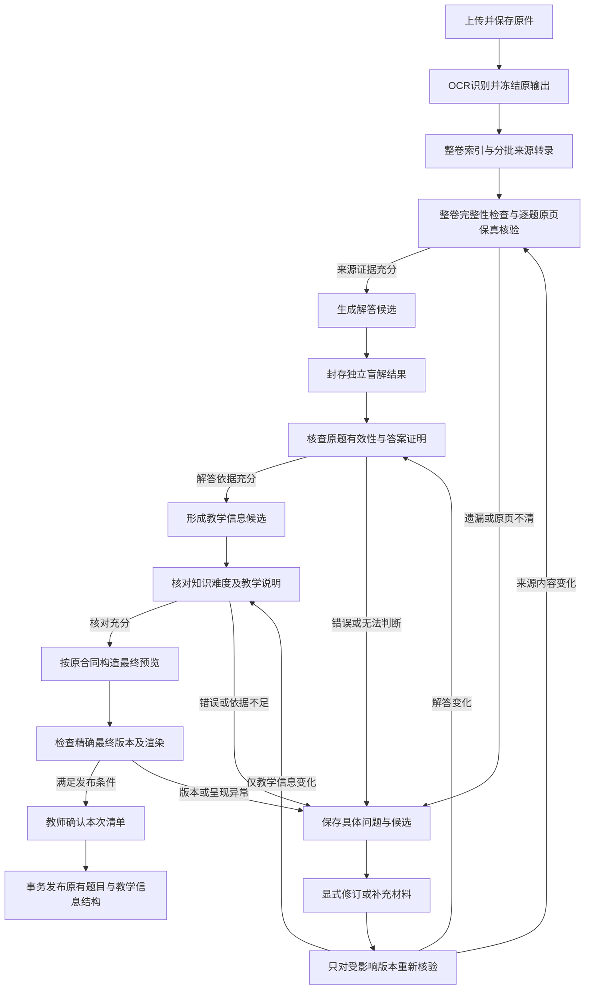
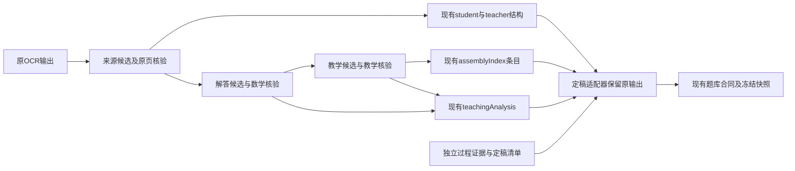

# 试卷导入准确性优先重设计

- 日期：2026-11-02。
- 状态：已采纳的初始实施设计，2026-11-02；用户已同意 D1/D2/D3。本工作区已接入初始实现，隔离工程回归中；未执行真实模型试点。
- 决策入口：[ADR-0010](../adr/0010-import-accuracy-first.md)。
- 2026-11-03 后续决定：[ADR-0011](../adr/0011-two-model-import.md) 将新上传的逐题后处理六次合并为处理、统一复核两次，普通设置只需两个模型，取消额外独立盲解。下文阶段、调用数及盲解方案保留为旧六步策略的实施记录；旧运行按冻结策略继续，不能将这些数值当作新两模型策略的调用量或质量证据。
- 范围：PDF／DOCX 普通试卷上传至最终题目内容和题目教学信息。TXT／Markdown 复用后半段流程，如无原图，明确核对材料的限制。
- 修订：已处理 [GLM5.3 / Gemini 复审意见](../review/import-accuracy-first-design-review-2026-11-02.md)，三项决策随后获用户同意；“两端固定、中间可变”是本设计的架构原则。

## 1. 目标与固定边界

第一目标是最终实际交付字段的准确、完整及有依据；第二目标才是在该质量边界内减少等待和教师工作量、提高入库率。允许一张卷只有少量题完成；其余题保留原件、候选、具体问题和断点。把某题挡住不等于系统正确，放行也不等于答案已被独立证实，二者都要另行评测。

用户要求冻结三份合同，新增层级只存在于中间数据和读取视图：

| 冻结对象 | 保持不变的结构与语义 | 当前实现入口 |
| --- | --- | --- |
| OCR 输出 | `OcrDocument{pages,assets,issues}`；既有页、块、坐标、原页图、素材角色及哈希不改 | `desktop/src-tauri/src/ocr.rs:36,878` |
| 最终题目内容 | 原 `question` 根、`student{stem,options,parts,assets}`、`teacher{answers,solutions,assets,scoringSuggestions,missingReferenceAnswer,missingReferenceSolution}`、来源及双版本/哈希；来源类型附加字段照旧 | `desktop/src-tauri/src/imports.rs:1965-1997,2095-2129` |
| 最终教学信息 | 原 `assemblyIndex.entries[]` 的任务、主考 UID、教材投影、逐解法依赖、难度及依据；原 `teachingAnalysis`、`teachingFocus` 和版本结构 | `desktop/src-tauri/src/imports.rs:2130-2163`；`imports/teaching.rs:1453-1496` |

`questionType` 仍是四类；难度仍是五档加 `null` 未评估，口径仍为 `content-demand-v1`；`knowledgeSchemaVersion:2`、`teachingFocusSchemaVersion:2` 不改。`teachingFocus` 仍只有 `examFocus` 与 `studentRequirements`。知识名称继续由真实 UID 目录解析，不新增重复名称字段。

原题、原参考与 AI 新解答仍分别保存；原卷没有答案解析时对应原字段保持空白。生成稿不继承原文审核身份。学生内容与教师资料、题库与个人数据继续隔离。

冻结范围包含已有可选审计字段及其历史含义，不能借“清理层级”删除、重命名或重新计算旧记录。现有必需的 `verification`、`provenance`、版本绑定仍按原合同写入；新增完整核验细节留在伴随过程记录。新读取视图可以分层呈现，不改变存储合同。

### 1.1 两端固定，中间可持续调整

两端分别是原 OCR 输出合同，以及最终题目内容和教学信息组成的落地合同。本文的阶段划分、候选实体、任务角色数量、提示词、批次和预算参数属于初始处理策略，可以演进，不要求每次策略调整都同步修改两端或教师阅读界面。

| 部分 | 稳定要求 | 演进方式 |
| --- | --- | --- |
| OCR 输入端 | 字段、布局/素材语义、身份与哈希保持 | 策略只读引用，不覆盖或改造成另一种 OCR 结果 |
| 中间处理 | 保持准确性、版本可追溯、权限与费用边界 | 可以拆合阶段、调整核验方法与过程 schema；保存不可变策略快照，在隔离材料上验证 |
| 最终落地端 | 原题目内容/教学信息字段、枚举、含义、哈希及读取兼容 | 各策略通过自己的适配器生成同一合同，发布仍核对实际交付字段 |

阶段数量和模型调用次数不构成准确性证明，也不被写成永久产品约束。可以用更有效的中间策略替换当前实现；核验覆盖与可用证据必须保持真实，不能省去检查后沿用旧“已核验”含义。声称独立盲解的策略仍必须落实实际输入隔离。

每个运行记录 `pipelineVersion`（执行引擎/过程协议）和独立 `strategyVersion/strategySha256`（实际处理政策），并引用 `ProcessingStrategy`。策略快照冻结阶段图、任务角色与已保存配置的实际绑定、提示词/过程 schema、核验和组合规则、目录及预算引用。端合同身份也作为过程引用保存，不给最终题目新增版本字段。

单次运行内策略不变；恢复使用原策略和已用额度。新策略通过新运行/明确修订启用，记录 `previousRunRef` 与可验证的复用引用；原件和有效 OCR 无需重做，旧候选/报告只有输入和适用条件仍满足时才可复用，不冒充在新策略下重验。已发布题、旧审核及冻结成卷不自动改变。

策略可以预先定义有界条件分支，按材料、已有有效证据和实际核验结果选择不同执行路径，并保存实际阶段/调用；这不等于运行中偷偷更换规则。并非每道题必须运行同样数量的模型请求，但实际交付字段仍需满足该策略声明的核验覆盖。

已采纳范围内的常规策略优化可直接版本化实施与验证，不为每次参数优化重复走产品确认。突破两端合同、已确认质量/权限/隐私边界或已授权费用上限，仍应明确处理范围变化；不得利用新策略 ID 重置旧运行或费用。中间 schema 升级保留其旧记录读取/重放能力，不要求永远沿用某份中间字段清单。

## 2. 当前需要解决的具体问题

以下是源码能确认的边界，并非对全库实际准确率的结论：

| 当前机制 | 仍然缺少什么 |
| --- | --- |
| 来源模型同次返回转录和检查意见（`imports/review.rs:473-505`） | 同次自评不能成为独立的原页保真核验 |
| 整卷来源覆盖与素材检查（`imports/source_batches.rs:742-744`） | 程序检查完整性，不验证全部原文语义或数学正确性 |
| 教学稿零命中、无疑点可成为候选；命中后一次复核 | 零命中不能证明答案、证明和教学说明准确；修复动作也不是新版本核验 |
| 同一导入题对象含题面、原参考、标签、审核与工作流（`imports.rs:627-758`） | 候选、事实和处理结论容易被当成同一份最终题目 |
| 教学稿发布可更新原难度（`imports/teaching.rs:1492-1496`） | 最终教学信息需要明确选择的版本，不能由最后执行的写入步骤隐式决定 |

不通过继续堆叠术语、格式规则承担数学判断。规则继续负责身份、结构、边界、素材、计数与实际渲染；LLM 和教师负责语义核对，实际独立审阅负责评测其效果。

## 3. 新流程



图中回到核验表示依赖失效后的重新处理入口，不是自动循环；是否调用模型取决于新操作的明确范围和预算。没有明确修订操作时停留待处理。

| 阶段 | 输入与产物 | 质量职责 |
| --- | --- | --- |
| 1. 接收原件 | 保存原文件、身份和哈希；DOCX 复用现有可靠 PDF 转换 | 配置、归属和原件持久化；失败不丢文件 |
| 2. OCR | 原样保存现有 OCR、manifest、原页图和素材 | 识别结构保持不变；不因下游出错反复 OCR |
| 3. 来源整理 | 沿现有整卷索引、3 个常驻 worker、短题最多 3 题/批或单道解答题转录 | 只转录真实来源，不求解、不填教学标签；原来源每轮 120 秒预算保持 |
| 4. 来源核验 | 完整性检查加单独执行的原页核对，形成 `source_fidelity` 报告 | 核题干条件、选项、小问、公式、图表、跨页、原参考存在性和素材归属 |
| 5. 解答准备 | 对已核实题面生成 `SolutionDraft`，另行生成并封存 `IndependentSolve` | 形成可被检查的答案和完整推导；生成自检只记辅助信号 |
| 6. 数学核验 | 看原题、候选、已封存独立解及原参考，形成 `math_and_reference` 报告 | 核答案、每个小问、证明闭环、适用条件、特殊值、分类端点；单列原题与原参考缺陷 |
| 7. 教学信息形成 | 使用固定题面、已核验解答和真实目录，形成 `TeachingDraft` | 给出主考 UID、任务、路径依赖、难度与依据、考点及学生要求；可并行形成这些候选字段 |
| 8. 教学核验 | 单独核对教学候选与固定题面/解法/目录 | 知识主次、逐路径依赖、难度依据、考查任务和学生要求分别有依据 |
| 9. 定稿与确认 | 指定来源候选、解答候选、教学候选及有效报告；构造原有发布载荷并预览 | 校验最终字段与已核验内容一致，查看真实公式、表格、图片和学生/教师隔离；教师可批量确认 |
| 10. 原子发布 | 同事务写既有 `bank_questions`、组卷索引、映射及发布回执 | 重新核验精确版本、权限、重复、素材和定稿清单，不在发布事务中外呼 |

整卷来源完整性仍是进入常规下游的前提；来源半成品不能冒充完整卷。完整性通过后，各题核验可以分别推进，一题未决不要求重跑其他已合格题。整卷失败保留成功批次，已具备逐题证据不能外推未核题。

### 来源核验与原题有效性分别表达

- 来源核验以原页图为证据，OCR 主要用于导航与匹配，不能只比较 OCR 与转录后声称已对原卷。
- 中间记录分别保存 `answer`、`solution` 的 `referencePresence: present | absent | uncertain`。确认 `absent` 可以正常保留原字段空白；`uncertain` 不能伪装为“原卷没有”。
- 忠实转录的原卷错题、歧义或错误答案归为来源本身问题，不能自动改题，也不能归为 OCR 错误。
- 若原参考已发现实质错误，常规合格发布继续阻断；教师可按现有明确修订机制形成新候选、保留原文及差异，然后重新核验。不得把已知错误原参考无提示地输出到教师卷。

### 独立求解必须落实到实际输入

`IndependentSolve` 的请求仅包含已核实学生正文和真实学生素材，不包含原答案、原解析、生成解答、难度结论或生成模型的自检意见。收到完整结果后先保存，再发起比较/核验请求，不能在一条请求里要求“先独立想再阅读候选”并声称盲解。

请求使用独立、无共享历史的上下文。系统提示、文件名、附件说明、替代文本及模型可用工具同样属于可见输入；只发送本机生成的不泄露答案的标识和用途说明，不开放读取原参考的工具。`inputVisibility` 及执行审计绑定最终实际发送的完整请求和素材清单，验收从发送路径核查，不能只检查未被实际使用的视图函数。

含答案的整页图不进入盲解输入。无法可靠分离的材料标明限制，停留未核；不能用伪造裁图、隐藏 HTML 或提示词要求忽略答案代替隔离。来源核验可看完整原页，盲解、教学核对使用不同的只读输入视图，OCR 原结构不改。

不同执行降低相互抄写的风险，使用不同模型可降低部分相关错误，但两模型一致也不能证明数学正确。比较时须核查实际等价性与关键推理，分歧不能自动判生成稿错误，也不采用多数投票。若同一模型承担两个角色，记录这一事实，不能宣传为异构独立验证。

### 素材披露证据与分歧定位

在中间输入视图中为实际发送的素材保存 `disclosure: student_original | reference_only | mixed_or_uncertain`，不向 OCR、原 `sourceMaterialRoles` 或最终素材字段新增枚举。核对证据至少绑定素材 ID/哈希、原页图哈希、页码、真实区域和坐标变换、原题/原参考上下文块及核验报告。这个标记表达来源与披露程度，不能仅根据“有没有辅助线”判断。

原题本来给出的辅助线、虚线、坐标和标记都是学生材料，应原样保留。解答区后来添加的构造不能混作原题图；无法从原页证实归属时记录 `visual_cues_unverified`，不能声称盲解输入隔离成立。禁止为制造“纯题图”擦线、重画、猜测裁切或修改 OCR；只允许有真实区域证据的原学生图像视图。

数学核验本身包含有界的分歧诊断，不在每次分歧后自动增加第三次求解或投票。`VerificationReport` 可附 `disagreements[]`：

- `partId/claimA/claimB/stepA/stepB`：定位候选与独立解不同的结论或步骤，无法可靠定位的步骤留空并说明。
- `classification`：`equivalent`、`candidate_defect`、`independent_defect`、`both_defective`、`source_problem`、`unresolved`。
- `evidenceRefs/basis`：等价变换、具体计算、反例、缺失条件或证明缺口；只说“两答案不同”不足以确定错因。
- `affectedFields`：需要教师或修订操作处理的准确字段/小问。

该请求可以检查 A/B 各自的关键步骤，不要求第三种解法。结论未定、证据不足或核验本身失败时保留对应状态；具体分歧在正文问题处可展开对照，避免教师从两篇长解中自行找差别。产生修复候选仍需显式操作和一次有界额度，核验模型不能直接写稿。比较结果为等价也不豁免对证明缺口的检查。

### 教学信息的核对标准

| 最终字段 | 核对内容 |
| --- | --- |
| `primaryKnowledgeUids` | 引用真实叶知识点；与题目主要考查任务相符，不能把辅助知识全部标成主考 |
| `tasks`、`teachingFocus.examFocus` | 实际要求学生完成的数学任务，正式任务身份及目录约束保持 |
| `solutionPaths[].requiredKnowledgeUids/requiredPremises/basis` | 每条路径分别覆盖整题及全部小问，依赖与该路径实际方法对应；只标已取得有效数学核验的路径。新增替代解法先作为解答候选核验，不能仅因属于教学标注而跳过数学检查 |
| `difficultyLevel/difficultyBasis` | 依现有五档口径，与真实思维关口、计算和证明负担一致；依据不能只复述“综合性强” |
| `teachingFocus.studentRequirements` | 可观察、具体且与本题相符，不表达某个学生已掌握 |
| 能力、素养等可选信息 | 只核对实际交付字段，不增加普通组卷的必填前提 |

难度和部分教学判断具有内容估计性质。这里评估的是依据、口径和任务的一致性，不把“已核对”升级为实测难度、预测得分率或真实教学效果。无法支持的字段沿现有 `null`、空数组或缺省表达未知，不新增最终枚举。

## 4. 中间数据结构

所有以下名称和枚举均为已采纳方案的初始中间设计，尚非现有应用字段。它们可以随过程 schema/策略版本调整，在过程库/受限附件中独立保存，只由定稿适配器生成原有最终载荷。

| 实体 | 主要字段 | 生命周期与职责 |
| --- | --- | --- |
| `ImportRun` | `id,pipelineVersion,strategyVersion,strategySha256,strategyRef,previousRunRef,sourceRef,ocrRef,indexRef,questionLedgerRef,modelRoleSnapshot,operationBudget,stageRuns` | 整次导入、调用范围与断点，固定实际策略；不携带最终题目副本作为状态真值 |
| `ProcessingStrategy` | `id,version,sha256,inputContractRefs,outputContractRefs,stageGraph,roleBindings,promptRefs,processSchemaRefs,verificationRulesRef,compositionRulesRef,budgetPolicyRef` | 不可变的中间策略快照；与两端合同分别版本化，名称和具体过程字段允许演进 |
| `SourceCandidate` | `id,questionIdentity,revision,content,sourceRefs,fieldAnchors,referencePresence,sha256` | 来源转录候选；`content` 使用现有题面/原参考字段形态，定位信息独立保存 |
| `SolutionDraft` | `id,sourceCandidateRef,inputViewRef,materialVisibility,answer,solution,partCoverage,executionRef,sha256` | 生成解答候选；可以参考原参考但须由实际请求证明可见材料，不修改原参考 |
| `IndependentSolve` | `id,sourceCandidateRef,inputViewRef,inputVisibility,answer,reasoning,partCoverage,limitations,sha256` | 实际隔离输入下的求解结果，先封存再参与比较 |
| `TeachingDraft` | `id,sourceCandidateRef,solutionDraftRef,catalogueRef,annotation,metadataResponseRef,compositionRef,sha256` | 模型只返回教学字段；严格七字段由受限组合器使用已核验解答与真实元数据响应产生，不让模型复读数学稿 |
| `CompositionRecord` | `id,baseSolutionRef,teachingExecutionRef,catalogueRef,compositionVersion,fieldSources,composedCandidateSha256` | 保存确定性组合规则与每字段真实来源；不充当原模型响应 |
| `VerificationReport` | `id,kind,subjectRefs,coverage,checks,findings,conclusion,executionRef,sha256` | 只记录对具体版本的核验；不负责改稿或写题库 |
| `FindingResolution` | `id,findingRef,beforeRefs,afterRefs,action,actor,basis,recheckRefs,sha256` | 指定问题怎样处理；修订、确认原参考错误、补材料或保留未决分别记录 |
| `FinalizationManifest` | `id,questionIdentity,selectedRefs,reportRefs,publicationScope,unknownFields,excludedArtifactRefs,finalPayloadSha256,annotationSha256,confirmedBy,confirmedAt` | 冻结本次实际交付与确认范围；是过程发布凭据，不向题目结构增加字段 |

公共元信息为 `schemaVersion/importId/operationId/createdAt`；模型执行另存脱敏后的实际请求与响应、角色配置、完整性、费用和错误。标识及哈希由程序产生，不让模型抄写或补造。

`materialVisibility` 是中间合同：`student_only | student_and_original_reference | student_and_legacy_reference | student_and_both_references`。它同时绑定原参考/旧参考各自实际可见的答案、解析及素材引用；盲解只准 `student_only`。枚举不能代替实际发送请求校验，文件名、系统提示和附件清单也参与输入指纹。

### 目录快照

`TeachingDraft.catalogueRef` 指向不可变 `CatalogueSnapshot`，不是回查最新题库的活引用。快照保存 `id/schemaVersion/revision/sha256/createdAt`、来源配置指纹、当次完整可信校验目录和实际精简模型视图的独立哈希。具体保留：

- 知识 `uid/name/parentUid/isLeaf/sectionIds`、完整父子关系、现有定义/版本及实际存在的学科、教材、课标、年级上下文；不能因删掉子节点而把父节点误当叶节点。
- 教材章节层级与 UID 投影、别名及 canonical 规则版本；任务 `id/label/questionType/sectionIds` 及实际校验需要的 `partIds/partWeights`；工具前提名称、定义及版本。
- `content-demand-v1` 当次完整 rubric 及哈希、输入视图和身份/叶节点/教材投影校验版本。

教学生成、教学核验与组合使用同一快照。发布前比对所有实际引用实体的身份、定义和投影；发生变化使相关结论失效，不用最新目录静默补齐旧字段。个人域可凭快照重放已保存结论，题库未来服务化不需要读取个人过程材料。

### 持久化归属

中间过程沿用本机导入数据域，拟在现有 `personal.sqlite` 增量增加独立的 `import_process_artifacts`、`import_process_executions`、`import_finalizations` 记录，正文/图片大文件沿用受限导入附件目录。候选、报告与处置以 `kind` 和版本化合同区分，按导入、题目和输入引用建立索引；核验结论不能从原始日志临时猜算。现有 `imports` 记录仍作为旧任务兼容入口，不将新增所有对象再塞回同一个 `questions[]`。

`question-bank.sqlite` 仍只保存原题库合同、映射及现有发布回执。两库不宣称具有跨连接原子事务：先冻结个人域定稿清单及 pending 发布操作，再在题库事务内写成果和幂等回执，最后登记个人域完成。题库已提交而完成登记中断时按原操作/载荷哈希查询回执恢复，不能再调用模型、重复插题或自动删除已提交结果。题库普通读取不依赖个人过程库；来源审计按权限由导入域查看。

### 过程材料保留与归档

发布凭据与开发者诊断日志分别管理，不能套用日志淘汰策略：

| 材料 | 初始保留策略 |
| --- | --- |
| 已发布定稿依赖的原件、OCR/素材、目录快照、候选、真实请求响应、核验和确认链 | 长期保留；归档可以迁移到本机受限附件，但不截断、不破坏引用。题库普通读取独立，过程审计需要时仍按原哈希恢复 |
| 未发布但仍用于继续/修订/待核的最后有效候选与必要执行链 | 任务存在期间保留；超过容量停止新工作并提示归档/显式删除，不自动破坏恢复能力 |
| 未被任何定稿或活动候选引用的失败响应、废弃候选 | 初始参数为 30 天后列为可清理；新过程附件每个导入目录 2 GiB、全部过程附件 10 GiB 为容量上限，到限暂停新写入并提示显式归档/调整容量；参数可演进，运行中及引用中对象不可自动删 |
| 普通性能/开发者诊断 | 沿用已有白名单、脱敏及保留上限，不作为发布核验依据 |

清理前计算引用闭包，保留清理时间、操作者、范围和摘要凭据。删除/丢失原始响应后只能展示“材料已删除/不可完整重放”，不得仍称审计完整；如清理使未发布任务无法验证，继续入口明确阻断。对已有本机材料不自动执行此策略。

### 核验报告示意

```typescript
type Ref = { id: string; revision: number; sha256: string };
type ExecutionStatus =
  | 'queued' | 'running' | 'completed' | 'failed' | 'cancelled' | 'interrupted';
type CheckConclusion = 'no_issue_found' | 'issue_found' | 'unresolved';

type VerificationReport = {
  id: string;
  kind: 'source_fidelity' | 'math_and_reference' | 'teaching_information' | 'rendering';
  subjectRefs: Record<string, Ref>; // 按 kind 的版本化合同验证必需引用
  coverage: Array<{
    domain: 'source' | 'generated_solution' | 'original_reference' | 'teaching_information' | 'rendering';
    partId: string | null;
    fieldPath: string;
    state: 'checked' | 'not_checked' | 'not_applicable';
    basis: string;
  }>;
  checks: Array<{ target: string; conclusion: CheckConclusion; basis: string }>;
  findings: Array<{
    id: string;
    category: 'transcription_error' | 'source_defect' | 'solution_error'
      | 'annotation_error' | 'rendering_error' | 'unresolved';
    target: { domain: string; partId: string | null; fieldPath: string; step?: string };
    observed: string;
    expected?: string; // 无可靠依据时不得编造正确值
    evidenceRefs: Array<{ artifactRef: Ref; page?: number; blockId?: string; assetId?: string; quote?: string }>;
    basis: string;
    severity: 'blocking' | 'advisory';
  }>;
  conclusion: CheckConclusion;
  executionRef: string;
  sha256: string;
};
```

实际存储时每项报告按 `kind` 要求明确的来源、候选和目录引用，不接收模型自由选择的哈希或归属。技术失败写 `ExecutionStatus` 与错误；不生成“已完成且未发现问题”的报告，也不自动归为数学错题。

`no_issue_found` 只说明该执行在声明覆盖范围内未发现问题。不能通过空 `coverage`、漏掉小问或把困难字段全部设为 `not_applicable` 获得定稿资格；程序检查覆盖身份，语义核对由模型或教师给出具体依据。人工核验仍保存实际身份，模型记录不能写成教师审核。

模型不能凭 `severity:advisory` 解除实质错误的阻断。题干/素材错误、错误答案或证明、失真的教学标注默认阻断；模型返回的类别、结论、覆盖范围和疑点须通过 Rust 一致性校验，不能同时声明未发现问题又保留未解决实质错误。提醒性信息只有经绑定当前版本的显式核对、证明不影响实际交付字段准确性后才能保留为 advisory；降级不等于修复，真实错误必须产生新候选及有效复验。

### 依赖失效

| 发生的变化 | 必须重新取得有效结论 |
| --- | --- |
| 原件/OCR/整卷索引身份变化 | 来源候选及下游全部失效；不修改旧结果 |
| 题干、题型、选项、小问、必要图表变化 | 来源核验、解答、盲解、数学核验、教学信息及预览失效 |
| 仅原参考变化 | 对应原参考保真、数学比较和用过该参考的生成结果失效；精确输入证明未使用参考的盲解可保留 |
| 生成答案或解析变化 | 新版本须数学核验，依赖它的教学信息核验失效；原独立盲解可按精确输入引用保留 |
| 仅难度、主考、任务或要求变化 | 对应教学信息核验和最终载荷预览失效；题面和独立解不重算 |
| 仅样式/显示修复且字符内容变化 | 作为新候选；可复用其他有效证据，但受影响字段须重新核对，不能以排版名义跳过数学含义变化 |
| 目录版本变化 | 检查所引用知识/任务身份与定义变化；不能静默换 UID 或补全依赖 |

依赖判断来自保存的精确输入引用，不凭“看起来无关”跨版本复用。已有合格候选只因输入失效或明确新问题进入待处理，不为了提高新流程统计覆盖率全部重跑。

## 5. 定稿与发布门槛

正常完整成果发布前，Rust 逐题检查：

1. 整卷来源完整性、题目来源保真、全部实际发布原参考的核对证据有效；必要材料未缺失。
2. 准备交付的答案与解析完成数学核验，所有小问和关键论证有覆盖；原题/原参考实质疑点已解决。
3. 实际交付的主考、路径、难度及教学说明已核对；最终字段来自显式选择的同版本候选。
4. 所有相关阻断问题和无法判断项均已处理；模型自评、结构成功或句段已修改不能代替有效复验。
5. 原最终结构、内容哈希、版本、目录、图片与引用合法；真实最终预览显示公式、图表和小问完整，学生版隔离正确。
6. 定稿清单绑定发布载荷的精确哈希，教师确认后未再变化，事务发布重新检查；发生变化保留输入并要求重新确认。

教师可以批量确认全部满足条件的题，不强制逐题重复勾选。保存修订、核验完成、确认定稿和写入题库仍是不同动作。

自评置信档不参与新定稿资格。教师可对模型未判或分歧实施真实核对，以绑定当前版本的具体推导/原页证据形成有效人工报告，替代尚未取得的对应模型结论；不要求教师必须让模型先同意。点击确认、无依据地降低严重性、只写“我确认”不等于完成实质核对。

### 缺项与问题不得混同

| 情况 | 本方案处理 |
| --- | --- |
| 已核实原卷无答案/解析 | 原参考为空是合法事实；若生成解可靠，可发布独立 AI 教学稿，不把它放入原参考 |
| 某项可选教学信息无法可靠估计 | 使用原合同允许的未知值，记录 `unknownFields`，界面显示未评估/未标注；不得称“教学信息完整” |
| 已发现某字段错误 | 保留问题与错误候选，不能自动清空字段后将整题计为完整合格 |
| 主考/解法依据不足 | 不补造 UID 或路径；保留未知及其原因，不以章节标签伪造完整依赖 |
| 原题可靠但 AI 稿待核 | 保持待处理是默认；沿用的人工“仅原题”发布入口需显式说明排除哪些稿件和未知项，不能计为完整内容+教学信息合格 |
| 一道题或某小问未判 | 不用其他已判结果外推；根据预期交付范围继续待处理 |
| 模型检查和人工具体证据冲突 | 保存双方记录，问题未解决前阻断相应成果，不能把人工发布按钮当作清除实质问题的通用开关 |

旧管线和旧记录的“仅原题”人工权限按原规则保留。新管线采用下述门槛，ADR-0010 的 D2 已由用户明确同意；不是从准确性目标自行推断的权限变化。新增主流程不会通过剥离待核教学稿、隐藏未知或将缺解法改成章节标签来美化合格率。

新策略中的 `source_only` 也必须具备来源保真、题干有效性、全部实际交付原答案/原解析的数学核对、渲染和精确版本校验。现有 scope 的实际含义是“未采用独立 AI 教学稿”，不是“不发布任何教学标注”：`imports.rs:2130-2154` 仍可能输出主考、路径与难度。新定稿必须逐字段检查实际交付清单，`source_only` 只能豁免确实不交付的内容，不能按名称豁免已经输出的教学字段。

题面已核实但尚不能判断是否自洽，或原参考仍有实质错误时，不能只点“仅原题”绕过；教师有证据时可独立完成上述实质核对，或按已有明确修订机制形成新候选后复验。历史发布含义不追认为满足新门槛。ADR-0002 的成卷确认权继续保留，该条并非入库任意内容的通用豁免。

## 6. 最终投影仍使用原结构



### D3：程序锁定数学内容，模型只返回教学字段

D3 已采纳，初始实现采用 metadata-only 的真实受限变换。请求可阅读已核验的答案解析以形成教学说明，但返回合同只允许知识/任务/路径标注、`difficultyAssessment`、`teachingFocusSchemaVersion`、`teachingFocus` 和新疑点；禁止返回 `answer/teachingSolution`。请求使用程序提供的短身份，完整版本引用保留本机。返回未知字段或试图修改锁定数学内容时拒绝，不做模糊 LaTeX 等价替换。

Rust 按固定 `compositionVersion` 从真实解答候选逐字取 `answer/solution`，从实际教学响应取获准字段，构成严格七字段：`questionId/answer/difficultyAssessment/teachingSolution/teachingFocusSchemaVersion/teachingFocus/issues`。数学已有疑点不被元数据响应清空，未解决阻断仍阻止定稿。最终继续用原 `teaching::validate` 检查字段集合，但程序组装对象标明为派生候选，不能伪装成模型原始完整响应。

过程 `CompositionRecord` 保存 `baseSolutionRef/teachingExecutionRef/catalogueRef/compositionVersion/fieldSources/composedCandidateSha256`；`fieldSources` 对每个七字段及每个实际采用的标注列出真实执行/原候选引用。`sourceCandidate` 保持“采用的完整候选”含义，允许为真实受限变换重放结果；原响应另存，不将自动组合伪装为 `manualPatchHistory` 中的教师修改。

最终 `teachingAnalysis.model/promptSha256/requestSha256` 指向最后实际执行的教学受限变换，与现有“生成/复核的实际处理来源”含义一致，不能填虚构合成请求或拼接模型名称。数学稿原生成模型、教学整理模型、核验模型分别在过程记录中说明；界面将该单值称为模型处理来源，不能宣称它独自生成整份解析。题库无个人过程材料时也不猜测全部贡献者。当前受限组合已通过隔离字段、真实本机 HTTP 审计和发布重放回归；后续改版若无法保持这些原含义，须停止采用该候选，不能用兼容声明掩盖溯源变化。

现有 `teaching::verify_audit` 继续按旧工作流重放旧响应。新 `verify_finalization` 从真实解答响应、真实元数据响应、固定组合规则、有效核验和真实人工修改链重放同一个完整候选，再验证原七字段和最终哈希；不能仅凭 `verify_analysis` 的结构/自身哈希检查证明溯源。`reviewDispositions` 与候选变化的绑定照旧失效，不伪造旧 `teachingWorkflow` 或旧补丁响应。复用最终结构、哈希算法和事务约束，新过程审计另有兼容与失败回归。

实际七字段复读方案保留为后续小范围对照，届时单独记录其锁定文本漂移拒绝率、metadata-only 的越权/格式失败率、token 和耗时。二者都属于协议/传输质量，不混计为数学错误。当前程序组合已通过隔离工程兼容回归，尚未执行真实服务对照或原卷准确性试点。

`difficultyAssessment` 在该候选内仍只有 `level/basis`；导入持久化难度仍按现有合同附 `rubricVersion`。`solutionPaths` 仍存解法与知识依赖，数学核验报告不塞进 `basis`。

`teacher` 只从已选来源候选产生；AI 解答仍进入独立 `teachingAnalysis`。教学标注只从已选 `TeachingDraft` 产生；取消“最后写入步骤决定难度”的新任务隐式行为，教师已明确保存的修改优先，修改后也按精确版本核验。

现有 `verification.method` 只表达真实发布审核身份，不能为新增模型核验编造 `teacher_review` 或代理核验身份。完整核验记录由发布回执关联 `FinalizationManifest` 查询，不新增最终题目/教学信息字段。旧嵌入审计仍按原义保留。

## 7. 执行、调用与成本边界

调用政策已由用户采纳并在本工作区初始实现。新任务使用明确的 `pipelineVersion` 与 `strategyVersion`，旧任务沿旧政策；禁止给旧自评补发“独立核验完成”标签。下列分工和数值区分已接入的单题执行与后续合批规划，可在既定授权范围内版本化调整，具体运行冻结实际计划；工程实现不代表已完成真实准确性试点。

- 来源整理的索引、转录批次、worker 和每轮 120 秒截止保持；新增核验有独立且可见的预算，不把原来源工作改名来延长旧预算。
- 来源核验、解答生成、盲解、数学核验、教学生成、教学核验为不同任务角色。可显式绑定同一套命名配置，也可不同；本设计不强制厂商/型号，不新增静态模型白名单，不在执行前取模型列表。
- 新角色与预算须在设置/启动前明确保存，缺配置提示对应用途。不能回退通用配置、偷偷继承密钥、猜测图像能力或改变思考参数。当前 Qwen 验证按用户约定使用阿里云百炼。
- 一次已授权导入可以按预先声明计划自动执行核验；这些调用必须有执行前落盘的计划和计数。没有问题也需要覆盖拟发布版本的核验，D1 已明确采纳，不再重复请求该原则的确认。
- 核验请求只报告结论与证据，不承担写稿。发现实质问题后默认停止该题；教师显式选择修订/补材料，新操作限定一次修订及必要复验，失败继续待处理，不自动迭代到通过。
- 技术失败、中断、未知分别显示，显式继续复用已成功结果；已发起但结果缺失不能偷偷重新花费。修订次数、核验次数和旧额度分开保留，不能重置。
- 接受原件后立即返回持久后台任务，不占组卷全局锁；退出、取消、离开页面保留原件和进度。重启、阅读和预览不发模型请求。
- 所有实际模型请求脱敏，附件路径、所有权及哈希按原边界校验；不记录密钥、不主动带入学生资料。

调用数量、耗时和费用会增加；收益必须用准确性评测证明。应先在隔离新任务验证输入视图和证据链，再决定批量大小与并行度，不通过扩大超时、删掉核验或放宽门槛追求表面完成率。

### 7.1 任务角色与设置用途的映射

业务任务可以拆分，设置页仍统一维护用途和命名配置；下表是已接入初始策略的用途映射，不平行增加两套含义重叠的用途分区，后续可随策略版本调整。`ImportRoles` 已兼容旧三键并支持四个新增可选键；新用途缺项明确提示未配置，旧客户端仅保存三键时保留既有新增绑定，显式 null 才清除对应用途，读取不自动迁移写盘。

| 设置用途 | 保存键 | 旧任务 | 新任务 |
| --- | --- | --- | --- |
| 拆题 | 原 `sourceParsing` | 原索引与转录 | 原索引与转录，不承担新增保真核验 |
| 解析生成 | 原 `teachingGeneration` | 原课堂稿生成 | 解答生成与教学字段生成，两者复用该显式配置及思考覆盖，不自动修改强度 |
| 解析复核 | 原 `teachingReview` | 原问题命中后复核 | 仅用于用户显式发起的一次修订；不自动成为下列核验用途 |
| 来源核验 | 新 `sourceVerification` | 不使用 | 原页保真核验；须已确认图像能力 |
| 独立求解 | 新 `independentSolve` | 不使用 | 输入隔离的独立解 |
| 数学核验 | 新 `mathVerification` | 不使用 | 答案、证明、原参考及分歧诊断 |
| 教学信息核验 | 新 `teachingVerification` | 不使用 | 对实际教学字段的检查 |

模型配置和密钥仍使用已有命名配置存储，不复制密钥。新增用途在扩展版本配置中显式保存，未设置保持空，旧读取不迁移写盘；旧三项绑定及旧默认角色策略不变。新流程启用时检查其需要的绑定，不能把旧解析复核配置自动认作全套独立核验授权。每个角色的思考设置绑定真实配置/provider/型号，只使用已确认支持的参数。

### 7.2 首轮预算数字与批次约束

**当前实现与后续合批规划分开。** `import-accuracy-first-v1` 复用原索引及来源批次，后续六个阶段目前逐题执行，每题依次为来源保真、解答生成、独立求解、数学核验、教学字段生成、教学核验；成功阶段按精确输入复用，单题问题保留。以下表中的新增阶段三题合批和并发数是后续优化规划，不表示当前已有该吞吐。PDF／DOCX 在没有缓存、失败、修订的情况下，当前调用数为 `1 + Bs + 6*N`；20 道短题来源恰为 7 批时为 128 次，来源全部单题时为 141 次。TXT／Markdown 的来源调用继续按其原兼容入口统计，不凭公式补造索引调用。

以下为 D1 采纳的**初始规划上限**，不是当前执行设置、实测 token 或平均耗时；中间策略可改版，各次运行仍按实际计划冻结上限。`K` 按 1000 token 计。输入上限须包括系统提示、目录和视觉 token 的安全预留；输出上限包含能被 provider 限制/计费的思考与可见输出。无法取得视觉/思考的可靠上界时不声称已实现硬费用限额，应先校准或停在预算未确定。

生产目录准入验证后，当前实现将教学字段生成、教学核验及显式修订的单请求输入上限冻结为 **160K**，其余沿用下表上限；完整目录与 columns/rows 模型投影分别保留，不删除知识点或任务来挤入旧 32K。下表及 89／105／141 次的输入相加继续保留为原规划算例，不能当作这项调整后各请求同时打满的输入上界。160K 是单请求准入限制，实际按最终 body 估算及 provider 真实 usage 记账；整次运行仍受 **10M** 输入上限约束，不增加授权总预算。

预算必须在 provider 适配、思考参数及导入专用输出策略**全部应用后**，依据最终实际 body 预留。当前 `model.rs:252-258,1624-1630` 会将 DeepSeek Flash 开启思考的索引、转录和课堂生成请求设为 `max_tokens:65536`；不能先按名义 16K 预留，再让请求构造器将其改为 64K。下表对索引/转录/两类生成保留该 65,536 输出余量；新增核验角色的默认拟预留为 32,768。具体配置的实际 body 若需要更高上界，首次外呼前重新计算计划并取得明确预算，不能静默提高或截短模型输出。

| 任务 | 批次 | 每请求输入预留上限 | 输出预留上限 | 新角色拟定单请求截止 | 并发 |
| --- | --- | --- | --- | --- | --- |
| 整卷索引 | 每卷一次 | 64K | 65.536K | 沿原来源阶段共用 120s | 原来源 3 worker |
| 来源转录 | 短题最多 3、解答/长材料单题，保留原长度边界 | 24K | 65.536K | 同一轮来源共用 120s，非逐请求累加 | 原来源 3 worker |
| 来源保真核验 | 最多 3 道短题且原页/上下文可清楚分组；解答或图表密集题单题 | 24K | 32.768K | 120s | 最多 2 |
| 解答生成 | 最多 3 道短题；解答、多小问、长材料单题 | 16K | 65.536K | 120s | 最多 2 |
| 独立求解 | 单题 | 16K | 32.768K | 180s | 最多 2 |
| 数学核验与分歧诊断 | 单题 | 40K | 32.768K | 180s | 最多 2 |
| 教学字段生成 | 最多 3 道短题；解答、多小问、长材料单题 | 32K | 65.536K | 120s | 最多 2 |
| 教学信息核验 | 单题 | 40K | 32.768K | 120s | 最多 2 |

新增工作共享最多 3 个在途模型请求，同角色最多 2 个；这是拟实现调度，不能将现有来源 worker 数当作全部阶段已并行。模型语义输入不能为了合批丢题图、跨页条件或原文上下文；超过输入/视觉额度时在发请求前缩小批次并重算计划，仍超限则保留待处理，不截题、不降质。合批中每题独立核验和保存，不允许一条总体通过代替逐题结论。

对一张来源和目标均为 `N` 题的完整新卷，设来源、保真、解答、教学字段的批数分别为 `Bs/Bf/Bsln/Bt`，盲解/数学核验/教学核验均单题。无缓存、失败、补材料或修订时：

```text
plannedCalls = 1 + Bs + Bf + Bsln + Bt + 3*N
```

若四类批次数恰好相等为 `B`，算例为：

89／105 次为按未来合批策略推算的情景，不是当前六个单题阶段的调用量；141 次全单题情景与当前实现的最坏正常调用数相符。均非真实服务用量或 ETA。

| 20 题情景 | B | 计划调用数 | 总输入预留上限 | 总输出预留上限 |
| --- | --- | --- | --- | --- |
| 均符合三题合批条件 | 7 | 89 | 2.656M | 3.637248M |
| 14 道可合批短题、6 道单题解答 | 11 | 105 | 3.040M | 4.554752M |
| 全部单题 | 20 | 141 | 3.904M | 6.619136M |

这些是上述上限的相加，实际用量通常不会同时打满，尚无实测依据可给折扣系数。多小问、长材料、跨页与素材会使不同阶段批数不同，正式预览须使用各自真实批数，不能一律套 `B`。调用数不包括 OCR、HTTP 恢复下载、显式修订或失败后的新操作，后者有独立计划且计入父任务额度。

### 7.3 操作总上限与超限行为

`operationBudget` 在首次外呼前冻结下列内容，并按角色逐次落盘预留/实际消耗：

```text
roleCallCaps, maxCalls, maxInputTokens, maxOutputTokens,
maxActiveWallSeconds, maxInFlight, priceSnapshot?, currencyLimit?,
used, reserved, remaining, sourceRoundCount, parentBudgetId
```

- 普通 20 题算例的默认计划就是各阶段算出的调用数，额外失败重试/自动修订预留为 0；任何扩大先形成新显式计划。单次主动模型处理预算建议 60 分钟，达到后暂停，保留已成功核验，不缩短题文或降低核验覆盖换完成。
- 40 道目标题的首轮试点建议冻结为：最多 4 份真实原卷、来源总题数最多 80、目标题 40；全轮模型调用硬上限 **324 次**、输入预留 **10M token**、输出预留 **16M token**、主动模型处理预算 **120 分钟**、共享在途请求最多 **3**，自动重试/自动修订 **0 次**。324 是 `4 次索引 + 80 次最坏单题来源转录 + 40*6 次后续单题任务`；原规划表相加为 8,896,000 输入、15,990,784 输出 token。采用当前两类教学请求 160K 准入上限后，所有单请求同时打满的输入相加为 **18,816,000**，已不在 10M 内；父上限仍保持 10M，请求前按剩余额度阻断，不能保证 40 题全部完成，也不能据此自动提高总预算。各角色上限按冻结清单计算，不允许挪空角色额度跳过核验。
- 来源每轮 120 秒截止继续保留；试点每卷显式来源操作最多 3 轮，成功批次跳过，继续不重置父预算。实际材料超过任一试点范围时暂停并重定计划，不把原卷切成假文档，也不静默只取前 80 题。
- 父预算跨继续、窗口关闭、进程重启累计。主动计时按持久开始/暂停边界累计，排除用户已暂停后的等待时间；OCR 和教师审阅另列耗时，不能混称为模型处理 SLA。
- 调度还须容纳该请求完整的角色截止时间；父主动时间余额不足时提前暂停，不把请求截止临时缩短来挤入最后余额。已在途请求在其预留截止内收取结果；保留实际耗时，系统/网络清理延迟不伪装为仍在授权发新请求。
- 外呼前根据最终实际 body 对包括在途请求的额度作原子预留，HTTP 使用的 body 指纹必须与预留记录一致，后续适配器不能再加大 token。无法容纳该请求的最坏预留、达到时间/调用上限或用量无法确认时，写过程状态 `budget_paused` 和具体原因，不再调度；保留原件、候选、报告、已用额度及在途身份。已发起请求按原截止接收可取得的完整结果，不在途中擅自重发；预留已计入父上限。时间预算可能先于 token/调用额度耗尽，以上数字不保证整轮在 120 分钟内完成。
- provider 返回的实际 usage 含义分别保存；缺少/不确定用量保留 unknown，维持对应预留，不按 0 释放；输出截断失败且保留原响应，不接受半份结果。费用超限不等于数学错误，不能放进 `solution_error`。
- 金额上限使用启动时冻结的各 provider/模型、缓存/思考/视觉费率与 token 预留计算，并在外呼前预留金额。本设计尚无实际费率，因此不提供虚构人民币估计。没有可靠费率/计费上界时费用明确未知；真实付费试点须先明确金额预算，或明确选择仅按调用/token 上限执行且接受费用未知，不能宣传一个无法执行的金额硬上限。本轮不启动付费任务。

超限后的“继续”是调整同一父任务预算的显式操作，不自动创建新预算绕过原上限。原始费用和失败次数继续累计。

2026-11-02 原件实测后的 `import-accuracy-first-v3` 策略：来源核验仍发送实际原页及裁图，OCR 只投影本题真实块的位置，避免重复整页 OCR 文字超出原 24K 准入上限；OCR 存档及两端合同不变。教学字段生成与核验共用冻结的完整 `content-demand-v1` 标准。核验报告须精确覆盖目标，子路径只写问题位置，正面依据不写成问题；非法控制字符和未覆盖目标仍拒收，原失败响应保留。

新策略的 `unknownUsagePolicy=retain-reservation-continue-other-questions-v1` 调整上文“用量未知即全卷暂停”的初始行为：失败调用的最坏预留、执行身份和未知状态完整保留，在预留加实际消耗仍可容纳后续请求时，只继续其他题；不自动重发失败题，不释放未知额度，不提高父预算。旧策略默认仍暂停；显式切换策略创建继承原预算的新运行，只能恢复 `usage_unknown` 暂停，实际超限继续阻断。成功阶段只在输入、素材、来源和适用合同仍一致时引用原证据，其原运行、模型请求和提示词身份不改写；策略修订不扩大教师已选发布范围。

### 7.4 时长与 ETA

120/180/300 秒是截止预算，不是请求平均耗时。两个 review 的“10～15 分钟”或“小时级”都不能作为本方案实测结论。

仅按 105 次请求、共享 3 并发计算，若假设各请求平均分别为 30、60、120 秒，其服务时间量级分别是 **17.5、35、70 分钟**；此算式未包含 OCR、排队/限流、阶段依赖和人工处理，也未体现各阶段不同并发上限，因此不是 ETA。此前“20 题约 100+ 次”的量级在混合算例成立，但不是所有 20 题卷都如此。

未校准时界面显示计划调用数、剩余额度、当前阶段和“时间待校准”，将“最多主动处理预算”与“预计完成时间”区分。试点保存每角色实际完整请求耗时、排队、token、首字/完整响应、关键路径和并发；有足够同配置样本后显示注明样本量的中位/P90 区间。样本少或换配置后恢复初步/未知预期，不拿单请求截止乘题数冒充预测。

## 8. 用户看到的流程

保留当前单题阅读与原卷对照，不再要求教师理解底层候选/审计对象：

1. 上传后显示来源整理、解答核验、教学信息核验及实际已保存进度。
2. 单题依次阅读题面与原参考、AI 答案解析、教学信息；具体问题就地显示，原页和完整依据按需展开。
3. 题面、解答、教学信息分别显示核对状态；“模型核验未发现问题”与“教师已核对”使用真实含义。
4. 问题清单说明哪个字段、哪里不一致、材料是否足够、下一步能做什么；技术失败与数学疑点分开。
5. 默认突出“内容及教学信息已具备确认条件”的题数；待处理、未知、重复、仅原题分别统计，不将其合成就绪百分比。
6. 教师确认的是预览中的精确成果及范围。保存字段不自动采用，修订后显示受影响项目待重新核验。

原图、教师资料和内部核验意见不进入学生版正文；技术 ID、哈希、请求和额度放在按需详情。

### 新旧记录共用读取投影

Rust 提供版本化只读 `ImportQuestionView`：旧记录从 `imports.questions[]` 投影，新任务从过程库投影，统一提供题目身份、正文/参考/教学展示、阶段与分域核对状态、具体问题、允许操作、实际发布字段范围和版本令牌。后端 summary、单题详情、问题筛选与批量确认计数使用同一投影口径；前端不从旧 `teachingWorkflow.status` 猜新任务资格。

旧 `ready_candidate` 不映射成新增来源/数学/教学核验通过，显示“旧流程检查，未执行新增核验”；新状态写操作由各自 Rust 执行器重校验真实引用，视图 `canPublish/canRepair` 只用于展示。新 `detailVersion` 覆盖候选、核验报告、定稿、动作权限和过程修订，不能只沿用旧 imports JSON 哈希；保留当前迟到响应、脏编辑保护和按需读取边界。

新增中间实体不在教师主工作区各占一个 Tab 或平铺控件。沿用统一单题阅读流，问题在对应字段旁用一句话说明，按需展开现有详情/对照抽屉。显示“模型核对未发现问题”或真实“教师已核对”，不以一个绿色“已核验”暗示所有数学内容已获独立真值。题库常规阅读无需个人过程库；完整多来源详情不可用时不猜测贡献者或追认核验。

## 9. 准确性验收

先冻结一批实际原始试卷、题目身份、拟发布/待处理决定、模型配置、提示词和预算，再独立审阅。包括各种题型、难度、图表/扫描、原卷无参考、跨页和疑似原卷错误。回归/模拟案例用于工程边界，不能冒称真实教师案例。

| 指标 | 统计口径 |
| --- | --- |
| 最终题面保真 | 实际独立审阅的拟发布题中，题干/选项/小问/图表均完整准确的比例 |
| 答案与证明准确 | 分别报告答案正确、各小问证明完整、方法适用；任何一项严重缺陷单列 |
| 教学信息质量 | 各已交付主考/依赖/考点/要求与依据一致；难度按同一口径独立复评，分清主观分歧与事实错误 |
| 危险放行 | 覆盖全部实际拟发布成果，按 `publicationScope` 分层报告实质错误题数及分母；题面、解答、教学信息分别归因，不能只统计完整成果 |
| 未决与技术失败 | 未完成审阅、核验未知、材料不足、技术失败分别统计，不能计作正确 |
| 正常题误阻断 | 对待处理题也建立独立真值；只有确实合格才能称误阻断 |
| 协议/组合失败 | 七字段复读对照的锁定文本漂移拒绝率、metadata-only 越权/缺字段/格式失败、组合重放失败分别报告，不归为数学错误 |
| 人工工作量 | 实际核对、修订、补材料耗时及每卷题量，不用待办数代替耗时 |
| 次要结果 | 完整成果入库率、仅原题发布数、耗时、调用数、费用和重复题数 |

独立准确率分母只包括实际完成独立审阅的题，另报全部拟发布题与审阅覆盖率；未知不能从总体报告中消失。发布策略不能只挑简单题后用子集准确率声称全面提升。样本零实质错误也只支持该样本，需报告样本量/不确定性，不能声称全库 100%。

“完整成果”按每次操作前冻结的预期交付字段判定，存在对应 `unknownFields` 的题不能笼统计为教学信息完整。完整成果、仅原题、含未知教学字段三组分别报告内容准确性、审阅覆盖率和数量，不能只报告仅原题数量来转移风险；调整交付范围另记显式决定，不回改原定分母。

首轮建议固定四类题型各 10 道，共 40 道目标题并覆盖上述来源风险，**40 道全部独立复审**，拟发布与待处理均不得只审其中一组。原卷仍使用真实完整文件，来源阶段核对整卷覆盖；下游只对冻结清单执行试点，其他题不冒称已核验。来源/目标清单、预算、配置、输出范围与独立审阅标准在第一次外呼前一并冻结；超出 §7 的范围停止并重定计划。

试点是方案验证，不是已授权真实调用或已达成指标。发现严重漏放先定位错误链，修正后使用新的未见材料复测；放量后的抽样真值方案需另行确定，不能直接沿用 40 题观察比例。新增阶段若没有实质检出收益而扩大误阻断/人工量，冻结放量并评估收缩该阶段，不为维持链条而保留无效调用；核验范围调整显式记录新策略，不降低真值或扩大放行来维持入库率。

初始试点放量条件建议为样本中无已知严重错误放行、未知按设计保留、三份冻结合同与恢复/失效边界全部通过。是否扩大范围基于实际证据再定，不承诺未经验证的固定正确率。

## 10. 实施顺序与本次范围

1. 冻结三份现有合同及实际渲染样例，先验证发布适配器的字段集合、枚举、哈希域和学生/教师隔离完全兼容。
2. 在新过程存储中实现候选、引用、核验报告和失效图；只对新任务启用，旧数据不回填新状态。
3. 实现用途受限输入视图、目录快照、真实请求审计、原子额度预留及中断恢复；从实际发送路径验证盲解隔离、超限停止、用量未知不归零和父预算不重置。
4. 实现来源、数学和教学核验；验证空覆盖、漏小问、旧哈希、仅改状态、模型伪造身份不能获得新定稿资格。
5. 实现定稿清单、受限组合与原输出合同适配，隔离验证实际 SQLite 持久化、原子发布、真实多来源重放及新旧读取投影，不使用用户数据库试迁移。
6. 接入现有阅读/问题处理界面；再执行真实原卷隔离试点及独立质量审阅，按准确性指标决定后续。

本次已将 D1/D2/D3 及“两端固定、中间演进”记录为采纳决策，同步仓库约定，并在本工作区接入初始代码。没有修改实际用户的运行模型配置或运行数据库，也没有执行真实模型调用或准确率评测。后续中间过程可按策略版本迭代，不能将本方案某次阶段划分永久固化为最终题目合同。

## 11. 2026-11-02 初始实现边界

- 新导入使用独立准确性入口 `import_accuracy_start` 及 `import-accuracy-first-v1`；旧导入保留原策略。非测试构建拒绝不带已有 `importId` 的 `import_start`／`import_prepare` 新上传，明确提示使用当前准确性入口；两旧入口只允许继续已有导入，按原记录的策略和运行处理，不自动升级旧任务或回退新任务。`cfg(test)` 仅为历史单元回归保留旧上传 fixture，新准确性入口仍在读取／保存文件前严格检查必需用途配置。四个新增核验用途须显式配置，不从通用配置或旧复核用途借用密钥。读历史、预览和发布重放不调用模型。
- 新过程记录位于本机个人数据域，候选、真实请求响应、报告、目录快照、组合和定稿凭据分别持久化。来源索引／转录仍采用旧 worker 和每轮截止；通过实际请求前钩子纳入新运行预算，不因复用旧实现而绕过额度。
- 后续六角色当前逐题执行；模型仅按本次用途视图接收材料。盲解的参考字段、整页图及非学生素材被拒绝，文件名、替代文本和本机路径不充作盲解标签，实际请求留存。生成响应和核验报告须完整 `stop`，截断和失败保留真实响应及用量，不循环重发。
- 解答生成与数学核对投递实际学生图和原参考图；盲解、教学标注与教学核对只投递实际学生图，来源核对同时读取实际原页和本题引用的全部学生／参考裁图，核对前的引用角色不作为已经证实的归属。缺少必要原页或裁图时在来源请求前停止，不用图片引用代替真实图像字节。发布重放同时核对实际请求中的图像内容哈希及各用途应接收的素材清单。
- 最终七字段候选由已核验数学稿与真实 metadata-only 响应确定性组合；原题和原参考仍来自来源候选。核对权限、当前来源、候选和目录必须匹配，人工实质报告与模型报告分别保存。
- 真实完整目录与模型用 columns/rows 投影分别保存并可重放；所有知识点、任务、前提和教材身份保留，模型输出仍用真实 UID／ID。生产目录使原 32K 教学输入门槛不可用，因此两类教学请求及显式修订采用 160K 单请求准入上限，10M 整次输入额度保持不变。纯来源转录不附加教学目录。
- 新运行冻结七类任务的实际系统指令、截止时间、返回合同、用途配置及思考参数；继续调用前与最终请求核对，程序策略变化不能静默混入旧运行。已有成功凭据仍按保存版本重放，读取不外呼。
- `source_only` 须显式选择，只移除独立 `teachingAnalysis`。来源、题干有效性、实际原参考及仍交付的主考、解法路径、任务、难度均须完成对应核对；明确不发布的生成解答或教学重点问题可保留在过程记录中。教师带具体依据的实质核对可以替代对应模型未判，修改受核内容仍使原核对失效。
- 运行预算在创建时保存，各次外呼以最终 provider body 原子预留。当前普通入口为每次导入建立独立运行，上限为 324 次调用、10M 输入、16M 输出、7200 秒主动处理预算；这不是 20 题预计消耗，也不等于已经启动“四卷共享父预算”的真实试点。跨导入试点仍须先建立共同父预算和冻结清单，不能把四个独立运行相加后宣称全轮仍受 324 次限制。
- 输入估算剥离实际图像 Data URL 的编码字节，以真实尺寸校验和实际服务商／确切型号的已知视觉上界计算，再加非图正文和消息框架。官方 DeepSeek Flash 的每图上界为 1024 token；百炼已确认 Qwen 3.7／3.8 视觉合同按实际 `max_pixels`／高分辨率参数预留并计入视觉分隔符。依据分别见 [DeepSeek Vision](https://api-docs.deepseek.com/guides/vision/) 与 [百炼图像与视频理解](https://help.aliyun.com/zh/model-studio/vision)。未知服务路由、型号或视觉计费上界明确阻断，不按相同模型名称套用其它服务商的计费；MiMo 图像路径仍属未确认范围，纯文本任务不因此阻断。
- 处理附件的容量预检覆盖原件、逐题过程材料及个人库／WAL／SHM；单导入 2GiB、过程域 10GiB 超限时保留证据并停止新工作，不自动删稿。当前新增的是容量预检，30 天清理、归档界面及跨并发磁盘预留不能据此声称已经实现。

目前验证材料为隔离 Rust、真实本机 HTTP 模拟及浏览器工程回归；外部服务的题面保真、数学准确率、教学信息质量、实际费用和端到端耗时仍待按 §9 的真实原卷方案独立评测。40 道真实目标题、四卷聚合试点及其准确率均未因代码或模拟回归而完成。
