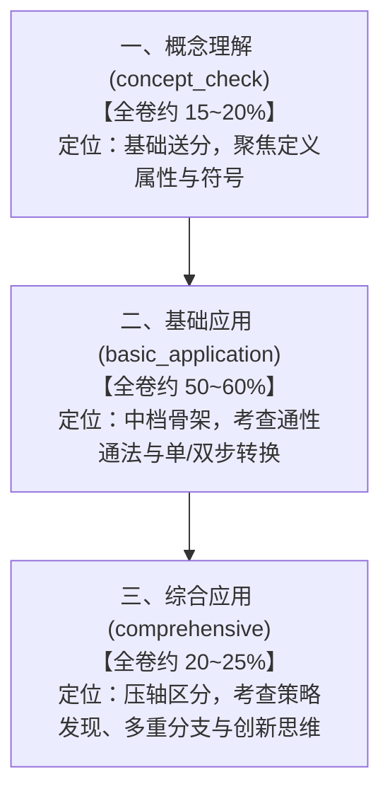

# 2025 年高考数学真题与课标能力素养体系对照深度剖析报告

**文档归属**：`docs/gaokao-2025/comparative-analysis.md`  
**研究对象**：2025年全国高考数学真题全集（全国新高考Ⅰ卷、全国新高考Ⅱ卷、北京卷、天津卷、上海卷）  
**对照基准**：教育部《普通高中数学课程标准（2017年版2020年修订）》、中国高考评价体系及 Tutor 课标能力素养与认知负担体系  

---

## 核心结论摘要

> [!IMPORTANT]
> **总论**：2025 年高考数学真题的命题机制、考查层次与能力要求，**与我们此前梳理的课程标准能力素养体系及 Tutor 教学测评框架完全吻合、高度对应，并且在真题中体现得淋漓尽致**。
>
> 2025 年高考数学命题不仅全面落实了**六大核心素养**，而且彻底贯彻了新高考“新结构（19题）”的改革导向：**降题量、减刷题、破套路、重思维、考素养**。试题在“考查意图（概念理解/基础应用/综合应用）”的梯次推进上，以及在“七维认知负担（知识整合、策略发现、推理论证、数学运算、表征转换、提示表达、情境熟悉度）”的调控上，展现出极高的科学性与一致性。

---

## 一、 六大核心素养在 2025 真题中的实证对照

| 核心素养 | 课标与Tutor定义维度 | 2025 高考真题典型佐证试题 | 考查机制与真题命题方式剖析 |
| :--- | :--- | :--- | :--- |
| **数学抽象** | 从现象中抽取数学本质，运用符号与形式化语言精确表征 | • **全国Ⅰ卷 题1、题2** • **全国Ⅱ卷 题3** • **北京卷 题1、题7** | **卷首概念题绝不搞偏难怪，直击概念本质**： 全国Ⅰ卷第2题考查正整数集合 $\mathbb{N}^*$ 约束下的补集元素个数；全国Ⅱ卷第3题考查一元三次方程解集与离散集合交集；北京卷第7题通过值域与任意/存在量词判定充分必要条件。考查学生对数学符号、集合语言、命题真伪的精准抽象理解。 |
| **数学建模** | 从实际现实或科学情境中抽象数学问题，建立并求解模型 | • **全国Ⅰ卷 题6（帆船航海）** • **全国Ⅱ卷 题14（双球容器）** • **全国Ⅱ卷 题19（乒乓球概率）** • **北京卷 题14（3D打印）** | **真实情境带来实质性理解与建模负担，拒绝虚假包装**： 全国Ⅰ卷第6题创设帆船比赛测风情境，给出“视风风速 = 真风风速 + 船行风速”，学生必须在坐标网格中完成向量抽象、坐标解算并比对气象风级表。全国Ⅱ卷第19题将乒乓球比赛积分规则抽象为离散独立重复试验概率模型。 |
| **直观想象** | 借助空间想象与几何直观感知形态，数形结合解决问题 | • **全国Ⅰ卷 题8、题17** • **全国Ⅱ卷 题6、题11** • **北京卷 题10、题17** | **数形结合与动态空间构想**： 全国Ⅰ卷第8题通过画出指数函数与水平直线交点，用几何直观秒解大小关系；全国Ⅰ卷第17题四棱锥四点共球，考查空间几何体外接球球心轨迹与平面投影；全国Ⅱ卷第6题考查抛物线焦半径定义转化（抛物线几何性质 $\leftrightarrow$ 代数坐标）。 |
| **数学运算** | 明确运算对象，设计简捷运算途径，准确求得结果 | • **全国Ⅰ卷 题13、题18** • **全国Ⅱ卷 题7、题16** • **天津卷 题16、题18** | **拒绝繁难死算，考查代数变形的合理性与简捷性**： 解析几何（如全国Ⅰ卷第18题椭圆）设而不求、联立韦达定理与斜率商式化简；数列求和（全国Ⅰ卷第16题错位相减或导数法求和）考查算法通性通法。 |
| **逻辑推理** | 依据规则演绎推导，严密分类讨论，逆向分析与反证 | • **全国Ⅰ卷 题8、题9、题19** • **全国Ⅱ卷 题18** • **北京卷 题15、题21** | **分类讨论的完备性与高阶反证法**： 全国Ⅰ卷第19题导数压轴题第(2)问，利用“长为1的闭区间上必存在唯一整数”进行精妙的反证法论证；全国Ⅱ卷第18题讨论参数 $k$ 对导数符号和极值点分布的影响；北京卷第15题判断真假命题时要求严密构造反例。 |
| **数据分析** | 样本数据推断、成对数据关联、随机变量分布列与决策 | • **全国Ⅰ卷 题14、题15** • **全国Ⅱ卷 题1、题19** • **北京卷 题18** | **统计概率紧扣时代现实，考查数据科学思维**： 全国Ⅰ卷第15题列联表独立性检验，从医药超声波筛查真实统计数据中计算 $\chi^2$ 统计量并决策；全国Ⅰ卷第14题有放回抽样随机变量数学期望，考查离散型分布列建模。 |

---

## 二、 三大考查意图（认知层次）在真题中的阶梯布局

高考命题严格遵循循序渐进的认知阶梯，与 Tutor 系统的 `assessmentIntent` 设定完全一致：

### 1. 概念理解（`concept_check`）
- **真题特征**：题干短小精炼，设问单一，无复杂中间计算链，考查概念本质理解与易混淆点辨析。
- **代表试题**：
  - 全国Ⅰ卷 1（复数虚部）、2（集合补集与正整数定义）；
  - 全国Ⅱ卷 1（样本平均数公式）、2（复数除法与实部虚部）、3（集合交集）；
  - 北京卷 1（集合交集）、2（复数模长）。
- **与此前总结的对标**：直接对应 Tutor 系统的“送分基础题/概念检查”原则，严禁在概念题中堆砌繁复计算。

### 2. 基础应用（`basic_application`）
- **真题特征**：标准题型，情境常规，方法明确指向通性通法（如双曲线离心率公式、三角诱导公式、等差/等比数列基本量计算、立体几何空间向量建系求线面角）。
- **代表试题**：
  - 全国Ⅰ卷 3（双曲线虚轴实轴与离心率）、4（正切函数对称中心）、5（偶函数周期性求值）、7（圆心到直线距离）；
  - 全国Ⅱ卷 5（余弦定理边角互化）、7（等差数列基本量求和）、12（向量垂直坐标运算）；
  - 全国Ⅰ卷 15（列联表 $2\times 2$ 独立性检验小计算）、17(1)（四棱锥面面垂直证明）。
- **与此前总结的对标**：对应 Tutor 系统中的“中档基础题”，学生只要熟练掌握课本定理与常规算法即可直接得分。

### 3. 综合应用（`comprehensive`）
- **真题特征**：题面蕴含隐藏条件，需要跨章节整合（如代数与几何、导数与三角、离散概率与组合递推），存在策略发现瓶颈，多问递进。
- **代表试题**：
  - 全国Ⅰ卷 8（指对幂大小比较策略发现）、14（放回抽球期望）、18（椭圆定点定值与轨迹圆）、19（导数与高倍角三角函数极值反证）；
  - 全国Ⅱ卷 14（立体几何两球容器最值）、18（含参函数极值与零点唯一性证明）、19（乒乓球概率极限与不等式放缩）；
  - 北京卷 20（导数最值与零点）、21（数列与数论集合创新压轴）。
- **与此前总结的对标**：对应 Tutor 系统中的“高阶挑战与区分题”，体现高认知负荷与多维素养融合。

---

## 三、 七维认知负担在高考难题中的深度运作

在 Tutor 难度评估模型中，我们提出了**七大解题负担维度**。2025年高考真题充分证明了：**难题之所以难，不是因为计算步骤冗长，而是因为题目在这七个维度上施加了复合负担**：

### 深度案例剖析 1：全国Ⅰ卷 第8题（指对幂大小比较）
- **题干**：实数 $x, y, z$ 满足 $x + \log_2 x = y + \log_3 y = z + \log_5 z$，判断 $x, y, z$ 大小关系不可能的是哪一项。
- **七维负担解构**：
  1. `strategy_discovery`（策略发现，极高）：常规求导无法分离变量，常规运算完全失效；学生必须洞察到将等式设为参数 $m$，或构造方程 $t + \log_a t = m$。
  2. `representation`（表征转换，极高）：将纯代数方程转化为曲线 $y = a^{m-x}$ 与直线 $y = x$ 的图象交点，或利用反函数进行数形结合。
  3. `reasoning`（推理论证，中高）：通过底数大小对曲线陡峭程度的影响，推理出交点横坐标的排列顺序，排除不可能的分支。
  - **结论**：本题完美印证了“高思维、低计算”的课标命题要求。

### 深度案例剖析 2：全国Ⅰ卷 第6题（帆船比赛风速测定）
- **七维负担解构**：
  1. `contextual_familiarity`（情境熟悉度，高负担）：引入航海风速术语（“视风”、“真风”、“船行风速”），阅读材料具备陌生感与专业背景。
  2. `knowledge_integration`（知识组合）：将物理力学相对运动规律与数学平面向量无缝融合。
  3. `representation`（表征转换）：将图2中的平面直角网格箭头转换为代数向量坐标 $\vec{v} = (x, y)$，再将运算结果转换回表格中的离散风级名称。

### 深度案例剖析 3：全国Ⅱ卷 第19题（乒乓球赛二项分布与极限）
- **七维负担解构**：
  1. `knowledge_integration`（跨模块整合）：离散概率 $\to$ 独立重复试验 $\to$ 数列累加和 $\to$ 极限与不等式。
  2. `computation`（运算复杂度，高）：多项式二项式系数展开、递推关系化简、放缩配凑。
  3. `response_support`（表达与论证，极高）：作为无选项的开放式解答题，考生必须步步有据，完整证明组合恒等式与概率不等式。

---

## 四、 2025 新高考命题的三大核心趋势反哺教学

通过对这 5 套真题的系统梳理，高考真题对日常教学与单元测评提出了极具指导性的信号：

1. **“新结构 19 题”重塑试卷节奏**：
   - 题量由 22 题减为 19 题，解答题由 6 题减为 5 题但总分增至 77 分，每道解答题平均 15~17 分；
   - 题型顺序不再按学科模块机械固定，概率统计可以做压轴，导数也可以放中间；
   - 这一改革彻底打破了“猜题押题”和“模板化应试”，要求教学必须注重**知识的通用性和本质理解**。
2. **强化概念的内涵理解与精准表达**：
   - 从卷首集合、复数、充要条件的小题可以看出，概念考查极其纯粹，抓住概念核心本质即可在 1 分钟内准确秒杀；若概念模糊则极易掉入选项陷阱。
3. **重视应用情境与数学建模的真实性**：
   - 从帆船航海、3D打印，到超声波医学检验、乒乓球赛制，数学与现实世界紧密连接。题目不再是虚构的文字游戏，而是真实的参数提取与模型构造。

---

## 五、 生成的真题知识库归档索引

已在 `docs/gaokao-2025/` 目录下完成 5 套真题的全量解析与细目表重构：

| 文档名称 | 试卷名称 | 题量 / 分值 | 核心考查亮点 |
| :--- | :--- | :--- | :--- |
| [`nation-1.md`](nation-1.md) | 2025年高考数学（全国新高考Ⅰ卷） | 19 题 / 150 分 | 帆船向量建模、指对幂数形结合、导数三角反证压轴 |
| [`nation-2.md`](nation-2.md) | 2025年高考数学（全国新高考Ⅱ卷） | 19 题 / 150 分 | 双球容器空间装配、乒乓球赛制概率分布压轴 |
| [`beijing.md`](beijing.md) | 2025年高考数学（北京卷） | 21 题 / 150 分 | 3D打印零件几何体、充要条件量词深度辨析、数论集合压轴 |
| [`tianjin.md`](tianjin.md) | 2025年高考数学（天津卷） | 20 题 / 150 分 | 传统大题严密布局、圆锥曲线与三角综合论证 |
| [`shanghai.md`](shanghai.md) | 2025年高考数学（上海卷） | 21 题 / 150 分 | 填空题为主的宽口径覆盖、高要求代数变形与分析 |
