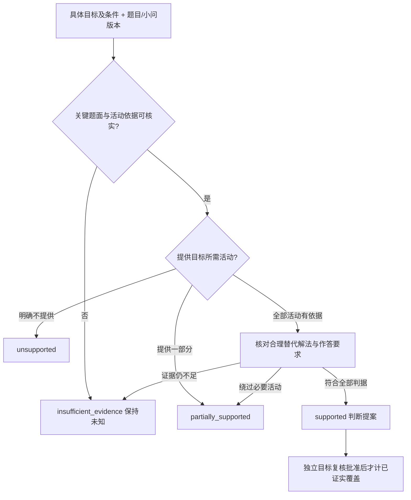
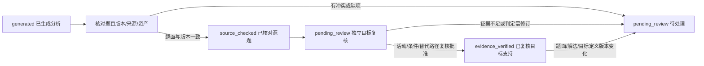

# 教学目标与题目证据标注规范

版本：1.1.0-draft。日期：2026-10-10。依据：[ADR-0003 草案](../adr/0003-teaching-requirements.md)。

当前基线：50个集合源单元中45题就绪、5题待处理；目标目录12项；已生成集合18题与高考10题的分析，独立目标复核通过数为0。新增27题只接入允许解法和任务供给，不能继承四维目标支持。

## 1. 分开管理三种证据

1. **题包就绪**：题面与教师内容分离、来源和版本可核对，有完整允许解法。由题库台账管理。
2. **源题核对**：分析引用的题面、选项、小问、资产、答案与具体版本一致。
3. **目标支持复核**：对具体目标定义、完成条件和题目版本，检查活动、证据与合理替代路径后批准判断。

这三项不能自动传递。ready、JSON合法、哈希匹配、程序运行成功、参考解法正确，都不能单独证明教学目标已复核。原生产者的 producerVerificationStatus 只保留历史声明。

分析保存在独立目录，通过 questionId、partId、题面/教师内容版本与目标定义版本关联。带小问的题逐问分析，选题和替换仍以完整父题为单位；不得把整题支持复制为每个小问支持。

## 2. 目标最小结构

| 要素 | 要求 |
| --- | --- |
| 知识范围 | 区分主考知识与解题依赖；已有教材章节才能映射，未知保持待映射 |
| 可观察表现 | 写具体对象与活动，如“将空交集转化为包含关系并检验端点” |
| 完成条件 | 记录提示、作答形式、是否要求书面理由、允许工具及特殊前提 |
| 支持判据 | 分清完整活动、部分活动、未知证据与明确不相容的边界 |
| 来源和版本 | 明确项目自定义/课标依据等身份，逐项维护目标版本，不伪造正式知识点UID |

知识点、认知要求、能力、核心素养构成目标框架，不要求每道题强行填满。认知要求不是题目难度或学生掌握度；解题方法另行记录。七维认知负担作为可选工程特征，不替代目标，也不作为普通组卷的统一就绪门槛。

## 3. 四档支持判断

判断必须针对特定目标及完成条件，并附具体题面、解法或小问证据。当前分析JSON采用以下字段值；接入选题合同需要显式适配，不能因名称相似而跳过复核。

| 分析值 | 含义 | 边界 |
| --- | --- | --- |
| supported | 完整支持 | 全部必要活动有经核对的依据，已考量合理替代解法 |
| partially_supported | 部分支持 | 明确提供部分活动，但不足以独立覆盖整个目标 |
| insufficient_evidence | 证据不足、未知 | 目标、题面、图形、解法或关键活动依据不足 |
| unsupported | 明确不支持 | 有依据说明题目不提供目标活动，或作答条件不相容 |

合理旁路的影响取决于目标：通过代入能绕过自主策略发现，不表示题目没有运算或关系判断价值。无需穷尽所有数学解法，但已知合理路径必须记录。不能以期望难度、题位配额或候选不足反推支持结论。

## 4. 必查案例

**普通书面推导与反证分开。** obj-written-derivation-01 要求提交连续求解步骤及关键理由；obj-proof-formal-argumentation-01 要求自主建立反证假设、构造矛盾并回扣结论。041、050可以提供普通书面推导机会，不因此完整支持反证。全国Ⅰ卷19.p2存在直接证明路径，应记录对“必须自主反证”目标的旁路影响。

**参考解析不替代学生作答要求。** 单选或填空只交结论，不完整支持提交书面证明。它们仍可考查推理判断，不能因题型而一概排除逻辑推理维度。全国Ⅰ卷第8题真实条件是 $2+\log_2x=3+\log_3y=5+\log_5z$，可以取共同参数检验排列；不得基于错误题面或教师复杂解法宣称自主构造函数是必需活动。

**小问不继承整题覆盖。** 050.p1仅在m=-2时求补交集，对同时要求含参求解和包含转化的区间目标只能部分支持。050.p2提供含参转化与端点推导机会，但N长度恒为2，不提供N为空的退化分支训练。题干给出了分支提示时，分类后求解与自主发现分类也要分开。

**明确基数约束不等于禁止重复列举。** 018经用户确认补充“两个不同元素”，因此a=4使基数为1而不符合题意；$\{4,4\}=\{4\}$ 本身仍是合法集合。没有明确基数条件的019不能沿用同一舍解理由。015也不能仅用重复书写就断言对应集合不同。

**替代解法需完整且前提准确。** 049是 $ax^2-bx-2$，端点代入得到 $a+b-2=0$、$4a-2b-2=0$，求a=b=1后还应回代检查不等式符号。这条路径不用韦达定理，但需要 quadratic_basics；独立分析不自动修改组卷索引的已登记路径。

**题号、关键词和解法名称不决定维度。** 全国Ⅰ卷19不是集合章题；出现概率不自动支持数据分析素养。帆船题已给合成关系，读图运算与自主提出模型不同。038修复的完整上界证明已在题包记录，但选项可以让学生只验证1013元素构造后作答，不能据教师补证认定强制书面上界证明。

## 5. 复核生命周期

evidence_verified 需要独立复核记录，包括复核者、时间及证据定位。结构校验只检查记录与绑定，不保证复核者的数学结论正确，也不强制教师逐题签字。

目前18条集合分析为 source_checked，10条高考分析为 pending_review；8个样例同步对应题面与版本，不额外增加覆盖量。高考 sourceVerification.status 已统一为 source_checked，表示来源核对结果，不能替代顶层分析状态或目标复核批准。

新增27题的题包就绪与34项任务供给可以用于当前蓝图实验；目标支持证据仍需按题包和目标版本逐批建立。参见[A组扩充](../validation/set-expansion-a.json)、[B组扩充](../validation/set-expansion-b.json)、[高考修复](../validation/gaokao-analysis-repair.md)、[扩充验收记录](../validation/question-bank-expansion.md)和[当前处理报告](processing-report-2026.md)。
