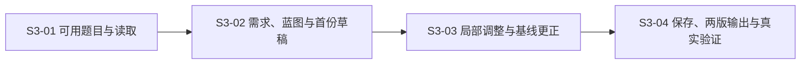

# Tutor v1 MVP 开发任务

- 状态：S3-01 已完成；S3-02～S3-04 待开始。
- 日期：2026-10-10；由 S2-04 拆分。
- 设计依据：[ADR-0001](../adr/0001-assembly-workflow.md)、[ADR-0002](../adr/0002-question-bank-blueprint.md)、[采纳记录](../validation/adr-0002-adoption.md)。
- 验证基线：[S2-01](../validation/mvp-assembly-task.md)；供给依据：[S2-02](../validation/question-bank-supply.md)和[来源清单](../validation/sources/set-source-catalog.md)。
- 目标：用户在本地完成一次集合专项组卷，能局部修正并保留满意题，输出学生版与教师版，并判断是否愿意实际使用。

## 开发顺序

实现技术栈和存储方式在任务启动时选择满足本地可运行的最小方案，记录运行命令与必要决策；不把复刻旧项目、接入生产数据库、全库重处理或搭建通用平台作为前提。本阶段不开发多人协作和学生作答系统。

## S3-01 整理集合材料并提供可用题目读取

- 状态：已完成；18 个优先题包就绪、50 单元台账及实际读取验证齐备。依赖：ADR-0002 已采纳。
- GitHub Issue：[S3-01 #6](https://github.com/mrzys/tutor/issues/6)。
- 输入：已归档的两份 PDF、固定 SHA、[50 单元机器清单](../validation/sources/set-source-catalog.json)、[标杆内容](../validation/benchmark-paper.md)及教材目录依据。
- 交付：版本化结构化题目数据、50 单元处理台账、可运行的本地题目读取模块与命令行验证入口、运行说明；具体文件及读取接口在实现时确定。
- 本轮实际文件、运行与材料问题：[S3-01 交付记录](../validation/s3-01-question-data.md)。50 单元中另有 32 题尚未结构化；018 已按用户确认补明两个不同元素条件，保留原文与修订记录。

工作与验收：

1. 建立全部 50 单元的来源与处理台账，两 PDF 对应同一批题，不重复计数。逐项报告题面、教师资料、素材、边界依据及内容问题；未就绪项说明原因。
2. 优先完成标杆 10 题和直接备选 002、003、013、007、009、010、020、034，共 18 个不同源题的可读题目包；审计 ID 显式映射到本地稳定身份，不冒称旧库 ID。其余 32 题的全量结构化不阻断首次交付。
3. 从 PDF 核对题干、选项、公式、图片、父题/小问与来源位置；学生题面分开存放，不能复用混合答案的 OCR 块。对优先题包逐题核查，保存核查对象、内容版本、差异及结果，不能只靠 hash 或字段存在判准确。
4. 原卷结论、整理增补、建议评分分别保留引用。032/033/039 无独立答案块不当作无结论；030/032 的内容问题、038 的未知与证明疑点分别保留，未经核查不计为自动合格题。
5. 实际运行读取指定题目及内容版本，能读到完整题面、对应教师资料、素材和依据，能分别返回未就绪、缺失与读取失败。展示已就绪/待处理数量，不把 18 题就绪写成 50 题全可选。

首个可检查成果：读取一题单选与两道完整解答题，对照原 PDF 核查小问、公式和答案归属；随后完成 18 题优先集合。无需付费重跑整库，旧处理结果只有来源与内容核对一致后才复用。

## S3-02 从需求形成蓝图并生成首份草稿

- 状态：待开始；依赖：S3-01 优先题目包与真实读取可用，50 单元台账齐备。
- GitHub Issue：[S3-02 #7](https://github.com/mrzys/tutor/issues/7)。
- 输入：S2-01 需求及默认结构、允许知识依据、S3-01 的真实题目读取。
- 交付：最小可运行本地组卷界面、需求与蓝图确认、实际候选检索及可重新打开的首份草稿、选题依据与缺项记录、运行说明。

工作与验收：

1. 用户能查看并调整主考范围、已学边界、题量/时长/总分及偏好；初中基础集合、本次显式前提可查。预填内容经本次确认后使用，不自动沿用旧任务条件。
2. 将需求转成题位目标，显示可用供给与不足；用户一次确认计划后进入真实检索，不再确认“开始搜索”。固定场景可以使用可见预设，LLM 若参与必须记录实际调用与失败，不以预制返回冒充生成。
3. 从 50 单元候选台账中的已就绪题包按来源、题型、具体任务、允许解法及重复关系选题，不把标杆 ID 写死在选题逻辑；记录未就绪项，自动结果只计已证实符合且题面可用的题。
4. 无合格候选的题位留空，差异或未知候选单独说明，用户可以选择；检索失败与零候选分别回显。首稿及重新打开后的实际题目、顺序、题分与缺项一致。
5. 本次默认分配为 6×8+2×10+14+18，合计 100；题分和小问分值可核算。难度估计缺失就保持未知，不把原标杆 0.693 当成新草稿实测结果。

验证：保留实际检索条件、候选与选中身份、内容版本及匹配理由，对照标杆列出差异；不要求命中相同 10 题。题包不足时记录真实结果，不能用模拟题补成一次“成功”。

## S3-03 局部调整草稿并保留已有成果

- 状态：待开始；依赖：S3-02 草稿与实际选题能力。
- GitHub Issue：[S3-03 #8](https://github.com/mrzys/tutor/issues/8)。
- 输入：已确认计划、可编辑草稿、候选及差异依据、来源清单的直接与部分备选关系。
- 交付：换题、锁定、增减题、改分、调难度及基线更正；可回看的操作结果与计划差异；必要的持久化、重试和过时结果验证。

以下固定题号/ID场景使用标杆构造受控测试草稿，验证局部操作；不要求 S3-02 的真实首稿命中标杆。S3-04 的用户运行仍使用实际选题结果。

工作与验收：

1. 第 3 题可在核查可用后由 022 换为 020，只更新指定题；第 7 题的 019 仅作部分相关建议，第 9 题不能拿已经占用第 10 题的 041 当新增直接备选。034 替换第 4 题须显示细项差异，不声称完全等价。
2. 同时请求换第 3、8 题，前者成功保留、后者无直接候选保留原题；无关题及锁定不变。自动修改跳过锁定题，用户直接改锁定题可执行。
3. 增减题、改分更新当前草稿的题号与实际统计，保留与基线的差异。删掉原第 8 题得到 9 题/90 分；将其 10 分改为 12 分得到 10 题/102 分，不自动改其他题凑回 100。小问合计须与该题当前分值一致；重新分配可作为建议供用户应用。
4. 调难度只改变授权范围内的选题目标，不改写题面、伪造估计或清空无关题。换题默认保留当前题位分值，新题评分不能直接套用旧细则，资料不足如实说明。
5. 用户更正已学前提或显式更改来源时保存新基线和记录，保留题目与锁定并重检受影响项；例如取消韦达后检查第 8 题允许解法，证据不足保持未知。新来源未经身份与依据核查不自动当作合格供给。
6. 同一修改重试不重复执行成功项；读取失败不先删除现题；晚返回的旧建议不覆盖用户的新操作。实际执行日志/测试分别证明这些行为，故障注入须明确标注为测试，不能当成真实供给结果。

用户直接操作表达对应授权；自然语言建议先展示作用范围供应用。验收不要求用户逐题审批未知。

## S3-04 保存成卷、输出两版并完成真实使用验证

- 状态：待开始；依赖：S3-03 可调整草稿及可靠内容读取。
- GitHub Issue：[S3-04 #9](https://github.com/mrzys/tutor/issues/9)。
- 输入：当前草稿、题目/素材/教师资料版本、实际赋分及差异，S2-01 的 A4 与两版交付要求。
- 交付：不可变成卷快照及确认摘要、学生版与教师版可打印文件、恢复与分别重试输出能力、工程验证记录和用户真实使用反馈。

工作与验收：

1. 确认前展示实际内容、计划差异、未知与缺项，保存用户看到的版本和摘要；保存失败不能报告成卷成功。后续改动建立新草稿，库中内容更新不改变已成卷内容。
2. 两版从同一快照生成，题目顺序、题号、分值及小问对应一致。学生版无答案、解析和教师记录；教师版逐项标明原卷、整理增补及建议评分，缺项/冲突如实说明。
3. 实际检查 A4 打印预览和输出文件中的公式、图片、跨页与解答留白。确认两版可打印，不能只凭 HTML 存在或导出请求成功认定交付成功。
4. 缺题面或未选位置保留题号、打印明确占位，卷头标未完整及完整可作答父题的数量/分值；删除后重新编号计分。缺教师解析不降低学生题面可用题数，但须标明教师版未满足项。
5. 分别记录两版成功/未完整/失败，一版失败不丢失另一版与成卷；重试仍输出同一确认内容。用实际输出核对第 1、2 题及其他混入答案的样本，防止学生版泄露。
6. 当前用户实际在系统中完成一次需求确认、选题、局部调整、保存与输出，判断是否愿意使用结果；记录替换次数与原因、缺项、手工修正及反馈。若邀请其他教师试用，另记实际参与者，不把代理检查或开发者演示称为教师接受。

自动化检查只能证明工程行为。用户不接受结果则记录原因并调整设计或实现，不能把“功能跑通”当作用户验证完成；学生成绩提升、实测难度与 45 分钟适用性不在本任务中预先承诺。

## 完成口径

四项任务均须交付实际可运行成果与相应证据。GitHub Issue 建立本身不代表开发项已实现；当前 S3-01 的实际交付及未完成项见其记录，其他开发项待开始。50 单元台账、优先结构化题包与实际合格候选分别报告。

题目内容问题、来源扩展、知识映射及依赖缺口在对应任务中明确处理，不能用“未知”冒充通过，也不为凑题数静默放宽条件。先从 S3-01 的本地材料与读取开始，完成一个可检查成果后再扩大处理范围。
