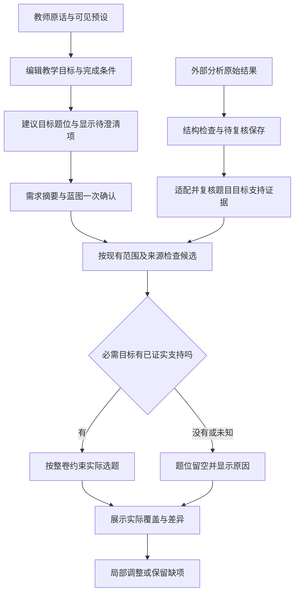

# S3-05：教学需求确认与目标驱动蓝图

- 状态：需求侧与分析接收边界工程已完成；题目目标支持证据待 Gemini 结果适配与复核，用户接受待验证。见[交付记录](../validation/s3-05-teaching-requirements.md)。
- 日期：2026-10-10。
- 设计依据：[ADR-0003 草案](../adr/0003-teaching-requirements.md)，沿用 [ADR-0001](../adr/0001-assembly-workflow.md)、[ADR-0002](../adr/0002-question-bank-blueprint.md) 的确认、留空与成果保留规则。实施本任务不自动将 ADR-0003 改为已采纳。
- 依赖：S3-01～S3-03 已有可运行成果；S3-04 工程已完成，当前用户实际使用验证仍待反馈。
- 目标：教师能把组卷意图整理为具体目标，查看目标如何安排到蓝图，并区分计划覆盖与题库已经证实的支持。

## 本轮交付

1. 在现有需求与蓝图界面中保留教师原话，增加可编辑的教学目标、完成条件和必需／偏好；需求摘要与蓝图沿用一次确认。
2. 目标参与题位安排，显示建议依据、未安排目标及待澄清项。原有具体考查任务保留为可见模板，可以调整，不能充当四维证据。
3. 给外部题目分析建立独立接收边界，保留原始结果和待复核状态。先验证结构与身份，不自动导入题库、不改变题面就绪状态，也不因结构合法认定目标支持成立。
4. 用可运行测试和界面操作验证以上行为，明确哪些结果等待真实题目分析与复核。

本轮先完成需求侧和证据接入边界，不把规则或模板称为自然语言模型理解。自由文本没有可靠解释时保留原话，由教师补充或调整具体目标；不生成正式课标代码。四维无须全部填写，七维负担不作为前置条件。

## 最小流程



确认表示认可需求与安排，不将未知转为已证实。未澄清目标或缺少候选时仍可保留计划和成果，不新增搜索审批。偏好目标的支持未知不单独阻止其他条件已符合的题目选入，但必须保留其未知状态，不能计为该目标已覆盖。

## 最小合同

原有 `requirements.goal` 保存需求原话，既有题型、来源、主考范围和已学边界仍独立生效。新增 `requirements.teachingGoals` 为可选数组；未提供时继续原有预设组卷，不要求历史草稿补填四维。

| 字段 | 含义与约束 |
| --- | --- |
| `id`、`version` | 本次目标身份和正整数定义版本；修改目标含义时更新版本，不能靠同名沿用旧支持结论 |
| `knowledgeScope` | 现有目录的章节 ID 数组；暂时只使用已存在的目录身份，不生成正式知识点代码 |
| `cognition` | `unspecified`、`understand`、`apply`、`reason`；用于当前界面的内部操作分类，不宣称是课标等级、题目难度或学生掌握程度 |
| `observable` | 学生需要完成的具体表现，如“判断给定有限集合的包含关系并说明依据”；允许为空，但记为待澄清 |
| `conditions.prompt` | `unspecified`、`provided`、`independent`：未指定、提供方法提示、独立完成 |
| `conditions.response` | `unspecified`、`answer`、`written_reasoning`：未指定、提交结果、提交书面理由或论证 |
| `priority` | `required` 或 `preferred`；保留教师明确要求，不因歧义、缺题或跳过澄清自动降级 |
| `abilities`、`literacies` | 可选描述数组；用于表达目标，无内容允许留空，名称相同不足以证明题目支持 |
| `source` | `{ kind: "teacher", text: "…" }`，保留教师表达依据；模板建议的安排理由另行显示，不能伪装成教师原话 |

题位新增可选的 `goalIds` 数组，引用本次需求内的目标，允许教师直接修改。默认关联只根据章节和作答形式提出建议，例如书面论证目标优先建议解答题；它不判断题目支持，不把“解答题”直接等同于“自主论证”。显式冲突只记录问题，不修改目标优先级或其他明确要求。

蓝图的 `goalReview` 按目标报告 `planned`、`unassigned` 或 `pending_clarification`，并附 `issues`。这里的 `planned` 仅表示已安排到题位；存在安排但关键内容未明确时仍报告待澄清。实际覆盖必须另有当前题目或小问版本、目标版本、理由与经复核证据，不能用题位的 `goalIds` 证明覆盖。

题目分析接收与选题结论分开：接收边界保留原始载荷、来源身份及 `pending_review` 状态。具体 Gemini 格式通过适配处理；不将结构检查通过升级为 `supported`，不自动发布题包。未经适配与复核的原始结果不进入主流程的目标支持判定。

接收命令为 `npm run analysis:receive -- <提交.json>`，每次接收独立保存到 `.tutor/analysis-submissions/`。最小提交信封如下，`rawAnalysis` 中保留生产方原始分析对象；示例不是已复核题目分析：

```json
{
  "schemaVersion": 1,
  "questionId": "tutor-set-001",
  "contentVersion": "填入分析时的实际题面版本",
  "teacherVersion": "填入实际教师资料版本，未涉及可省略",
  "producer": "Gemini",
  "rawAnalysis": { "保留生产方实际字段": "不要求先改写其分析" }
}
```

接收只检查信封字段结构，尚不核实题目是否登记、版本是否当前或证据是否正确。原信封也完整保留为 `rawSubmission`；生产方即使自报已批准，接收结果仍为 `pending_review`、`matchingEligible: false`。此入口目前没有自动接入选题的适配器。

### 选题与历史兼容

- 必需目标关联题位后，自动选题须同时通过原有题面、来源、范围、允许解法和重复关系检查，以及该目标的已复核完整支持检查。只有相关标签或旧任务映射时，目标支持保持未知，题位留空并说明差距。
- 偏好目标可在支持未知时展示按其他条件选入的题目，同时显示“尚未证实支持”；不将偏好安排计为实际覆盖。
- 未安排的必需目标仍是未满足项；题目已选入不意味着整份需求已满足。支持状态与题面可用状态、范围符合状态分别报告。
- 已有无教学目标的计划继续使用现有选题合同。恢复旧草稿和成卷使用保存内容，不自动补入新目标；新定义或新分析不改写历史快照。
- 后续修改目标或题位关联时保留其他题目及锁定，重核受影响项；未知或缺题不撤销已确认蓝图。

## 数据边界

本轮真实供给仍是 [50 单元台账](../../data/question-bank/ledger.json)中的 18 个就绪题包；另外 32 个源单元不是可直接选题的完整题包。已有 [任务目录](../../data/assembly/task-catalog.json)与[题目索引](../../data/assembly/question-index.json)只提供当前任务和允许解法等依据，不代表知识、认知要求、能力和核心素养全部已核实。

Gemini 处理中使用的现有题与高考材料独立保留。实施本任务不修改其原卷、题面、分析输出或汇总标签，不重跑旧材料生成脚本。收到分析后先抽样核对原题、作答条件、合理替代解法及证据定位，再决定哪些结论可用于选题；有小问时按小问核查，选取与替换仍以整题为单位。

## 验收场景

| 场景 | 应观察到的结果 |
| --- | --- |
| 相同章节分别设置概念解释、运算应用和书面论证目标 | 目标及其完成条件进入蓝图；安排建议与理由可查看、可修改，不能只出现在备注里 |
| 教师只写“活题”或目标表现为空 | 原话保留，显示待澄清；必需仍是必需，不声称已经明确或满足 |
| 必需的书面论证目标关联单选题位 | 显示作答形式冲突或待调整项，不静默改变目标，不仅凭答案解析有证明就算支持 |
| 无已复核支持证据的必需目标 | 可确认和保存蓝图，相关题位不自动选入未知候选，已有成果与锁定保留 |
| 偏好目标支持未知 | 其他条件符合时可以选题，目标实际支持仍明确显示未知 |
| 外部结果结构正确，但没有复核 | 原始结果及待复核状态保留，不增加已证实覆盖，也不提升题面就绪数量 |
| 读取旧草稿、无目标计划或历史成卷 | 原有组卷与恢复行为继续可用，历史内容不被新目标或分析改写 |
| 目标定义版本或题目版本变化 | 旧支持结论不能直接套用，受影响目标保持待核查并可追溯 |

验证分三层：自动测试检查合同、关联和选题边界；浏览器操作检查一次确认、直接编辑和未知回显；真实样本复核检查支持判断。前两层通过不代表第三层完成，更不代表学生已经达成目标或难度已得到实测。

## 完成与后续

需求确认、目标题位关联、证据接收边界及兼容行为有实际实现和验证记录后，可以报告对应工程交付；不得仅凭新增本文标记完成。真实目标支持接入须等待 Gemini 结果适配和样本复核，覆盖率按实际证据报告，不为凑齐蓝图编造结论。

本任务完成不替代 [S3-04 用户实际使用验证](mvp-implementation.md#s3-04-保存成卷输出两版并完成真实使用验证)。后续根据教师反馈与真实支持样本补强规划，不先建立全教材目标目录或要求全库七维标注。
