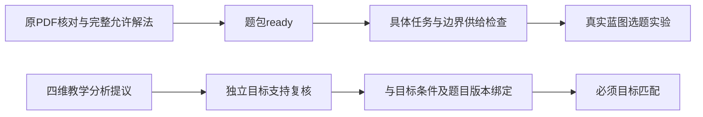

# 题库扩充与蓝图供给验证

日期：2026-10-10。目的是增加真实材料的任务覆盖和候选数量，避免只用首批18题评估蓝图。使用3个子代理分别整理两组集合材料、修复高考分析，集合两组再交叉检查；根代理整合台账、任务、校验和运行验证。

## 实际供给

| 指标 | 扩充前 | 当前 |
| --- | ---: | ---: |
| 集合来源单元（两份PDF去重后） | 50 | 50 |
| 就绪完整父题 | 18 | 45 |
| 待处理 | 32 | 5 |
| 具体任务预设 | 10 | 34 |
| 单选／填空／解答就绪题数 | 14／2／2 | 30／13／2 |

新增27道题来自原有材料，不是模型生成的相似题；其中A组12题、B组15题。新增24个任务，多个同任务候选共享任务身份。原默认10题预设保留；新任务可在蓝图“考查任务”中选择。

逐题核对对象、源PDF物理页、版本、允许解法、章节/显式前提与差异见 [A组记录](set-expansion-a.json)、[B组记录](set-expansion-b.json)。两代理使用PDF技能渲染原页，逐题看题面和教师资料；正式reader验证、来源PDF哈希与KaTeX公式检查通过。学生题面与答案解析独立存放。

交叉复查：B组复查A组全部12题；A组复查B组重点028、029、030、031、033、038、040、048及对应教师原页。038另独立穷举同类小规模全集；原解析直接假设最大元素2025的缺口，改为一般最大元素奇偶分类的完整补证，明确标记`generated`，保留原题和原答案。

## 保留待处理的5题

| ID | 具体问题 |
| --- | --- |
| 015 | 重复列举仍可表示同一集合，原单选B、C同时成立 |
| 019 | 原答案排除a=0依赖未明写的“两个不同元素”条件 |
| 021 | 两份PDF的选项集合括号均缺失，需显式恢复与复核 |
| 025 | “能被3整除余2”措辞矛盾，需显式纠正笔误 |
| 032 | 方程对象集合与原解析改成数集的语义冲突 |

这些题没有注册为可选题。018此前经用户确认补充的基数条件不自动套用到019。重复列举不是集合非法的理由。

## 真实蓝图实验

可执行 `npm run blueprint:check`，确定性结果保存在 [运行结果](question-bank-expansion-results.json)。这不是45题都适用于任意蓝图的声明。

| 场景 | 实际结果 |
| --- | --- |
| 每个具体任务各一个题位，共34题 | 34个任务都有合格候选，选中34个不同完整父题，0读取失败 |
| 同一集合相等任务连续4个题位 | 3个真实不同候选，第4位留空，不重复凑数 |
| 上述34任务但已学仅1.1，撤销全部显式工具 | 选中12题，其余22位留空，有效117分；所选完整路径均只需1.1且无额外工具 |
| 原默认蓝图 | 仍为10题／100分 |

全部34任务实验显式启用了全部已登记工具前提：韦达定理（`vieta`）、二次方程基础（`quadratic_basics`）、绝对值不等式（`absolute_root`）和初中几何边长性质（`basic_geometry`）。其中014、017依赖几何边长性质，当前自动基础依赖不包含几何，只有教师在本次需求中明确允许后才是合格候选；`basic_geometry` 默认不勾选。题包就绪不代表在任意已学边界和工具配置下均可选。

34题／340分只是覆盖所有任务的工程实验尺度，不是推荐给教师的实际试卷。

浏览器使用Playwright（当前无Browser插件），隔离服务4321及临时存储，不写入用户组卷历史。桌面1440×1000和手机390×844均显示45就绪／5待处理；单选下拉框有20个任务。实际把前4题设为集合相等、第5题设为无和集最大基数，选入029、030、031、038，第4题留空，整卷9题／92分；保存刷新后内容、分值与缺题保持一致。查看截图，公式正常，无控制台错误，手机没有整页横向溢出。

浏览器记录在本机临时目录：`C:/Users/mrzys/AppData/Local/Temp/tutor-expanded-qa-fd24f2483e3148ac9bcd59d711733844/`。隔离服务验证后已停止。主服务4318只读检查确认45／5和34任务。

## 教研分析修复与边界

修复高考10条已生成分析中的6处实质错误，详见 [高考修复记录](gaokao-analysis-repair.md)；5套卷合计100题，只交付5套概况和10条分析，没有100题逐题目录或100道可选题。高考题未注册进本轮集合候选池。

同步修复标杆018、022的过期版本、050.p1的过强支持判定、049替代解法中的负号、反证法与普通书面求解混用，以及错误指对题面派生的目标定义。目标定义增加独立版本；新校验核对实际题包内容哈希、标杆内容、引用、小问与状态，18个独立错误变异均被拒绝。

当前集合18题与高考10题有分析提议，目标独立复核完成数为0；新增27题记录实际活动与捷径，但没有自动继承教学目标支持。必须目标缺证据仍留空。能力/素养未标注不阻断普通任务组卷。

验证通过：全量102项测试（含显式几何边界检查）、45题`bank:check`、`analysis:check`、`blueprint:check`、前端构建、桌面与手机实际操作。历史成卷不随题库扩充重写。全量测试暴露旧输出测试对并行启动顺序的偶发假设，已改为核对首轮两种输出均调用、重试仅调用教师输出，保留缓存复用断言；重新运行102项全通过。

当前主要限制：解答题仍只有041、050两道；34个任务中28个只有一个候选。已增加任务覆盖，替换多样性仍有限。下一步应优先补充解答题和同目标不同情境的真实候选，再完成目标支持适配与独立复核；不为提高表面数量静默放宽条件。
