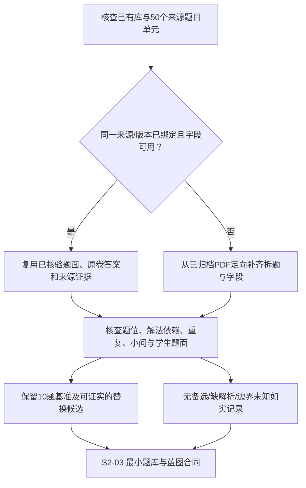

# S2-02：集合专项题库供给与证据核查

- 核查日期：2026-10-10（Asia/Hong_Kong）。
- 任务基线：[S2-01 验证任务规格书](mvp-assembly-task.md)，已获用户确认。
- 状态：已完成供给核查；结果为需补数据，当前不能直接支撑完整自动成卷。未创建新生产题库或运行旧库重处理。
- 结论：**旧项目已有可复用的数据与处理能力，但不能直接作为本次任务的合格题库。优先复用处理能力、定向补齐本次集合材料，不从零重建整个题库。**

## 1. 核查对象与口径

本次任务要求集合专项（教材 1.1–1.3），10 题、45 分钟、100 分，默认 6 单选 + 2 填空 + 2 解答；以已归档的两份集合汇编为唯一来源基准。原卷答案、整理增补解析和本次建议评分规则必须区分；自动候选需有已学边界依据，未知不能计为符合。

“已上传”“OCR 页”“已拆题”“已发布”“标签命中”“符合本次任务”分别统计。题目数量按题目单元计算，带小问的解答题算一题；两个版本的同一道题不重复计算。旧库的内部质量状态不是本次来源或教学适配的证明。

| 对象 | 证据 | 本次用途 |
| --- | --- | --- |
| 旧库当前 V1/V2 数据 | [只读数据库与 API 快照](sources/existing-bank-snapshot-2026-10-10.json) | 确认已有记录、候选身份、来源、答案与解法来源 |
| 已归档集合材料 | [解析版 PDF](raw/第1讲_集合_一轮复习基础梳理_解析版.pdf)、[标注为原卷版的 PDF](raw/第1讲_集合_一轮复习基础梳理_原卷版.pdf) | 本次任务的来源基准 |
| 原卷全量清单 | [题目清单](sources/set-source-catalog.md)、[机器清单](sources/set-source-catalog.json) | 核准题数、题型、位置、候选深度与缺项 |
| 10 个题位 | [标杆卷](benchmark-paper.md) | 对照题型、具体考点与解法依赖 |

## 2. 实际访问与可复核证据

旧库连接读取已有项目根 `.env` 的 `DATABASE_URL`；连接启用 `default_transaction_read_only=on`，全部数据库查询位于 `REPEATABLE READ READ ONLY` 事务，查询超时 20 秒。快照不保存连接串、用户名、密码、API Key、存储对象地址或签名 URL。该连接证明当前配置库可读，不声称它与所有历史报告或所有部署实例相同。

同时使用已有 Tutor 集成配置实际请求 `https://tutor-kb.mrzys.fun/api/openapi/question-candidates`。该 POST 是候选读取接口，未调用 OCR、拆题、解题、发布或数据修改接口。学生题面与教师资料两种 profile 均返回 HTTP 200、197 条候选，均无下一页；两者的题目 ID 和题面版本与数据库快照一致。

候选检索条件见快照的 `api[].request`：`subject=math`、`knowledge_scope_policy=primary_overlap`、`limit=300`；学生资料使用 `student_content/source_ready`，教师资料使用 `teacher_material/solution_ready`，要求素材就绪，不要求官方评分点。**这是宽范围供给探针，不是本次已学边界最终筛选。**

旧知识树中“并集”直接挂在章节点下，未归入“集合间的关系与运算”分支。本轮明确使用以下三个入口，防止漏查并集题；其后代也不自动等同本次教材边界，例如“容斥原理”仍需单独核查。

- `M-K-01-110`：集合的概念与表示。
- `M-K-01-120`：集合间的关系与运算。
- `M-K-01-1210`：并集。

重放入口：[只读核查脚本](sources/audit-existing-bank.mjs)。它从调用方指定的既有项目读取数据库依赖和配置，不是 Tutor v1 的架构依赖。参数仅为本地路径，凭据不写入命令或结果：

```powershell
node docs/validation/sources/audit-existing-bank.mjs --bank-root <已有题库项目目录> --api-config <已有Tutor配置文件> --output <新的核查快照路径>
```

每条数据库证据保存 SQL、参数和真实返回，题目 ID 绑定 `content_version_id` 与题面 hash。重放结果可能随旧库更新而变化；本次结论绑定保存的快照。

## 3. 旧项目已有多少、能直接用多少

### 3.1 全库规模与本次候选

| 层次 | 当前实际数量 | 能支持的结论 |
| --- | ---: | --- |
| V1 来源试卷记录 | 1,602 | 已有导入记录，不表示均拆题或可选 |
| V1 questions 行 | 23,853 | 包含 OCR 页等中间记录，不能称为 23,853 道可用题 |
| V2 来源试卷记录 | 232 | 来源记录数量，不等同正式可用试卷数量 |
| V2 canonical question 行 | 4,201 | 题目实体数量，包含非就绪记录 |
| V2 学生题面选题投影 | 2,877 | 旧系统当前允许读取的学生题面 |
| V2 教师资料选题投影 | 2,855 | 旧系统当前允许读取的教师资料 |
| 本次三个入口宽范围命中 | 197 | 175 单选、3 填空、15 解答、4 多选；未证实全部符合任务 |
| 本次两份 PDF 的 V2 SHA 精确匹配 | 0 | 在所查 `source_documents` 中无精确匹配，不能复用为同一来源 |

197 道候选对应 201 个 occurrence、181 个来源文档；当前记录有 197 个不同的重复簇标识（无标识时按题目 ID 计）。这只证明旧系统当前去重身份，不能证明没有近似重复。

### 3.2 同名集合材料实际只处理到 OCR 页

V1 `exams.id=1450` 的文件名为“第1讲 集合---2026年高考数学一轮复习基础梳理（原卷版）.pdf”，状态是 `split/pending`。关联的 18 条 `questions` 行（ID 28693–28710）全部为 `question_type=OCR页`、`status=needs_review`、`label_status=pending`，答案与解析独立字段均为空，`solution_source=missing`。

这些是分页中间产物，**不是 18 道已处理集合题**。部分 OCR 正文混有例题答案、讲解和训练题；不能因为独立答案字段为空，就认定可作为纯学生题面。名称接近也不能证明与本次 PDF 是相同字节版本：V1 记录本轮未取得可绑定的文件 SHA，身份仍记为未绑定。V2 标题含“集合”的来源试卷查询返回零条，不能用标题未命中替代全库精确内容比对。

### 3.3 其他试卷的集合题不能直接替代这次来源

候选确实有题目 ID、题面版本、来源卷 ID、PDF hash 与来源页码，可以作为未来扩大来源时的复用基础。但这 197 道来自其他来源文件；按当前“本地集合汇编唯一基准”，本轮没有将其中任何一道计为本次来源已核验候选。

全部 197 道候选当前版本的答案和可用于 scope 的解法记录均为 `source_type=ai_generated`、`review_status=auto_verified`。这证明旧库保存了 AI 生成资料及其状态，不能称为“原卷标准答案”或“原卷整理增补解析”；本轮也未独立审定这 197 道题的全部答案与证明。

## 4. 真实样本暴露的范围、题型与去重问题

以下引用均可在快照 `studentCandidates` 与 `candidateSources` 按题目 ID 和版本复核；判断仅针对列明事实。

| 题目 / 版本 | 实际题面或来源事实 | 对本次任务的影响 |
| --- | --- | --- |
| 5829 / 4810 | 区间集合的包含关系，填空题 | 有集合参数训练价值，但不等价于标杆第 7 题互异性检验或第 8 题韦达求参 |
| 6221 / 5168 | 差集定义、二次不等式与区间包含，填空题 | 需核查具体解法与前提，不能直接充作任意填空题位替换 |
| 6875 / 5796 | 两个有限正整数集合的交集元素和，填空题 | 与标杆两个填空题位考点不同；“有 3 道填空”不能证明两个题位均有备选 |
| 5927 / 4897 | 题干要求处理对数不等式 | 明确不符合本次已学边界，即使集合标签命中 |
| 6129 / 5078 | 集合由含 `ln` 的函数定义 | 明确不符合本次已学边界 |
| 6631 / 5575、6717 / 5651 | 同样的含参区间与指数不等式题，题干仅有分值等排版差异 | 均不符合已学边界，并有近似重复线索；不能当独立替换深度 |

作为对照，仅要求所有直接 `primary/supporting` 标签落在上述三个入口子树内，返回 82 道（77 单选、2 填空、3 解答）。这是**标签层探针**：未检查逐题解法事实，也未加入本次允许的初中前置映射，所以它既不是合格题数，也不能据此否定被排除题的所有适用解法。

这些样本说明：宽范围标签重叠可用于召回；最终题位匹配还需检查具体考点、解法依赖、未知项、题型和重复身份。不能把旧系统按教材页推导的已学集合，直接当作本次用户确认的课程前提。

## 5. 本次归档来源的供给与缺项

解析版与标注为原卷版的材料各有 50 个题目单元，对应同一批题，不计为 100 题。题型为 32 单选、16 填空、2 解答；两版本 50/50 题干提取串归一后对应。50 题均能找到答案结论和解答，其中 3 题没有独立答案块，需从解答结论定位。计数、物理页码、重复局部题号的稳定位置、题型及每题位候选，以[全量清单](sources/set-source-catalog.md)为准。

**原卷版不等于纯学生版。** 11 个题目单元仍含答案或解答，包括标杆第 1、2 题；抽取学生题面时须按内容字段去除答案和讲解，并逐题核查，不能直接复用整份 PDF 或混合 OCR 正文输出。

边界初判为 49 项 within、1 项 unknown、0 项 confirmed out。该判断依据题面和原解法可使用的知识，不是所有题目均已发布就绪：`SET-SRC-038` 使用未明确列入前提的抽屉原理，上界论证也需复核；`SET-SRC-030` 有解析笔误，`SET-SRC-032` 有对象语义和公式排版问题。50 条题干去空白 hash 无完全重复组，语义近重复仍未全量审定。

严格保持题型与题位完整考查目标时，第 1–4 题有直接备选，第 5–10 题没有直接备选。第 7 题虽有互异性相关填空，但没有同时保留“元素属于条件、二次方程求根、互异性舍解”的另题，不能虚增替换深度。备选难度和用时未实测，不能保证换题后的总难度系数不变。

解答题只有 2 道，恰是标杆第 9、10 题，两个题位均无同题型替换题。它们可支撑首份标杆卷的原题内容，但不能支撑“每个解答题位都有备选”的承诺。换题时必须如实返回供给不足、保留当前满意题；若后续要求增加这两个题位的备选，需明确扩大来源，不能静默改题型、放宽已学边界或用 AI 新编题冒充原卷题。

本轮清单只是来源审计与候选证据，**尚不是已入库、可通过接口选题、可保存草稿并生成两版成卷的题库**。这两种产物分别验收。

## 6. 处理建议与下一阶段输入



建议顺序：

1. 保留原 PDF 及 SHA，以物理页码 + 题目出现位置识别 50 个单元；重复局部题号不合并。
2. 复用旧项目的来源、分页、拆题、题面版本、题图、小问和重复身份能力；本次没有足够证据认定旧 OCR 与归档 PDF 完全一致，逐页比对前不直接导入。
3. 原卷有答案和解析时优先抽取并绑定来源；整理增补与 AI 生成分别标注，不先为所有题重新购买 AI 解题。
4. 针对 10 个题位建立匹配证据和备选清单。解答题无备选是已知供给结果，其他未证实项保持未知。
5. 在 S2-03 中定义最小读取字段与不足/未知语义，再实施定向导入。该过程不需要重建全部知识点系统、旧库发布门禁或题库管理平台。

| 能力 | 本轮判断 | 后续最小处理 |
| --- | --- | --- |
| 来源访问与身份 | 两 PDF 可访问且有 SHA；旧同名记录未绑定 | 用归档 SHA 建立来源，不按文件名冒认 |
| 首份 10 题原题内容 | 标杆和来源可对照 | 抽取为题目字段并绑定版本 |
| 自动候选与边界判断 | 旧接口可读，但宽范围命中不等于符合 | 以本次明确前提与具体解法为依据 |
| 学生版题面 | 原卷版存在答案泄露风险 | 显式题干/选项/小问白名单及输出核查 |
| 教师版原卷答案解析 | 归档来源可读，旧候选为 AI 资料 | 保留来源内容与整理增补的不同归属 |
| 解答题替换 | 2 个题位无同题型备选 | 返回不足并保留现题；扩源另行明确 |
| 难度与时长 | 只有本次预估，没有实测 | 保持预估标识，不宣称实测匹配 |
| 稳定版本/题组/重复 | 旧库有相关身份，原卷清单有位置证据 | 新合同绑定来源出现、canonical、小问与题面版本 |

最终路线是**复用已有能力、定向建立本次来源样本**。当前缺的是这份材料可靠的结构化结果与任务匹配证据，不是必须从零建立一个大题库。
