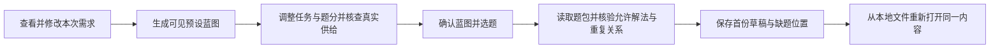

# S3-02：从需求到首份真实草稿

- 日期：2026-10-10；状态：已完成工程交付。
- 任务：[S3-02](../tasks/mvp-implementation.md#s3-02-从需求形成蓝图并生成首份草稿)。
- 实际运行证据：[检索条件、逐题候选、匹配理由和内容版本](s3-02-selection-evidence.json)。该文件从浏览器本次确认后保存的草稿提取，不是模拟返回。

## 运行与实现

仓库根目录执行 `npm ci`、`npm run build`、`npm start`，打开 <http://127.0.0.1:4318>。开发命令 `npm run dev` 使用 5173 页面与 4318 API。Node.js 24+；无需数据库、模型密钥或外部题库服务。

React + Vite 提供界面，KaTeX 本地渲染公式；Node HTTP 服务调用 S3-01 读取模块。任务预设与人工核对的允许解法位于 `data/assembly/`，选题逻辑不包含标杆题 ID。保存到 `.tutor/drafts/` 的草稿包含完整题包、当前题位、知识依据和来源快照、逐题检索记录；写入成功后才回显保存成功。重新打开直接读取原内容，不重新选题；损坏文件报告校验失败。

主考范围和已学范围分别确认。平方根、绝对值定义及基本数值计算属于初中基础，自动注入且可查；韦达、二次方程工具、绝对值不等式符号工具作为显式前提。至少一条已记录完整解法符合条件才可自动选入，缺证据保持未知。教师答案缺失本身不作为学生题面的通用门槛。

## 本次实际结果

本次确认高一、集合 1.1–1.3 为主考及已学范围，两份已归档集合材料、三个显式前提；45 分钟、目标 100 分、难度偏好 0.70、6 单选 + 2 填空 + 2 解答。50 个来源单元中 18 题就绪、32 待整理；没有补造题目。题号按蓝图顺序，合格候选按稳定身份升序选取并排除已用题及重复组。

下表短 ID 均指 `tutor-set-xxx`；具体内容/教师版本、每位全部候选及允许解法见机器证据。

| 题位 | 分值 | 合格候选 | 实际选中 | 对照标杆与匹配说明 |
| --- | ---: | --- | --- | --- |
| 1 | 8 | 001、002、003、013 | 001 | 同标杆，成集确定性 |
| 2 | 8 | 007、008、009、010 | 007 | 标杆为 008；同属常用数集的元素关系，007 检查多条关系的正确个数，不能声称题目完全等价 |
| 3 | 8 | 020、022 | 020 | 标杆为 022；同属正整数描述法转列举法，020 条件为 x−3<2 |
| 4 | 8 | 034、035 | 034 | 标杆为 035；同属真子集判断，034 侧重空集与元素/集合区别，不覆盖标杆所有干扰项细节 |
| 5 | 8 | 045 | 045 | 同标杆；有限集可逐项代入，无需撤销基础运算权限 |
| 6 | 8 | 047 | 047 | 同标杆；并补覆盖及参数范围，需已确认二次方程工具 |
| 7 | 10 | 018 | 018 | 同标杆；沿用用户确认的“两个不同元素”题面版本 |
| 8 | 10 | 049 | 049 | 同标杆；已记录完整解法需韦达及二次方程工具 |
| 9 | 14（6+8） | 050 | 050 | 同标杆；区间补交与空交参数 |
| 10 | 18（8+10） | 041 | 041 | 同标杆；根集合关系及子集计数，需二次方程工具 |

结果为 **10 题 / 100 分**，与标杆有 3 个题目身份不同。目标难度 0.70 只保留为偏好，实际逐题及整卷难度未知，未移植标杆的 0.693。

取消韦达前提的另一实际浏览器运行得到 **9 题 / 90 分**；第 8 位保留明确占位，卷头标记未完整卷，候选 049 证据不足而未自动选入。自动化回归另验证取消全部显式前提得到 7 题 / 64 分：001、018、045 基础解法仍可使用，仅 6、8、10 位留空。该回归与浏览器运行分开记录。

## 验证及界面检查

`npm test`：30 项通过，覆盖实际选题、边界收窄、基础自动注入、重复耗尽、版本过时、读取失败与零候选区分、分值校验、知识快照、API 持久化及保存/损坏失败。故障项通过隔离测试文件注入，不能解释成当前材料有这些故障。`npm run build` 通过，草稿及公式按需加载。

浏览器使用本地生产构建，桌面 1536×1024、窄屏 390×844。实际执行需求→蓝图→确认并保存；任务修改将候选数由 4 刷为 1；改题分保持编辑值，小问合计错误会阻止确认；恢复后完成选题。默认草稿有 10 个父题、54 个 KaTeX 公式节点、0 公式错误；刷新及草稿列表重开恢复原结果。取消韦达后验证缺题位置和差异说明。窄屏目录可跳转，页面无横向溢出，蓝图表格在容器内滚动。浏览器检查未发现控制台警告或错误。

界面与蓝图、草稿两张生成概念图对照检查了五项：白底与绿色操作色、顶部三步导航、左侧摘要及右侧工作区、分隔线表格和试卷层级、公式与折叠依据。保留这些视觉结构；实际任务名称、来源学校完整题面、固定题型文本、数字赋分、小问分值和错误/缺项状态是实现所需调整。概念图只用于设计，不作为实际试卷或检索证据。

## 下一步边界

S3-03 实现草稿内换题、锁定、增减题、改分、调难度及基线更正；现在的蓝图编辑发生在选题前。差异候选当前可查看，应用替换在 S3-03 提供。S3-04 再交付不可变成卷、学生/教师可打印文件与真实使用反馈。

当前仅覆盖这批集合题与人工任务映射，不是通用自动知识标注或难度优化器；教师真实接受、45 分钟适用性及 A4 输出尚未验证。
