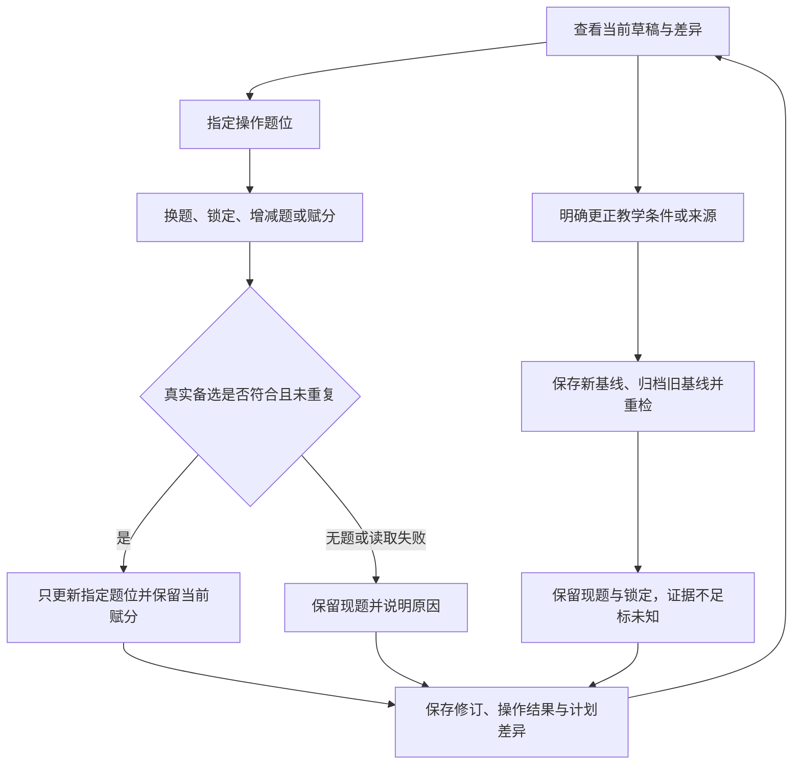

# S3-03：局部调整草稿并保留已有成果

- 日期：2026-10-10；状态：已完成工程交付。
- 任务：[S3-03](../tasks/mvp-implementation.md#s3-03-局部调整草稿并保留已有成果)；依据：[ADR-0002](../adr/0002-question-bank-blueprint.md)。
- 前置成果：[真实首稿及选题记录](s3-02-assembly-draft.md)。仍使用 50 单元台账中的 18 个就绪题包，其余 32 个待处理；本轮没有编造或扩充题目供给。

## 实现与行为

在本地草稿页面可查看候选并换题、锁定、增减题、修改题分及小问分值、调整指定题位的目标难度，以及更正已学、显式前提、主考或来源基线。逐次保存实际结果、修订号和操作记录；刷新及重开直接恢复已保存内容。

自动操作跳过锁定题；用户直接操作锁定题可以执行。批量换题逐项保留成功结果，无备选项保留现题，不影响其他题。候选需复用真实题库的来源、题型、具体任务、完整允许解法及重复关系核查；未知/差异候选需用户直接明确选择，仍保留提示。当前题、已占用题、重复组、待处理材料与读取失败项不能因此绕过检查。

换题保留题位当前分值，校验新题小问与赋分是否兼容；新题使用自身教师资料，评分状态标记待核对，不沿用旧题细则。改分不调整其他题凑回目标分；小问身份及合计不一致时拒绝保存。增减题更新题号与当前统计，普通局部操作保留原基线，差异单独显示。更正教学条件时归档旧基线、保存新依据快照，保留内容和锁定并重检；未证实允许解法保持未知。

现有题包没有独立难度估计。调整目标难度只记录所授权题位的偏好，自动操作仍跳过锁定题；题目、其他题位及实际难度未知状态保留。

每次操作携带稳定身份与预期修订号。同一请求重试返回原操作结果及当前草稿，不重复执行成功项；身份复用于不同内容报冲突。过时请求报修订冲突，不能覆盖新操作。服务器按草稿串行执行读取、检查与保存；保存失败不回显成功。进入 S3-04 确认成卷后原草稿停止修改，后续从成卷派生新草稿。

## 受控标杆验收

`tests/editor.test.mjs` 的 13 项领域测试使用真实读取模块构造标杆草稿。标杆身份只在测试夹具中指定，没有写入选题实现；这组固定场景与浏览器的实际首稿分开记录。

| 场景 | 验证结果 |
| --- | --- |
| 第 3 题 022 → 020 | 只替换该题，保留分值、无关题和基线 |
| 同时换第 3、8 题 | 第 3 题成功，第 8 题无直接备选而保留原题 |
| 034 替换标杆第 4 题 035 | 选题依据保留细项差异，未声称完全等价 |
| 第 7 题的 019 | 仅列为待处理的部分建议，说明未覆盖完整任务，不可直接选入 |
| 第 9 题候选 041 已被第 10 题占用 | 不可再次选入；即使其适配状态未知且用户确认差异，也不能绕过重复检查 |
| 锁定题操作 | 自动换题和自动调难度跳过；直接指定操作可执行并保留锁定 |
| 删除原第 8 题 / 把其分值改为 12 | 分别得到 9 题 / 90 分、10 题 / 102 分；未调整其他题分 |
| 增题与小问赋分 | 从真实未占用供给选题，无供给时留空；不正确的小问身份或合计拒绝保存 |
| 取消韦达前提 | 保存新基线和旧快照，保留 049 与锁定，标记允许解法未知 |
| 明确选择完整但适配未知的就绪题 | 保留未知状态与原因，不改标为已证实符合；待处理 019 仍不可选入 |
| 重试与旧建议 | 同一请求不重复执行；后续修订保留；身份和修订冲突分别报告 |
| 注入候选读取失败 | 原题保持，其他成功换题保留，读取失败与零候选分开 |
| 基线重检时当前题读取失败 | 保留已保存题包，适配标记读取失败，不宣称通过 |

故障注入只发生于隔离测试文件，不是本次真实材料的供给状态。另有 API 与存储测试核对并发请求、重复重试、保存失败释放队列，以及新旧请求不能相互覆盖；最终完整工程检查结果见 [S3-04 交付记录](s3-04-delivery.md)。

## 实际浏览器检查

本轮在本地生产构建上操作真实首稿。默认首稿第 2 题为 007、第 3 题为 020；没有为浏览器检查预置标杆身份。以下短 ID 均指 `tutor-set-xxx`。

1. 锁定第 1 题，选中第 1、2、8 题批量自动换题。第 1 题被跳过，第 2 题由 007 换为 008，第 8 题没有直接备选而保留 049；其他题保持。
2. 将第 8 题由 10 分改为 12 分，实际统计变为 10 题 / 102 分，没有自动凑回 100 分。
3. 查看第 7 题候选，019 显示为未就绪的部分相关建议，不能点击选入。
4. 更正基线取消韦达，049 仍在原题位，允许解法标记未知；已有锁定保留，旧基线可回看。
5. 删除当前第 8 题，实际变为 9 题 / 90 分并重排题号；随后新增 8 分题位，得到 10 题 / 98 分，计划差异保持可见。
6. 修改所选题位的目标难度为 0.60，锁定题被自动操作跳过；实际难度仍未知，没有据此替换或清空题目。
7. 刷新后恢复修订 7 的内容、分值、锁定及操作结果。390×844 窄屏无页面横向溢出，浏览器控制台未见警告或错误。

上述为代理执行的界面与工程检查，不是当前用户或教师实际采用试卷的反馈。真正的使用意愿、需要的手工修正及接受原因在 S3-04 用户反馈入口中记录，当前仍待反馈。

## 文件与运行

核心修改为 `src/assembly/editor.mjs`、`src/assembly/store.mjs`、`src/server.mjs` 与 `web/`；`data/assembly/task-catalog.json` 引用来源审计清单，为 019 记录部分备选关系，没有将其升级为就绪题。领域测试见 `tests/editor.test.mjs`，存储/API 检查见 `tests/draft-store.test.mjs` 与 `tests/server.test.mjs`。

运行命令及本地数据备份见 [README](../../README.md)。本轮实现支持当前集合材料及人工整理任务索引；题目不存在、缺少完整适配证据或难度估计的问题仍按实际限制显示。下一项工程成果及待用户验证的边界见 [S3-04 交付记录](s3-04-delivery.md)。
