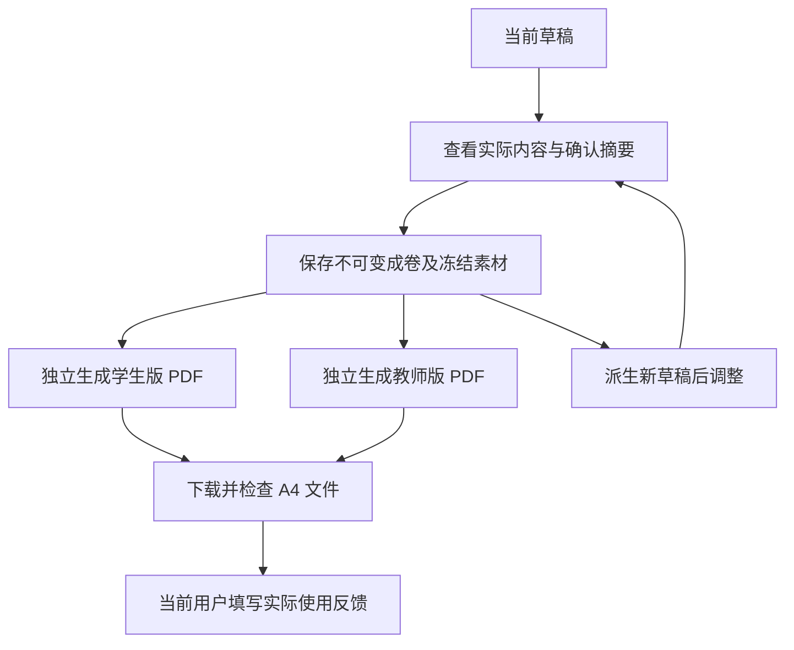

# S3-04：保存成卷、两版输出与使用验证

- 日期：2026-10-10；状态：工程交付完成，当前用户实际使用验证待反馈。
- 依据：[开发任务](../tasks/mvp-implementation.md#s3-04-保存成卷输出两版并完成真实使用验证)、[ADR-0002](../adr/0002-question-bank-blueprint.md)、[S3-03 交付](s3-03-draft-editing.md)。
- 本轮仍为 50 个来源单元、18 题就绪、32 题待整理；没有扩充材料或调用模型生成题目。

## 保存与输出

确认摘要显示实际可作答题数、有效分值、缺题、未知、计划差异及教师资料/评分事项。确认请求绑定修订号和稳定操作身份，保存的是完整内容与版本；不在输出时重新选题或读取题库最新版本。

成卷文件以仅创建方式原子发布并校验内容摘要；原草稿随后标记冻结。即使在成卷已发布、原草稿标记保存失败的窗口内，API 仍拒绝新修改，同一确认重试可恢复标记。后续修改派生新草稿，重试派生返回同一草稿并保留其后续编辑。冻结素材保存校验后的字节，不依赖后来变化的源文件。

两版使用同一快照及当前赋分，分别保存 PDF、页数、SHA-256、缺项和输出状态。一版失败不清除另一版；失败或文件损坏后可从同一成卷重试。有效成功输出直接复用已校验文件。输出状态与使用反馈独立于不可变成卷；反馈文件损坏只显示警告，不阻断成卷与文件恢复。

学生投影只含题面、选项、小问和所需素材。教师版另展示原卷材料、整理增补、建议评分及来源/版本，当前赋分与材料建议分值分开说明。缺教师资料不降低学生可作答题数。缺题位置打印占位、保留题号，卷头说明未完整及有效题数/分值；确认摘要和输出共用完整题面判定，缺选项或小问也不能计为完整题。

## 实际工程运行

本轮由代理操作生产构建的本地界面完成需求、蓝图、真实选题、局部换题、确认、生成与下载，不是预制接口返回。初始实际题序为 001、007、020、034、045、047、018、049、050、041；自动换第 2 题得到 008，其余保留，仍为 10 题 / 100 分。

首次成卷后，派生草稿将第 8 题由 10 分改为 12 分，得到 102 分；重开原草稿自动进入原成卷，原卷仍为 100 分。派生草稿再明确改回 10 分并保存为最终工程样卷，题序为 **001、008、020、034、045、047、018、049、050、041**，小问为第 9 题 6+8、第 10 题 8+10。

最终样卷身份：`e1e37049-ccbf-0d00-d931-cfa18eacd519`；来源草稿修订 2。快照摘要：`61b334ba7b99b7108618dc9eb421f972dbe2314322a766829d9b5593bcdfa7aa`。文件存于本机 `.tutor/outputs/<paperId>/`，运行数据不提交 Git。

| 实际文件 | 结果 | SHA-256 |
| --- | --- | --- |
| 学生版 | A4，3 页，10 题 / 100 分，完整 | `73fef648d506e90dd1d43c7a17d9c655762f049078dd8ae2d1665af08d5e9c81` |
| 教师版 | A4，7 页，10 题 / 100 分；020、034 缺建议评分资料 | `982ceeb57e0ad150028581be3c81c4f4327207636cae0eb7b892823f9312d3da` |

从界面实际下载文件，下载内容与输出记录一致。使用 pypdf 检查两版所有页面的 A4 尺寸、题号、材料隔离；Poppler 渲染全部 10 页并目视检查公式、中文、分页、选项、小问和解答留白。重点核对第 1、2 题无答案泄露，018 修订条件保留，049 公式中的“或”可读。教师版缺项与确认摘要一致，没有原始 JSON 提示。确认、输出页面在 390×844 窄屏无横向溢出，刷新后状态恢复；最终浏览器控制台没有警告或错误。

中途开发服务载入旧模块时曾输出失败，成卷保留，重启后从同一成卷重试成功；另一次检查发现教师提示重复且包含 JSON，修复后重新从派生草稿确认并生成上述最终文件。早期 `762b…` 工程样卷留作本地运行记录，不作为最终交付样例。各项工程检查均不等于当前用户或教师接受结果。

## 自动化与故障验证

最终 `npm test` **70 项通过**；`npm run bank:check`、`npm run build` 通过，生产依赖审计 0 漏洞。覆盖领域、HTTP、持久化、输出管理及真实 PDF，不以模拟 PDF 字节代替实际排版验收。

- 成卷领域 13 项：版本/确认冲突、并发确认与编辑、仅创建快照、篡改检测、冻结素材、发布后原草稿标记失败恢复、独立及幂等派生。
- 真实 PDF 5 项：学生资料隔离、A4 与题序/分值、教师来源与缺评分、缺题 9 题/90 分、缺选项 9 题/92 分，以及不可排版公式/缺素材明确失败。
- 输出管理与 API：一版故障不丢另一版、损坏文件不下载、重试内容不变、原草稿冻结、实际操作指标、反馈损坏不阻断成卷。

上述故障及反馈提交发生于隔离测试夹具，不能当作真实材料故障率或人类使用反馈。真实首批题包没有题面图片，冻结素材一致性及缺失处理已由测试验证；本次真实样卷不声称验证了来源图片的打印效果。

## 尚待完成的真实使用验证

页面提供当前用户自报反馈：愿意使用 / 修改后愿意使用 / 暂不使用、原因、缺项与手工修正；同时从冻结操作记录计算换题请求、成功换题、增删、改分及基线更正次数。换题操作可选填写原因。反馈不修改成卷。

本轮代理没有替用户提交实际反馈，用户真实完成组卷、采用意愿与手工修正尚未采集。因此 S3-04 第 6 项保持待验证，不能据工程跑通关闭真实使用验收。当前也未验证实测难度、45 分钟适用性或学生成绩提升。

运行、Python 依赖与字体设置见 [README](../../README.md)。当前使用 MathJax 矢量公式和 ReportLab 中文排版；题目供给不足、独立难度未知及评分资料不足仍如实保留。下一步应先由当前用户完成一次实际组卷和两版检查，根据反馈确定下一阶段范围。
